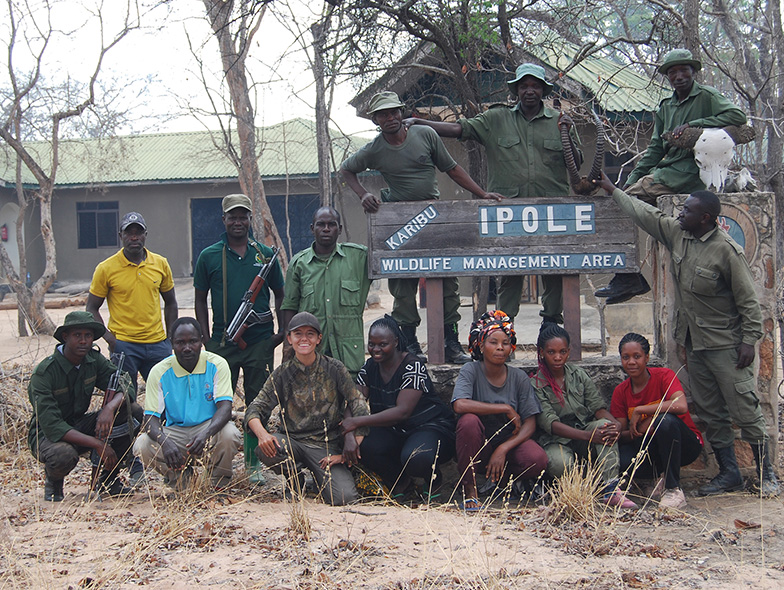

A camera trap survey of mammals has been conducted at the Ipole Wildlife Management Area (WMA) in Tanzania in collaboration with the local community based organization Juhiwai, Dr. Yves Hausser at HEPIA in Geneva, and the NGO ADAP, which has been working on community-based conservation projects in Africa since 1997. The study has two main objectives: (1) Quantify the richness and distribution of mid-sized mammals inside the WMA, and (2) Assess the environmental and anthropogenic factors that impact species richness and occupancy.

## Uni Bern supervisors

Ian Ausprey, Raphaël Arlettaz

## External collaborators

[Dr. Yves Hausser](https://eur03.safelinks.protection.outlook.com/?url=https%3A%2F%2Fwww.hesge.ch%2Fhepia%2Fannuaire%2Fyves-hausser&data=05%7C02%7Cmarcel.moser%40unibe.ch%7C1d202d973bfc4933c4ca08dc7febe6e7%7Cd400387a212f43eaac7f77aa12d7977e%7C1%7C0%7C638525898357225339%7CUnknown%7CTWFpbGZsb3d8eyJWIjoiMC4wLjAwMDAiLCJQIjoiV2luMzIiLCJBTiI6Ik1haWwiLCJXVCI6Mn0%3D%7C0%7C%7C%7C&sdata=X8qYtGTSErHMxPQu5OlVY%2BP8wrDeY%2FoLruG5yxCEJXM%3D&reserved=0), HEPIA, Geneva
[ADAP](https://eur03.safelinks.protection.outlook.com/?url=https%3A%2F%2Fwww.adap.ch%2F&data=05%7C02%7Cmarcel.moser%40unibe.ch%7C1d202d973bfc4933c4ca08dc7febe6e7%7Cd400387a212f43eaac7f77aa12d7977e%7C1%7C0%7C638525898357239707%7CUnknown%7CTWFpbGZsb3d8eyJWIjoiMC4wLjAwMDAiLCJQIjoiV2luMzIiLCJBTiI6Ik1haWwiLCJXVCI6Mn0%3D%7C0%7C%7C%7C&sdata=03s%2FEiYJDgx6pkwOt0kqaJ7xnCxhidIsuRdpu9ACFGI%3D&reserved=0), Geneva

## Publication

Novovitch, L.H., L. Villard, C. Fischer, Y. Hausser, S. Mermod, R. Arlettaz & I. Ausprey. 2026. Assessing the Impact of Human Presence on Mammal Distributions Within a Community Conservation Area in East Africa. African Journal of Ecology 64: e70145. PDF

## Related Master thesis

Novovitch, L. 2023. Assessing the impact of human disturbance on mammal distributions within a community conservation area in east Africa. Master Thesis, University of Bern. [PDF](/files/african_mammals/Novovitch_MSc2023_eng.pdf)
