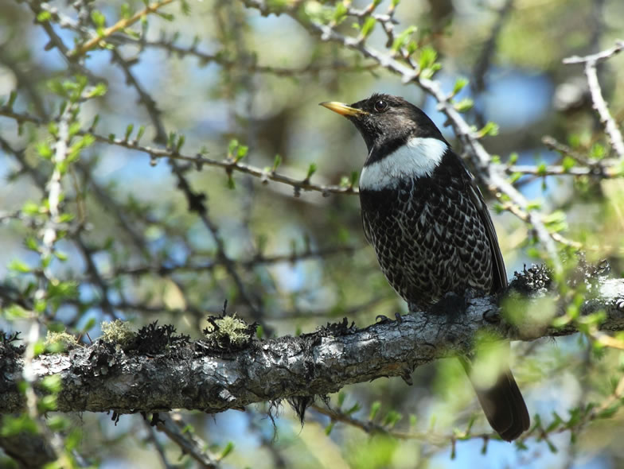

Climate change represents a new challenge for biodiversity, especially in high-altitude/latitude ecosystems, where the increase in ambient temperature is very high. Species with a boreo-alpine distribution are therefore particularly at risk of habitat loss and range contraction. Furthermore, alpine ecosystems are undergoing changes in land use, such as abandonment of pastures, intensification of semi-natural grasslands and increase in leisure activities. As land use changes often operate concomitantly with climate change, disentangling between these two main drivers is challenging.

The main goal of the Alpine Bird Project is to identify crucial parameters of habitat selection, resource acquisition and population dynamics for two model species typical of timberline (Ring Ouzel) & alpine ecosystems (Snowfinch). Our main hypothesis is that there are specific habitat-species associations that may be more crucial than physiological constraints in dictating species’ spatial occurrence. The overarching aim is to characterise an optimal habitat profile for each species, in order to develop clear guidelines for conservation management strategies in mountain ecosystems.

## Uni Bern supervisor

Prof. Dr. Raphaël Arlettaz

## External collaborators

 Dr. Mattia Brambilla, MUSE of Trento

 FLA - Lombardy Environmental Foundation ([link](https://flanet.org/wp-content/uploads/2021/07/Brochure-FLA-2020_inglese.pdf))

## Publications

Barras, A.G., I. Candolfi & R. Arlettaz. 2022. Spatio-temporal patterns of earthworm abundance suggest time-limited food availability for a subalpine bird species. Pedobiologia 93-94: Article 150826. [PDF](/files/alpine_birds_vs_climate_and_land_use_change/Barras_Pedbio2022_eng.pdf)

de Zwaan, D.R., D. Scridel, T.A. Altamirano, P. Gokhale, R.S. Kumar, S. Sevillano-Ríos, A.G. Barras, L. Arredondo-Amezcua, A. Asefa, R.A. Carrillo, K. Green, C.A. Gutérrez-Chávez, A. Lehikoinen, S. Li, R.S. Lin, C.J. Norment, K.N. Oswald, A.A. Romanov, J. Salvador, K.A. Weston & K. Martin. 2022. GABB: A global dataset of alpine breeding birds and their ecological traits. Scientific Data 9: Article Number: 627. [PDF](/files/alpine_birds_vs_climate_and_land_use_change/deZwaan_SciDat2022_eng.pdf)

Barras, A.G., S. Blache, M. Schaub & R. Arlettaz. 2021. Variation in Demography and Life-History Strategies Across the Range of a Declining Mountain Bird Species. Frontiers in Ecology and Evolution 9: Article 780706. [PDF](/files/alpine_birds_vs_climate_and_land_use_change/Barras_FroEcoEvo2021_eng.pdf)

Barras, A.G., F. Liechti & R. Arlettaz. 2021. Seasonal and daily movement patterns of an alpine passerine suggest high flexibility in relation to environmental conditions. Journal of Avian Biology 52: Article Number e02860. [PDF](/files/alpine_birds_vs_climate_and_land_use_change/Barras_JAviBio2021b_eng.pdf)

Barras, A.G., V. Braunisch & R. Arlettaz. 2021. Predictive models of distribution and abundance of a threatened mountain species show that impacts of climate change overrule those of land use change. Diversity and Distributions 27: 989-1004. [(PDF, 2.9 MB)](/files/alpine_birds_vs_climate_and_land_use_change/Barras_DivDtr2021_eng.pdf)

Barras, A.G., C.A. Niffenegger, I. Candolfi, Y.A. Hunziker & R. Arlettaz. 2021. Nestling diet and parental food provisioning in a declining mountain passerine reveal high sensitivity to climate change. Journal of Avian Biology 52: Article Number e02649. [(PDF, 920KB)](/files/alpine_birds_vs_climate_and_land_use_change/Barras_JAviBio2021_eng.pdf)

Barras, A.G., S. Marti, S. Ettlin, S. Vignali, J. Resano-Mayor, V. Braunisch & R. Arlettaz. 2020. The importance of seasonal environmental factors in the foraging habitat selection of Alpine Ring Ouzels *Turdus torquatus alpestris*. Ibis 162: 505-519. [(PDF, 1.1 MB)](/files/alpine_birds_vs_climate_and_land_use_change/Barras_Ibis2020_eng.pdf)

## Related PhD Thesis

Barras, A.G. 2021. Assessing the response of mountain birds to rapid environmental change: conservation ecology of the Alpine Ring Ouzel (*Turdus torquatus alpestris*). PhD Thesis, University of Bern. [PDF](/files/alpine_birds_vs_climate_and_land_use_change/Barras_PhD2021_eng.pdf)

## Related Master Theses

Candolfi, I.F.M. 2020. Factors ruling prey availability for Alpine Ring Ouzel throughout the breeding season: a possible phenological mismatch? Master Thesis, University of Bern. [PDF](/files/alpine_birds_vs_climate_and_land_use_change/Candolfi_MSc2020_eng.pdf)

Fenestraz, A. 2019. Habitat selection of the Ring Ouzel *Turdus torquatus alpestris* at the home range and landscape scales. Master Thesis, University of Bern. [PDF](/files/alpine_birds_vs_climate_and_land_use_change/Fenestraz_MSc2019_eng.pdf)

Marti, S. 2018. Foraging microhabitat selection of the Ring Ouzel *Turdus torquatus* in alpine timberline ecosystems: assessing model transferability arosss temporal and spatial scales. Master Thesis, University of Bern. [PDF](/files/alpine_birds_vs_climate_and_land_use_change/Marti_MSc2018_eng.pdf)

Barras, A.G. 2016. Foraging habitat selection by Ring Ouzels *Turdus torquatus* in alpine timberline ecosystems: building the evidence for species conservation management. Master Thesis, University of Bern. [PDF](/files/alpine_birds_vs_climate_and_land_use_change/Barras_MSc2016copy_eng.pdf)
