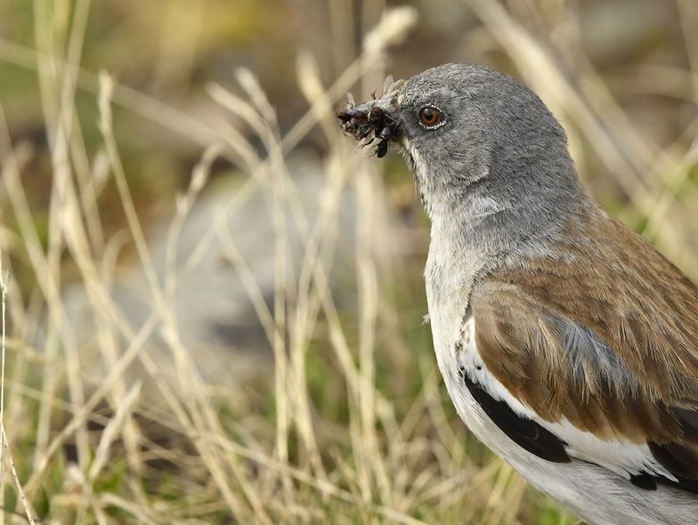

*(c) 2017 by Nathan Horrenberger*

Climate change represents a new challenge for biodiversity, especially in high-altitude/latitude ecosystems, where the increase in ambient temperature is very high. Species with a boreo-alpine distribution are therefore particularly at risk of habitat loss and range contraction. Furthermore, alpine ecosystems are undergoing changes in land use, such as abandonment of pastures, intensification of semi-natural grasslands and increase in leisure activities. As land use changes often operate concomitantly with climate change, disentangling between these two main drivers is challenging.

The main goal of the Alpine Bird Project is to identify crucial parameters of habitat selection, resource acquisition and population dynamics for two model species typical of timberline (Ring Ouzel) & alpine ecosystems (Snowfinch). Our main hypothesis is that there are specific habitat-species associations that may be more crucial than physiological constraints in dictating species’ spatial occurrence. The overarching aim is to characterise an optimal habitat profile for each species, in order to develop clear guidelines for conservation management strategies in mountain ecosystems.

## Uni Bern supervisor

Dr. Jaime Resano Mayor, Prof. Dr. Raphaël Arlettaz

## External collaborators

 Dr. Mattia Brambilla, MUSE of Trento

FLA - Lombardy Environmental Foundation ([link](https://flanet.org/wp-content/uploads/2021/07/Brochure-FLA-2020_inglese.pdf))

## Publications

Niffenegger, C.A., C. Schano, R. Arlettaz & F. Korner-Nievergelt. 2023. Nest orientation and proximity to snow patches are important for nest site selection of a cavity breeder at high elevation. Journal of Avian Biology 2023: e03046. [PDF](/files/alpine_birds_vs_climate_and_land_use_change/Niffenegger_JAviBio2023_eng.pdf)

Brambilla, M., C. Bettega, M.M. Delgado, M. De Gabriel-Hernando, M. Päckert, R. Arlettaz, S. Dirren, P. Fontanilles, J.A. Gil, M. Herrmann, S. Hille, F. Korner-Nievergelt, P. Pedrini, J. Resano-Mayor, C. Schano & D. Scridel. 2022. Insufficient considerations of seasonality, data selection and validation lead to biased species–climate relationships in mountain birds. Journal of Avian Biology 2022: e03015. [PDF](/files/alpine_birds_vs_climate_and_land_use_change/Brambilla_JAviBio2022_eng.pdf)

Delgado, M.d.M., R. Arlettaz, C. Bettega, M. Brambilla, M. de Gabriel Hernando, A. España, Á. Fernández-González, Á. Fernández-Martín, J.A. Gil, S. Hernández-Gómez, P. Laiolo, J. Resano-Mayor, J.R. Obeso, P. Pedrini, I. Roa-Álvarez, C. Schano, D. Scridel, E. Strinella, I. Toranzo & F. Korner-Nievergelt. 2021. Spatio-temporal variation in the wintering associations of an alpine bird. Proceedings of the Royal Society. Series B, Biological sciences 288: article number 20210690. [(PDF, 552KB)](/files/alpine_birds_vs_climate_and_land_use_change/Delgado_PRoySocB2021_eng.pdf)

Resano-Mayor, J., C. Bettega, M.d.M. Delgado, Á. Fernández-Martín, S. Hernández-Gómez, I. Toranzo, A. España, M. de Gabriel, I. Roa-Álvarez, J.A. Gil, E. Strinella, K.A. Hobson & R. Arlettaz. 2020. Partial migration of White-winged snowfinches is correlated with winter weather conditions. Global Ecology and Conservation 24: e01346. [(PDF, 541KB)](/files/alpine_birds_vs_climate_and_land_use_change/Resano-Mayor_GloEcoCon2020_eng.pdf)

Brambilla, M., J. Resano-Mayor, R. Arlettaz, C. Bettega, A. Binggeli, G. Bogliani, V. Braunisch, C. Celada, D. Chamberlain, J. Chiffard Carricaburu, M.d.M. Delgado, P. Fontanilles, P. Kmecl, F. Korner, R. Lindner, P. Pedrini, J. Pöhacker, B. Rubinič, C. Schano, D. Scridel, E. Strinella, N. Teufelbauer & M. de Gabriel Hernando. 2020. Potential distribution of a climate sensitive species, the White-winged Snowfinch *Montifringilla nivalis* in Europe. Bird Conservation International 30: 522-532. [(PDF, 204KB)](/files/alpine_birds_vs_climate_and_land_use_change/Brambilla_BirConInt2020_eng.pdf)

Resano-Mayor, J., F. Korner-Nievergelt, S. Vignali, N. Horrenberger, A.G. Barras, V. Braunisch, C.A. Pernollet & R. Arlettaz. 2019. Snow cover phenology is the main driver of foraging habitat selection for a high‑alpine passerine during breeding: implications for species persistence in the face of climate change. Biodiversity and Conservation 28: 2669-2685. [(PDF, 1.9 MB)](/files/alpine_birds_vs_climate_and_land_use_change/Resano-Mayor_BiodivCon2019_eng.pdf)

Brambilla, M., J. Resano-Mayor, D. Scridel, M. Anderle, G. Bogliani, V. Braunisch, F. Capelli, M. Cortesi, N. Horrenberger, P. Pedrini, B. Sangalli, D. Chamberlain, R. Arlettaz & D. Rubolini. 2018. Past and future impact of climate change on foraging habitat suitability in a high-alpine bird species: Management options to buffer against global warming effects. Biological Conservation 221: 209-218. [(PDF, 1.0 MB)](/files/alpine_birds_vs_climate_and_land_use_change/Brambilla_BioCon2018_eng.pdf)

Resano-Mayor, J., Á. Fernández-Martín, S. Hernández-Gómez, I. Toranzo, A. España, J.A. Gil, M. de Gabriel, I. Roa-Álvarez, E. Strinella, K.A. Hobson, G. Heckel & R. Arlettaz. 2017. Integrating genetic and stable isotope analyses to infer the population structure of the White-winged Snowfinch *Montifringilla nivalis* in Western Europe. Journal of Ornithology 158: 395-405. [(PDF, 930KB)](/files/alpine_birds_vs_climate_and_land_use_change/Resano-Mayor_JOrn2017_eng.pdf)

## Related Master Theses

Niffenegger, C.A. 2021. Nest site selection of the White-winged Snowfinch *Montifringilla nivalis* in the Swiss Alps. Master Thesis. University of Bern. [(PDF, 1.3 MB)](/files/alpine_birds_vs_climate_and_land_use_change/Niffenegger_MSc2021_eng.pdf)

Besimo, J. 2019. Foraging ecology and wintering monitoring of the White-winged Snowfinch (*Montifringilla nivalis*) in the Swiss Alps. Master Thesis, University of Bern. [PDF](/files/alpine_birds_vs_climate_and_land_use_change/Besimo_MSc2019_eng.pdf)

Binggeli, A. 2018. Alpine avifauna facing rapid climate change: foraging micro-habitat selection of the White-winged Snowfinch in the Swiss Alps. Master Thesis, University of Bern. [PDF](/files/alpine_birds_vs_climate_and_land_use_change/Binggeli_MSc2018_eng.pdf)
