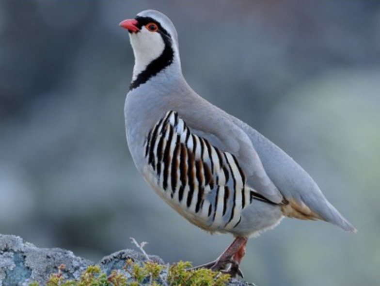
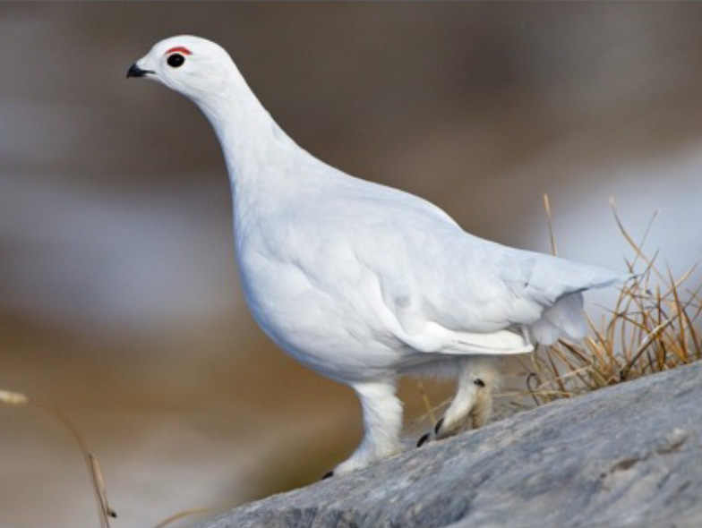

Mountains are among the regions most susceptible to temperature warming, and species adapted to alpine ecosystems are predicted to face local extinctions because of their limited tolerance to rapid increases in ambient temperatures. This is particularly relevant for the European Alps which have warmed at twice the rate of the northern hemisphere average over the past 100 years (2°C) and are predicted to experience an additional rise of 3°C by the end of this century. For this reason, alpine birds in the Alps exhibit severe range contractions, with multiple species moving upslope and loosing large portions of their ranges at lower elevations. The long-term consequences of such range shifts remain unknown, because we lack fundamental information on the physiological parameters dictating the persistence of alpine birds under different temperature warming scenarios. In particular, we lack basic knowledge on the thermal tolerances of alpine birds, including the specific climatic conditions under which they experience heat stress and potential hyperthermia. Using state-of-the-art advances in thermal imaging, GPS tracking technology, and physiological heat flux simulations, this project explicitly links physiological thermal tolerance estimates with movement behavior across microclimate gradients for two species of free-ranging alpine avifauna: the Alpine Rock Ptarmigan (*Lagopus muta helvetica*) and the Rock Partridge (*Alectoris graeca*). By examining how the two species adjust their movement behavior in relation to local microclimate and their predicted physiological tolerances to heat extremes, the project will provide concrete recommendations for managing microhabitat structures within alpine landscapes that are predicted to provide microclimatic buffering and refugia from thermal warming for alpine biodiversity

## Uni Bern supervisors

Ian Ausprey & Raphaël Arlettaz

## Related Master thesis

Robbi, L.A. 2025. Using drone-mounted thermal imaging cameras for microclimate mapping in alpine landscapes. Master thesis. University of Bern.
