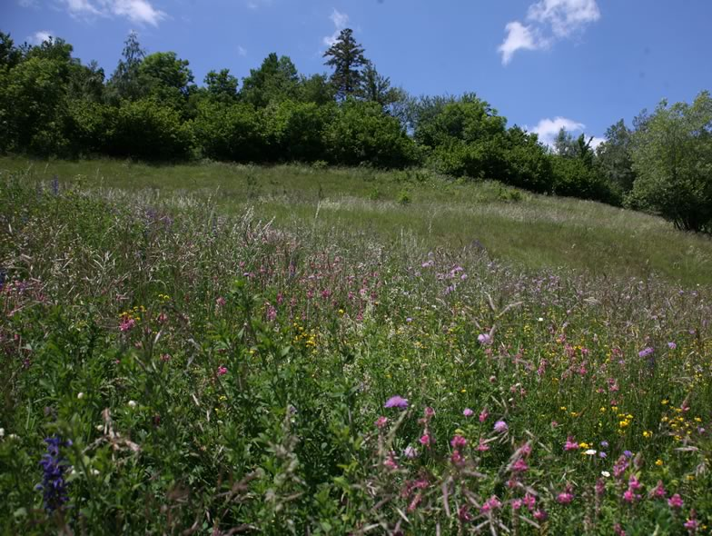

Biodiversity-rich montane and subalpine grasslands are degrading rapidly due to new intensification practices. In a former project we experimentally measured the separated and combined effects of fertilization with slurry and aerial irrigation (mimicking a gradient of management intensification) on both biodiversity and hay productivity/quality in mountain meadows. Results showed that plant biodiversity as well as some invertebrate groups like orthopterans and lepidopteran larvae were negatively affected by management intensification. By contrast, abundances and sometimes species richness of other invertebrate groups were higher in plots with low- to medium-input, providing support to a hump-shaped diversity-disturbance relationship. We conclude that to keep integral and abundant invertebrate communities we need to maintain a landscape-scale mosaic of no- and medium-input grasslands. See related publications below for more information.

In a new research module, we focus on the resilience of mountain hay meadows that are this time intensively managed and species-poor. The objective is to investigate their capacity to retrieve a biodiversity-richer state after extensification and at which agronomic costs. Adopting a field-scale experimental design, 39 meadows (thirteen triplet located in central Valais) that have been intensively managed for at least the last 20 years were selected in 2019. One third of them continue to be managed intensively, another third is now managed with low inputs (1/3 of the corresponding amount of fertilizer applied in the intensively managed meadows), and the last 13 meadows were extensified (no more input).

## Uni Bern supervisors

Jean-Yves Humbert, Raphaël Arlettaz

## Publications

Arnold, I., G. Marchand, A. Hayoz-Andrey, A. Serres-Hänni, R. Arlettaz & J.Y. Humbert. 2025. Relaxation of management intensity promotes butterfly communities in mountain grasslands. Biological Conservation 304: Article 111027. [PDF](/files/alpine_grassland/Arnold_BioCon2025_eng.pdf)

Humann-Guilleminot, S., S. Boch, G. Martínez-De León, M. Lessard-Therrien, A. Hayoz-Andrey, A. Serres-Hänni & J.Y. Humbert. 2023. Experimental extensification of mountain grasslands restores plant species richness but not species composition in the mid-term. Journal of Applied Ecology 60: 530-540. [PDF](/files/alpine_grassland/Humann-Guilleminot_JAppEco2023_eng.pdf)

Martínez-De León, G., L. Dani, A. Hayoz-Andrey, S. Humann-Guilleminot, R. Arlettaz & J.Y. Humbert. 2022. Mid‑ and long‑term responses of land snail communities to the intensification of mountain hay meadows management. BMC Ecology and Evolution 22: article 19 (11 pages). [PDF](/files/alpine_grassland/Martinez-DeLeon_BMCEcoEvo2022_eng.pdf)

Humbert, J.Y., S. Delley & R. Arlettaz. 2021. Grassland intensification dramatically impacts grasshoppers: Experimental evidence for direct and indirect effects of fertilisation and irrigation. Agriculture, Ecosystems and Environment 314: Article 107412. [(PDF, 1.9 MB)](/files/alpine_grassland/Humbert_AgrEcosysEnv2021_eng.pdf)

Boch, S., Y. Kurtogullari, E. Allan, M. Lessard-Therrien, N.S. Rieder, M. Fischer, G. Martínez De León, R. Arlettaz & J.Y. Humbert. 2021. Effects of fertilization and irrigation on vascular plant species richness, functional composition and yield in mountain grasslands. Journal of Environmental Management 279: Article 111629. [(PDF, 1.9 MB)](/files/alpine_grassland/Boch_JEnvMan2021_eng.pdf)

Kurtogullari, Y., N.S. Rieder, R. Arlettaz & J.Y. Humbert. 2020. Conservation and restoration of *Nardus* grasslands in the Swiss northern Alps. Applied Vegetation Science 23: 26-38. [(PDF, 1.4 MB)](/files/alpine_grassland/Kurtogullari_AppVegSci2020_eng.pdf)

Herzog, C., M. Lessard-Therrien, M. Van der Heijden, R. Arlettaz & J.Y. Humbert. 2019. The impact of mountain hay meadow management on litter decomposition and root colonization by arbuscular mycorrhizal fungi. In Improving sown grasslands through breeding and management (eds. O. Huguenin-Elie, B. Studer, R. Kölliker, D. Reheul, M. Probo, P. Barre, U. Feuerstein, I. Roldán-Ruiz, P. Mariotte & A. Hopkins), Grassland Science in Europe, vol. 24, pp. 452-454. EGF and Eucarpia. [(PDF, 397KB)](/files/alpine_grassland/Herzog_BS2019_eng.pdf)

Boch, S., E. Allan, J.Y. Humbert, Y. Kurtogullari, M. Lessard-Therrien, J. Müller, D. Prati, N.S. Rieder, R. Arlettaz & M. Fischer. 2018. Direct and indirect effects of land use on bryophytes in grasslands. Science of the Total Environment 644: 60-67. [(PDF, 645KB)](/files/alpine_grassland/Boch_SciTotEnv2018_eng.pdf)

Lessard-Therrien, M., J.Y. Humbert, I. Hajdamowicz, M. Stańska, R. van Klink, L. Lischer & R. Arlettaz. 2018. Impacts of management intensification on ground-dwelling beetles and spiders in semi-natural mountain grasslands. Agriculture, Ecosystems and Environment 251: 59-66. [(PDF, 321KB)](/files/alpine_grassland/Lessard-Therrien_AgrEcosysEnv2018_eng.pdf)

Lessard-Therrien, M., J.Y. Humbert & R. Arlettaz. 2017. Experiment-based recommendations for biodiversity-friendly management of mountain hay meadows. Applied Vegetation Science 20: 352-362. [(PDF, 858KB)](/files/alpine_grassland/Lessard-Therrien_AppVegSci2017_eng.pdf)

Landwehr, A., A. Oberson, M. Lessard-Therrien, J.Y. Humbert, R. Arlettaz & O. Huguenin-Elie. 2017. Effects of irrigation on phosphorus in soil, soil microbes and plants of semi-natural grasslands. In Grassland resources for extensive farming systems in marginal lands: major drivers and future scenarios (eds. C. Porqueddu, A. Franca, G. Lombardi, G. Molle, G. Peratoner &  A. Hopkins), Grassland Science in Europe, vol. 22,  pp. 348-350. Istituto Sistema Produzione Animale Ambiente Mediterraneo. [(PDF, 904KB)](/files/alpine_grassland/Landwehr_BS2017_eng.pdf)

Andrey, A., J.Y. Humbert & R. Arlettaz. 2016. Functional response of leaf- and planthoppers to modern fertilisation and irrigation of hay meadows. Basic and Applied Ecology 17: 627-637. [(PDF, 526KB)](/files/alpine_grassland/Andrey_BasAppEco2016_eng.pdf)

Lavanchy, G., M. Strehler, M.N. Llanos Roman, M. Lessard-Therrien, J.Y. Humbert, Z. Dumas, K. Jalvingh, K. Ghali, A. Fontcuberta García-Cuenca, B. Zijlstra, R. Arlettaz & T. Schwander. 2016. Habitat heterogeneity favors asexual reproduction in natural populations of grassthrips. Evolution 70: 1780-1790. [(PDF, 359KB)](/files/alpine_grassland/Lavanchy_Evo2016_eng.pdf)

Humbert, J.Y., J.M. Dwyer, A. Andrey & R. Arlettaz. 2016. Impacts of nitrogen addition on plant biodiversity in mountain grasslands depend on dose, application duration and climate: a systematic review. Global Change Biology 22:110-120. [(PDF, 281KB)](/files/alpine_grassland/Humbert_GloChaBio2016_eng.pdf)

Trivellone, V., E. Knop, T. Turrini, A. Andrey, J.Y. Humbert & G. Kunz. 2015. New and remarkable leafhoppers and planthoppers (Hemiptera: Auchenorrhyncha) from Switzerland. Mitteilungen der Schweizerischen Entomologischen Gesellschaft / Bulletin de la Société Entomologique Suisse 88:273-284. [(PDF, 550KB)](/files/alpine_grassland/Trivellone_MitSchEntGes2015_eng.pdf)

Andrey, A., J.Y. Humbert, C. Pernollet & R. Arlettaz. 2014. Experimental evidence for the immediate impact of fertilization and irrigation upon the plant and invertebrate communities of mountain grasslands. Ecology and Evolution 4: 2610-2623. [(PDF, 906KB)](/files/alpine_grassland/Andrey_EcoEvo2014_eng.pdf)

## Related PhD theses

Lessard-Therrien, M. 2017. A balance between productivity and biodiversity conservation in montane and subalpine semi-natural grasslands. PhD Thesis, University of Bern. [(PDF, 4.6 MB)](/files/alpine_grassland/Lessard-Therrien_PhD2017_eng.pdf)

Hayoz-Andrey, A. 2015. Optimal balance between yield and biodiversity in montane and subalpine meadows. PhD Thesis, University of Bern. [(PDF, 3.6 MB)](/files/alpine_grassland/Hayoz-Andrey_PhD2015_eng.pdf)

## Related Master theses

Guignet, C. 2026. Effect of passive restoration on soil bacterial communities in mountain grasslands. Master Thesis. University of Bern.

Eller, S. 2025. Passive restoration in mountain meadows: Landscape context shapes pollinator communities more than local management. Master Thesis. University of Bern.

Marchand, G. 2024. Response of diurnal butterfly community to passive mountain grassland restoration in the Swiss Alps. Master Thesis. University of Bern. [PDF](/files/alpine_grassland/Marchand_MSc2024_eng.pdf)

Martínez De León, G. 2020. Soil pH and plant diversity shape land snail communities in intensively-managed montane and subalpine meadows. Master Thesis. University of Bern. [PDF](/files/alpine_grassland/MartinezDeLeon_MSc2020_eng.pdf)

Rieder, N. 2017. Conservation and restoration of *Nardion* grasslands in the Swiss northern Prealps. Master Thesis, University of Bern. [(PDF, 2.1 MB)](/files/alpine_grassland/Rieder_MSc2017_eng.pdf)

Kurtogullari, Y. 2017. Importance of *Nardion* grassland quality for orthopterans: a case study in the Swiss northern Prealps. Master Thesis, University of Bern. [(PDF, 20.6 MB)](/files/alpine_grassland/Kurtogullari_MSc2017_eng.pdf)

Dani, L. 2017. Positive effects of management intensification on land snail communities in Swiss traditionally managed montane and subalpine meadows. Master Thesis, University of Bern. [(PDF, 3.5 MB)](/files/alpine_grassland/Dani_MSc2017_eng.pdf)

Herzog, C. 2016. The impact of mountain hay meadow management on litter decomposition and root colonisation by arbuscular mycorrhizal fungi. Master Thesis, University of Bern. [(PDF, 9.1 MB)](/files/alpine_grassland/Herzog_MSc2016_eng.pdf)

Delley, S. 2014. Grassland irrigation and fertilisation decrease soil and within-vegetation temperatures, negatively impacting orthopteran populations. Master Thesis, University of Bern. [(PDF, 1.3 MB)](/files/alpine_grassland/Delley_MSc2014_eng.pdf)
