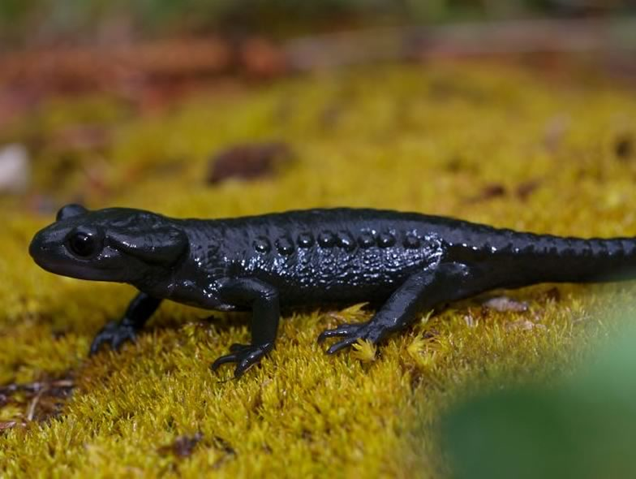

Baseline information for the conservation of a species requires understanding how its populations are distributed and how the distribution range depends on anthropogenic land-use and changes thereof. To improve knowledge about how such changes affect an enigmatic salamander species of the Alps (*Salamandra atra*), we evaluated the impact of habitat characteristics and dynamics on its distribution. Four study plots were selected along an altitudinal gradient in a valley in the Bernese Alps. Systematic surveys were carried out throughout the season to record salamander occurrence and habitat characteristics were mapped. The data were analysed using site occupancy models. Interestingly, from a landscape dynamics viewpoint, the oldest landscape-pattern best explained the current distribution of salamanders. This suggests that Salamandra atra adapts its distribution pattern very slowly to habitat changes and may thus today occur in habitats which only marginally fulfill species ecological requirements. These results have implications for the development of habitat conservation policies.

## External collaborator

Dr. Benedikt R. Schmidt, KARCH, Neuchâtel, Switzerland

## Related Diploma/Master thesis

Geiger, C. 2006. Ecological requirements of the Alpine Salamander *Salamandra atra*: assessing the effects of current habitat structure and landscape dynamics on local distribution. Diploma Thesis, University of Bern. [PDF](/files/alpine_salamander/Geiger_Dipl2006copy_eng.pdf)
