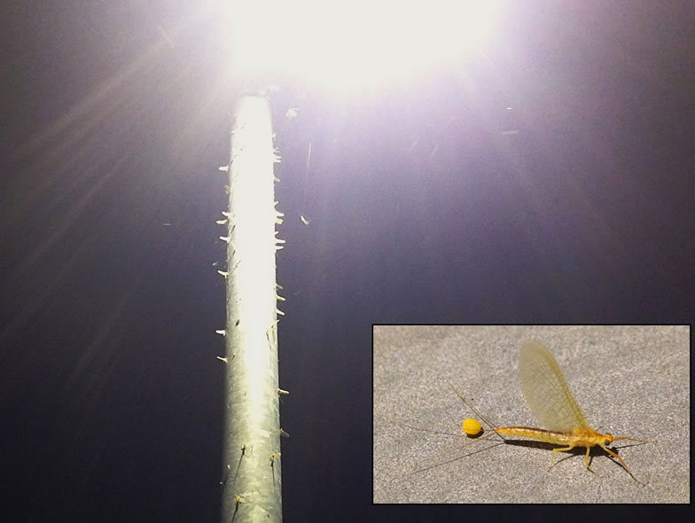

The behaviour and physiology of many organisms is disrupted by artificial lighting and this is emerging as an important nature conservation issue and research topic. There is a particular urgency for greater understanding of its ecological impacts, due to the rapid switch to white LED street lighting across much of the landscape. Despite the key role that natural cycles of lighting play in structuring ecological communities, little is known about how to limit the impacts of artificial lighting on species and habitats of conservation concern. A range of barriers still need to be overcome, including basic questions about where and when artificial light at night occurs within a particular landscape, and which ecological communities are exposed. The broad goal of this project is to build solid foundations for sound assessments of outdoor artificial lighting emissions within Switzerland, and to support emerging research on its ecological impacts.

This project has three phases:

1) Review, secure and explore a range of spatial and temporal datasets for lighting infrastructure and emissions in Switzerland.

2) A review of the species, habitats and ecological groups in Switzerland that are sensitive to artificial lighting.

3) Ecological impact mapping to identify locations where impacts are expected now, and under future plausible lighting scenarios.

## Uni Bern supervisors

James Hale, Raphaël Arlettaz

## External collaborator

Danielle Hofmann - Federal Office for the Environment FOEN

## Further informations

[Additional information in English (PDF, 271KB)](/files/artificial_lighting_and_biodiversity/additionalinformationA_LightinginEnglish_eng.pdf)

## Publications

Carannante, D., C.S. Blumenstein, J.D. Hale & R. Arlettaz. 2021. LED lighting threatens adult aquatic insects: Impact magnitude and distance thresholds. Ecological Solutions and Evidence 2: Article e12053. [(PDF, 1.0 MB)](/files/artificial_lighting_and_biodiversity/Carannante_EcoSolEvi2021_eng.pdf)

Plummer, K.E., J.D. Hale, M.J. O'Callaghan, J.P. Sadler & G.M. Siriwardena. 2016. Investigating the impact of street lighting changes on garden moth communities. Journal of Urban Ecology 2: juw004 (10 p.). [(PDF, 788KB)](/files/artificial_lighting_and_biodiversity/Plummer_JUrbEco2016_eng.pdf)

## Related Master Theses

Blumenstein, C.S. 2018. LEDs, rivers and insect attraction: distance thresholds for attracting adult aquatic insects from their river habitat to artificial lights. Master Thesis, University of Bern. [PDF](/files/artificial_lighting_and_biodiversity/Blumenstein_MSc2018_eng.pdf)

Carannante, D. 2018. LEDs, rivers and insect attraction: the attractive effect of artificial lighting on adult aquatic insects. Master Thesis, University of Bern. [PDF](/files/artificial_lighting_and_biodiversity/Carannante_MSc2018_eng.pdf)
