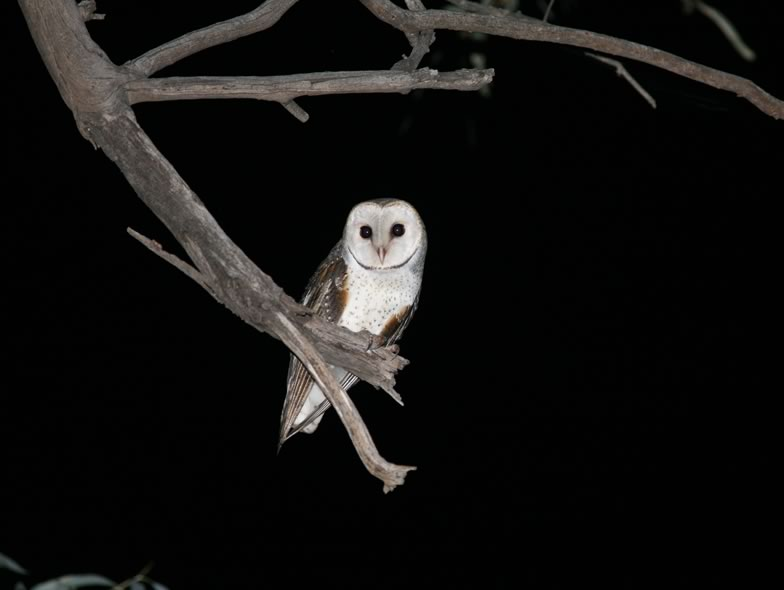

We used the barn owl as a model to test whether wildflower areas, a common agri-environment scheme in Switzerland that is known for harbouring large densities of rodents, can provide suitable and attractive food reservoirs for birds of prey. We found no evidence for a selection of wildflower areas by foraging barn owls during the breeding season, despite massive occurrences of rodents in that habitat type, compared to other sorts of habitats. This suggests that food availability, here possibly impeded by the dense sward, may be a more crucial factor than food abundance.

## Uni Bern supervisors

Michael Schaub, Raphaël Arlettaz

## Publications

Vickery, J. & R. Arlettaz. 2012. The importance of habitat heterogeneity at multiple scales for birds in European agricultural landscapes. In: Birds and Habitat: Relationships in Changing Landscapes (ed. R.J. Fuller), pp. 177-204. Cambridge University Press, Cambridge. [(PDF, 3.3 MB)](/files/vineyards/VickeryArlettaz_in_Fuller2012_eng.pdf)

Arlettaz, R., M. Krähenbühl, B. Almasi, A. Roulin & M. Schaub. 2010. Wildflower areas within revitalized agricultural matrices boost small mammal populations but not breeding Barn Owls. Journal of Ornithology 151: 553-564. [(PDF, 343KB)](/files/barn_owl/Arlettaz_JOrn2010a_eng.pdf)

## Related Diploma/Master thesis

Krähenbühl, M. 2006. Do set-asides act as small mammal biomass enhancers, and what is their relevance as food reservoirs for nocturnal avian predators? Diploma Thesis, University of Bern. [PDF](/files/barn_owl/Krahenbuhl_Dipl2006copy_eng.pdf)
