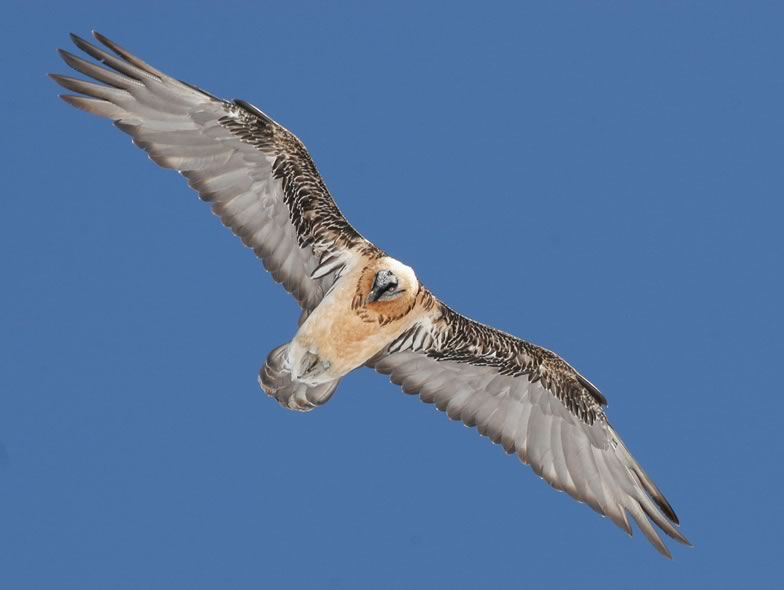

The Bearded vulture was extirpated from the Alps around 1880-1920 mostly due to massive decreases in food availability (decline of wild ungulates and hence bones whose marrow comprises the bulk of the diet of this scavenger) and systematic persecution by humans (shooting and poisoning). Birds reared in captivity have been reintroduced into the Alps since 1986. We first built a habitat suitability model for the Valais area, which showed the importance of Ibex populations and limestone substrate (2004). A more recent study confirmed the importance of these factors (2021). Second, we applied mark-recapture frameworks and population viability analyses to all observations collected in the Alps in order to estimate the demographic parameters and the risks of extinction of the reintroduced population. The two models developed so far (2009 and 2024) show a high survival probably and low risk of extinction as long as new sources of mortality don’t appear in the Alpine arch (e.g. wind turbines, poisoning against wolves, etc.). Third, we built spatial models to delineate the zones where conflict with the development of wind turbines (risk of collision with blades) may occur in the landscape in the future, in view of the development of the energy sector in our mountains (see [https://www.cb.iee.unibe.ch/research/flying_vertebrates_vs_wind_turbines/index_eng.html](/research/flying-vertebrates-vs-wind-turbines/)). This information generally provides guidance for adapted management measures within this major reintroduction programme.

## Uni Bern supervisors

Raphaël Arlettaz, Veronika Braunisch

## External collaborator

Dr. Antoni Margalida, Bearded Vulture Study and Protection Group, El Pont de Suert, Spain

## Publications

Schaub, M., F. Loercher, D. Hegglin & R. Arlettaz. 2024. Demographic assessment of reintroduced bearded vultures in the Alps: Success in the core, challenges in the periphery. Ecological Solutions and Evidence 5: e12347. [PDF](/files/bearded_vulture/Schaub_EcoSolEvi2024_eng.pdf)

Vignali, S., F. Lörcher, D. Hegglin, R. Arlettaz & V. Braunisch. 2022. A predictive flight-altitude model for avoiding future conflicts between an emblematic raptor and wind energy development in the Swiss Alps. Royal Society Open Science 9: article number 211041. [PDF](/files/flying_vertebrates_vs_wind_turbines/Vignali_RoySocOpeSci2022_eng.pdf)

Vignali, S., F. Lörcher, D. Hegglin, R. Arlettaz & V. Braunisch. 2021. Modelling the habitat selection of the bearded vulture to predict areas of potential conflict with wind energy development in the Swiss Alps. Global Ecology and Conservation 25: Article Number: e01405. [(PDF, 2.8 MB)](/files/flying_vertebrates_vs_wind_turbines/Vignali_GloEcoCon2021_eng.pdf)

García-Jiménez, R., J.M. Martínez-González, P. Oliva-Vidal, J. Piqué, J.A. Sesé & A. Margalida. 2020. Nocturnal flights by Bearded Vultures *Gypaetus barbatus* detected for the first-time using GPS and accelerometer data. Bird Study 67: 135-141. [(PDF, 1.1 MB)](/files/bearded_vulture/Garcia-Jimenez_BirStu2020_eng.pdf)

Margalida, A., J. Jiménez, J.M. Martínez, J.A. Sesé, D. García-Ferré, A. Llamas, M. Razin, M.À. Colomer & B. Arroyo. 2020. An assessment of population size and demographic drivers of the Bearded Vulture using integrated population models. Ecological Monographs 90: e01414. [(PDF, 1.3 MB)](/files/bearded_vulture/Margalida_EcoMon2020_eng.pdf)

Colomer, M.À., P. Oliva-Vidal, J. Jiménez, J.M. Martínez & A. Margalida. 2020. Prioritizing among removal scenarios for the reintroduction of endangered species: insights from bearded vulture simulation modeling. Animal Conservation 23: 396-406. [(PDF, 602KB)](/files/bearded_vulture/Colomer_AniCon2020_eng.pdf)

Margalida, A., M.S. Braun, J.J. Negro, K. Schulze-Hagen & M. Wink. 2019. Cosmetic colouring by Bearded Vultures *Gypaetus barbatus*: still no evidence for an antibacterial function. PeerJ 7: e6783. [(PDF, 7.4 MB)](/files/bearded_vulture/Margalida_PeeJ2019_eng.pdf)

García-Jiménez, R., J.M. Pérez-García & A. Margalida. 2018. Drivers of daily movement patterns affecting an endangered vulture flight activity. BMC Ecology 18: art. 39 (15 p.). [(PDF, 1.2 MB)](/files/bearded_vulture/Garcia-Jimenez_BMCEco2018_eng.pdf)

Hernández, M., M.À. Colomer, M. Pizarro & A. Margalida. 2018. Changes in eggshell thickness and ultrastructure in the Bearded Vulture (*Gypaetus barbatus*) Pyrenean population: A long-term analysis. Science of the Total Environment 624: 713-721. [(PDF, 433KB)](/files/bearded_vulture/Hernandez_SciTotEnv2018_eng.pdf)

Margalida, A. & D. Villalba. 2017. The importance of the nutritive value of old bones in the diet of Bearded vultures *Gypaetus barbatus*. Scientific Reports 7: article number 8061. [(PDF, 887KB)](/files/bearded_vulture/Margalida_SciRep2017_eng.pdf)

Margalida, A. 2017. Importance of Long-Term Studies to Conservation Practice: The Case of the Bearded Vulture in the Pyrenees. In High Mountain Conservation in a Changing World (eds. J. Catalan, J.M. Ninot & M.M. Aniz), pp. 343-383. Springer Open, Cham. [(PDF, 939KB)](/files/bearded_vulture/Margalida_BS2017_eng.pdf)

Margalida, A., J.M. Pérez-García & R. Moreno-Opo. 2017. European policies on livestock carcasses management did not modify the foraging behavior of a threatened vulture. Ecological Indicators 80: 66-73. [(PDF, 536KB)](/files/bearded_vulture/Margalida_EcoIdc2017_eng.pdf)

Margalida, A., J.M. Martínez, A. Gómez de Segura, M.A. Colomer, R. Arlettaz & D. Serrano. 2017. Supplementary feeding and young extraction from the wild are not a sensible alternative to captive breeding for reintroducing bearded vultures *Gypaetus barbatus*. Journal of Applied Ecology 54: 334-340. [(PDF, 269KB)](/files/bearded_vulture/Margalida_JAppEco2017_eng.pdf)

Schulze-Hagen, K., H. Frey & A. Margalida. 2016. Ernährungsspezialist Bartgeier: Der Vogel, der von Knochen lebt. Der Falke 63 (Sonderheft): 8-15. [(PDF, 6.9 MB)](/files/bearded_vulture/Schulze-Hagen_Fal2016_eng.pdf)

Margalida, A., J.M. Pérez-García, I. Afonso & R. Moreno-Opo. 2016. Spatial and temporal movements in Pyrenean bearded vultures (*Gypaetus barbatus*): Integrating movement ecology into conservation practice. Scientific Reports 6: article number 35746. [(PDF, 1.6 MB)](/files/bearded_vulture/Margalida_SciRep2016_eng.pdf)

Margalida, A., M.À. Colomer, D. Oro, R. Arlettaz & J.A. Donázar. 2015. Assessing the impact of removal scenarios on population viability of a threatened, long-lived avian scavenger. Scientific Reports 5: report 16962. [(PDF, 696KB)](/files/bearded_vulture/Margalida_SciRep2015_eng.pdf)

Moreno-Opo, R., A. Trujillano, Á. Arredondo, L.M. González & A. Margalida. 2015. Manipulating size, amount and appearance of food inputs to optimize supplementary feeding programs for European vultures. Biological Conservation 181:27-35. [(PDF, 1.3 MB)](/files/bearded_vulture/Moreno-Opo_BioCon2015_eng.pdf)

Margalida, A., M.À. Colomer & D. Oro. 2014. Man-induced activities modify demographic parameters in a long-lived species: effects of poisoning and health policies. Ecological Applications 24: 436-444. [(PDF, 317KB)](/files/bearded_vulture/Margalida_EcoApp2014_eng.pdf)

Margalida, A. & A.B. Marín-Arroyo. 2013. Dietary habits in the endangered Bearded Vulture *Gypaetus barbatus* from Upper Pleistocene to modern times in Spain: a paleobiological conservation perspective. Bird Conservation International 23:469-476. [(PDF, 164KB)](/files/bearded_vulture/Margalida_BirConInt2013_eng.pdf)

Margalida, A., M. Carrete, D. Hegglin, D. Serrano, R. Arenas & J.A. Donázar. 2013. Uneven Large-Scale Movement Patterns in Wild and Reintroduced Pre-Adult Bearded Vultures: Conservation Implications. PLoS ONE 8: e65857. [(PDF, 4.1 MB)](/files/bearded_vulture/Margalida_PLoSONE2013_eng.pdf)

Marín-Arroyo, A.B. & A. Margalida. 2012. Distinguishing Bearded Vulture Activities within Archaeological Contexts: Identification Guidelines. International Journal of Osteoarchaeology 22:563-576. [(PDF, 475KB)](/files/bearded_vulture/Marin-Arroyo_IntJOst2012_eng.pdf)

Biollaz, F., B. Posse, S. Denis, B. Gabbud, N. Jordan, S. Mettaz, B. Michellod & R. Arlettaz. 2011. Premières reproductions du Gypaète barbu *Gypaetus barbatus* en Valais depuis son extermination à la fin du XIXe siècle. Nos Oiseaux 58: 3-12. [PDF](/files/bearded_vulture/Biollaz_NosOis2011_eng.pdf)

Margalida, A. & D. García. 2011. Intraspecific nest usurpation in the bearded vulture *Gypaetus barbatus* in Catalonia (NE Spain). Ardeola 58: 303-308. [(PDF, 79KB)](/files/bearded_vulture/Margalida_Ardeo2011_eng.pdf)

Margalida, A., D. Oro, A. Cortés-Avizanda, R. Heredia & J.A. Donázar. 2011. Misleading Population Estimates: Biases and Consistency of Visual Surveys and Matrix Modelling in the Endangered Bearded Vulture. PLoS ONE 6: e26784. [(PDF, 217KB)](/files/bearded_vulture/Margalida_PLoSONE2011b_eng.pdf)

Margalida, A., M.À. Colomer & D. Sanuy. 2011. Can Wild Ungulate Carcasses Provide Enough Biomass to Maintain Avian Scavenger Populations? An Empirical Assessment Using a Bio-Inspired Computational Model. PLoS ONE 6: e20248. [(PDF, 1.1 MB)](/files/bearded_vulture/Margalida_PLoSONE2011a_eng.pdf)

Schaub, M., R. Zink, H. Beissmann, F. Sarrazin & R. Arlettaz. 2009. When to end releases in reintroduction programmes: demographic rates and population viability analysis of bearded vultures in the Alps. Journal of Applied Ecology 46: 92-100. [(PDF, 539KB)](/files/bearded_vulture/Schaub_JAppEco2009_eng.pdf)

Hirzel, A.H. & R. Arlettaz. 2004. Environmental-envelope based habitat-suitability models. In: S. Huzurbazar (ed.), Resource Selection Methods and Applications, Madison, Omnipress: 67-76. [(PDF, 2.5 MB)](/files/bearded_vulture/Hirzel_BS2004_eng.pdf)

Hirzel, A.H., B. Posse , P.A. Oggier , Y. Crettenand , C. Glenz & R. Arlettaz. 2004. Ecological requirements of reintroduced species and the implications for release policy: the case of the bearded vulture. Journal of Applied Ecology 41: 1103-1116. [(PDF, 230KB)](/files/bearded_vulture/Hirzel_JAppEco2004_eng.pdf)

Hirzel, A.H. & R. Arlettaz. 2003. Modelling habitat suitability for complex species distributions by the environmental-distance geometric mean. Environmental Management 32: 614-623. [(PDF, 1.0 MB)](/files/bearded_vulture/Hirzel_EnvMan2003_eng.pdf)

Arlettaz, R., P. Christe, P.F. Surai & A.P. Møller. 2002. Deliberate rusty staining of plumage in the Bearded vulture: does function precede art? Animal Behaviour 64: F1-F3. [(PDF, 82KB)](/files/bearded_vulture/Arlettaz_AniBeh2002_eng.pdf)

Arlettaz, R. 1996. Observations en Valais (Alpes suisses) de Gypaètes barbus (*Gypaetus barbatus*) issus de réintroduction: un premier bilan (1986-1995). Nos Oiseaux 43: 369-388. [PDF](/files/bearded_vulture/Arlettaz_NosOis1996_eng.pdf)

## Related PhD Thesis

Vignali, S. 2021. Predicting areas of potential conflicts between bearded vultures (*Gypaetus barbatus*) and wind turbines in the Swiss Alps. PhD Thesis. University of Bern. [PDF](/files/bearded_vulture/Vignali_PhD2021_eng.pdf)
