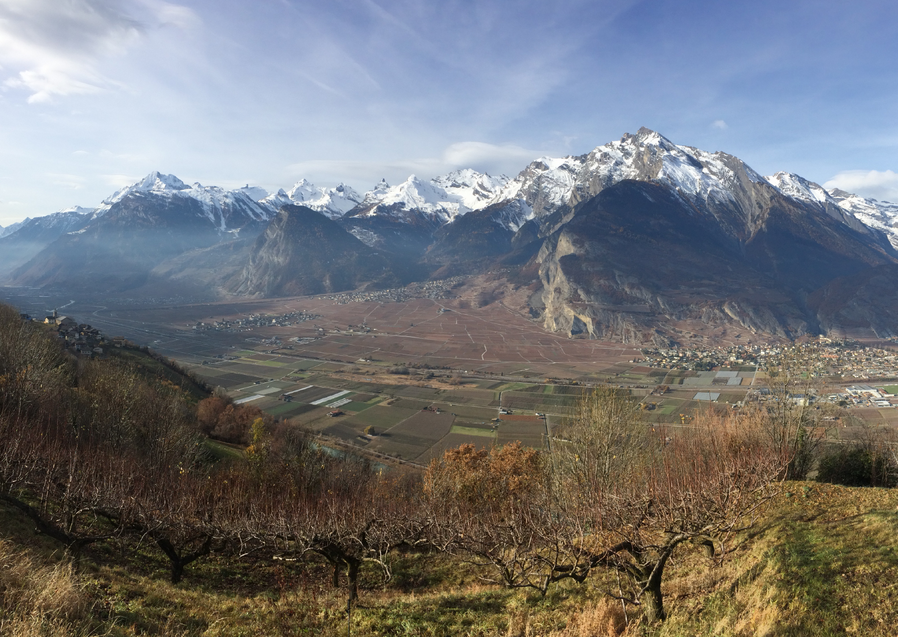

Intensively-managed fruit-tree plantations consisting of low-stem trees have progressively replaced traditional high- and mid-stem orchards in Europe during the intensification of agriculture in the second part of the 20th century. Such perennial agricultural systems often form dense, homogeneous landscapes interspersed with open fields, urban areas and semi-natural structures. In this project we are investigating how management practices and natural structures drive landscape- and field-scale habitat preferences of bird communities.

## Uni Bern supervisors

Alain Jacot, Raphaël Arlettaz

## External collaborator

Swiss Ornithological Institute, hoopoe & wryneck project

## Publications

Rime, Y., C. Luisier, R. Arlettaz & A. Jacot. 2020. Landscape heterogeneity and management practices drive habitat preferences of wintering and breeding birds in intensively-managed fruittree plantations. Agriculture, Ecosystems and Environment 295: Article 106890. [(PDF, 3.2 MB)](/files/biodiversity_in_intensively_managed_fruit_tree_plantations/Rime_AgrEcosysEnv2020_eng.pdf)

## Related Master thesis

Rime, Y. 2019. Habitat preferences of wintering and breeding birds in intensively managed fruit tree plantations. MSc Thesis. University of Bern. [PDF](/files/biodiversity_in_intensively_managed_fruit_tree_plantations/Rime_MSc2019_eng.pdf)
