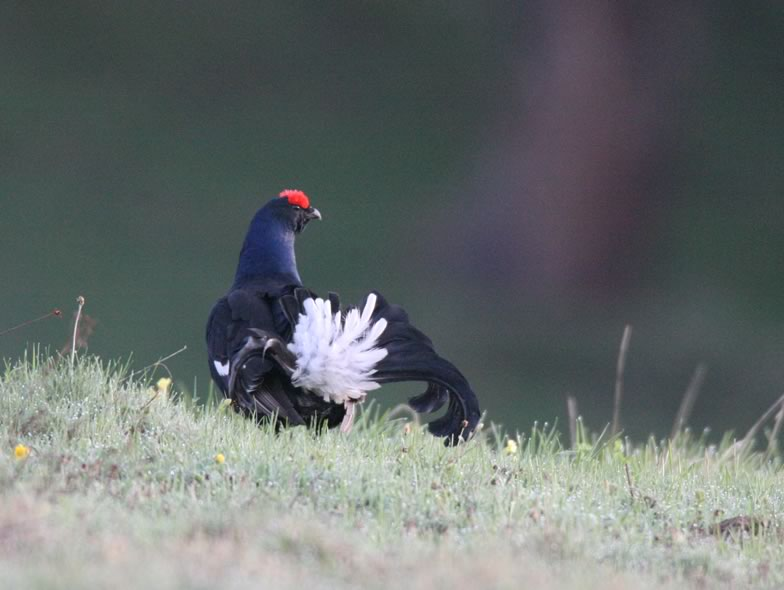

Alpine wildlife is impacted by land-use changes (abandonment and encroachement of pastures) and the growing tourism industry (especially snow sports activities). We used the Black grouse as a research model because its timberline habitat largely overlaps with recreational activities in the Alps. We had two research modules. In the first, we tried to understand the effects of recreation on species eco-physiology (stress, activity budget), behaviour (habituation to humans) and demography (population abundance, breeding success, survival rate); we then developed spatially-explicit models for delineating major areas of human-wildlife conflicts where quiet winter refuges should be implemented. In the second module, we investigated the breeding habitat requirements of Black grouse in order to provide recommendations for habitat management measures by foresters. Collaboration with local authorities and stakeholders, through the Valais field station of the Swiss Ornithological Institute, warrants that the proposed measures are effectively implemented....

## Uni Bern supervisors

Veronika Braunisch, Patrick Patthey, Raphaël Arlettaz

## External collaborators

Dr. Susanne Jenni-Eiermann, Swiss Ornithological Institute Sempach
Dr. Rupert Palme, Institute of Biochemistry, University of Veterinary Medicine, Vienna, Austria
Luca Rotelli, conservation consultant, Parco Naturale Veglia-Devero, Italy

## Publications

Braunisch, V., P. Patthey & R. Arlettaz. 2016. Where to Combat Shrub Encroachment in Alpine Timberline Ecosystems: Combining Remotely-Sensed Vegetation Information with Species Habitat Modelling. PLoS ONE 11: e0164318. [(PDF, 2.1 MB)](/files/black_grouse/Braunisch_PLoSONE2016_eng.pdf)

Arlettaz, R., S. Nusslé, M. Baltic, P. Vogel, R. Palme, S. Jenni-Eiermann, P. Patthey & M. Genoud. 2015. Disturbance of wildlife by outdoor winter recreation: allostatic stress response and altered activity-energy budgets. Ecological Applications 25: 1197-1212. [(PDF, 1.0 MB)](/files/black_grouse/Arlettaz_EcoApp2015_eng.pdf)

Arlettaz, R., P. Patthey & V. Braunisch. 2013. Impacts of Outdoor Winter Recreation on Alpine Wildlife and Mitigation Approaches: A Case Study of the Black Grouse. In: The Impacts of Skiing and Related Winter Recreational Activities on Mountain Environments (eds C. Rixen & A. Rolando), pp. 137-154. Bentham eBooks, Bussum. [(PDF, 3.0 MB)](/files/black_grouse/Arlettaz_BS2013_eng.pdf)

Patthey, P., N. Signorell, L. Rotelli & R. Arlettaz. 2012. Vegetation structural and compositional heterogeneity as a key feature in Alpine black grouse microhabitat selection: conservation management implications. European Journal of Wildlife Research 58: 59-70. [(PDF, 342KB)](/files/black_grouse/Patthey_EurJWilRes2012_eng.pdf)

Braunisch, V., P. Patthey & R. Arlettaz. 2011. Spatially explicit modeling of conflict zones between wildlife and snow sports: prioritizing areas for winter refuges. Ecological Applications 21: 955-967. [(PDF, 2.1 MB)](/files/black_grouse/Braunisch_EcoApp2011_eng.pdf)

Signorell, N., S. Wirthner, P. Patthey, R. Schranz, L. Rotelli & R. Arlettaz. 2010. Concealment from predators drives foraging habitat selection in brood-rearing Alpine black grouse *Tetrao tetrix* hens: habitat management implications. Wildlife Biology 16: 249-257. [(PDF, 695KB)](/files/black_grouse/Signorell_WilBio2010_eng.pdf)

Jenni-Eiermann, S. & R. Arlettaz. 2008. Does Ski Tourism Affect Alpine Bird Fauna? CHIMIA 62: p. 301. [(PDF, 320KB)](/files/black_grouse/Jenni-Eiermann_CHIM2008_eng.pdf)

Patthey, P., S. Wirthner, N. Signorell & R. Arlettaz. 2008. Impact of outdoor winter sports on the abundance of a key indicator species of alpine ecosystems. Journal of Applied Ecology 45: 1704-1711. [(PDF, 390KB)](/files/black_grouse/Patthey_JAppEco2008_eng.pdf)

Arlettaz, R., P. Patthey, M. Baltic, T. Leu, M. Schaub, R. Palme & S. Jenni-Eiermann. 2007. Spreading free-riding snow sports represent a novel serious threat for wildlife. Proceedings of the Royal Society. Series B, Biological sciences 274: 1219-1224. [(PDF, 123KB)](/files/black_grouse/Arlettaz_PRoySocB2007_eng.pdf)

Baltic, M., S. Jenni-Eiermann, R. Arlettaz & R. Palme. 2005. A Noninvasive Technique to Evaluate Human-Generated Stress in the Black Grouse. Annals of the New York Academy of Sciences 1046: 81-95. [(PDF, 195KB)](/files/black_grouse/Baltic_AlNYASci2005_eng.pdf)

#### Related PhD Theses

Signorell, N. 2008. Habitat management guidelines for the conservation of an emblematic species of Alpine timberline ecosystems, the black grouse: from fine-grained habitat selection to large-scale habitat suitability modelling. PhD Thesis, University of Bern. [PDF](/files/black_grouse/Signorell_PhD2008copy_eng.pdf)

Baltic, M. 2005. Impact of human disturbance on Alpine wildlife in winter: stress, activity and energetics in the endangered Black grouse *Tetrao tetrix*. PhD Thesis, University of Bern. [(PDF, 463KB)](/files/black_grouse/Baltic_PhD2005_eng.pdf)

#### Related Diploma/Master theses

Schranz, R. 2009. Effects of recreation disturbance on foraging patterns and habituation potential of Alpine wildlife: a case study of black grouse, an endangered species of timberline ecosystems. Master Thesis, University of Bern. [(PDF, 361KB)](/files/black_grouse/Schranz_MSc2009_eng.pdf)

Lingg, M. 2008. Is wildlife inhabiting snow sport areas less fit than in undisturbed areas? A case study of the Alpine Black grouse. Diploma Thesis, University of Bern. [(PDF, 290KB)](/files/black_grouse/Lingg_MSc2008_eng.pdf)

Wittwer, G. 2007. Negative impact of tourist resort settlement on reproductive success of Alpine wildlife: a case study of the Black grouse (*Tetrao tetrix*). Diploma Thesis, University of Bern. [PDF](/files/black_grouse/Wittwer_Dipl2007copy_eng.pdf)

Wirthner, S. 2006. Conservation ecology of the Alpine Black grouse (*Tetrao tetrix*): 1) modelling the impact of snow sports on local density; 2) arthropod food supply in different habitat types. Diploma Thesis, University of Bern. [PDF](/files/black_grouse/Wirthner_Dipl2006copy_eng.pdf)

Leu, T. 2003. Winter time-budget and energetics of free-ranging black grouse *Tetrao tetrix* enduring human disturbance. Diploma Thesis, University of Bern. [PDF](/files/black_grouse/Leu_Dipl2003copy_eng.pdf)
