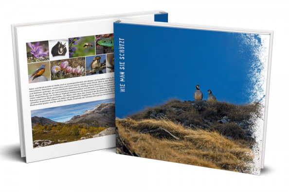

## A guideline for their protection

Nature and biodiversity in the Canton Valais is as exceptional as its landscapes and its culture. But flora and fauna are suffering more and more from various human interventions. Will the Valais population succeed in preserving their precious natural heritage for future generations? This book outlines how a harmonic relationship of humans and nature can be achieved.

An author team consisting of ornithologists and naturalists under the guidance of Prof. Raphaël Arlettaz has created a work reporting on the current state of biodiversity in Valais. A specific attention is given to a selected number of bird species, each playing a significant role in its ecosystem, for which Valais bears a special responsibility within Switzerland.

### Recension (in French):

[(PDF, 602KB)](/files/book_biodiversity_of_valais/Christe_BlSocVauSN2020_eng.pdf)

### to place an order:

German [Link](https://www.vogelwarte.ch/de/shop/buecher/voegel-und-biodiversitaet-im-wallis)
