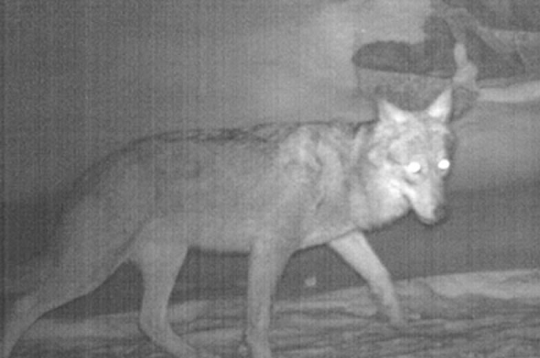
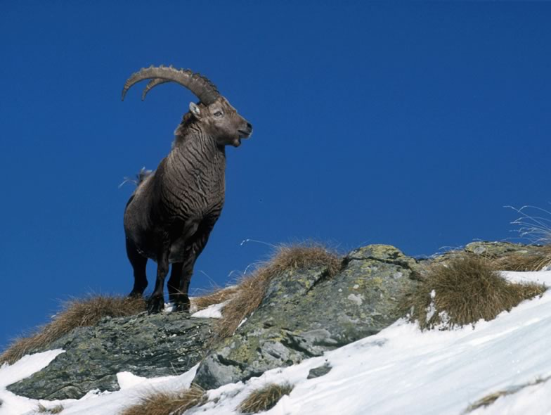

Estimating population sizes of wild ungulates is essential for establishing proper management plans, notably for hunting. Such population surveys usually rely upon visual counts. However, visual surveys are influenced by an observer’s capabilities, environmental circumstances and even abiotic factors such as weather conditions. New modelling frameworks are under development, which allow accounting for these potential biases with the objective to deliver more acurate population estimates. In this carnivores-ungulates project we try to collect information about the spatial and temporal occurrence of wild ungulates via their footprints and snow tracks along standardized walking transects in the Swiss Alps (Valais). In addition we monitor the presence of carnivorous predators (wolf, lynx, fox) with automatic photographic cameras. This information will be fit into N-mixture models with the objective to decipher the spatio-temporal patterns of occurrence of the apex predators (wolf, lynx), meso-predators (fox) and their main prey (red deer, roe deer, chamois, wild boar).

## Uni Bern supervisors

Veronika Braunisch, Stijn Verschueren, Raphaël Arlettaz

## Field technicians

Valentin Debons, François Biollaz, Stéphane Mettaz

## External collaborators

Dr. Marc Kéry, Swiss Ornithological Institute Sempach

## Publications

Arlettaz, R., G. Chapron, M. Kéry, E. Klaus, S. Mettaz, S. Roder, S. Vignali, F. Zimmermann & V. Braunisch. 2021. Poaching Threatens the Establishment of a Lynx Population, Highlighting the Need for a Centralized Judiciary Approach. Frontiers in Conservation Science 2: Article 665000. [(PDF, 5.9 MB)](/files/carnivores_ungulates/Arlettaz_FroConSci2021_eng.pdf)

Roder, S., F. Biollaz, S. Mettaz, F. Zimmermann, R. Manz, M. Kéry, S. Vignali, L. Fumagalli, R. Arlettaz & V. Braunisch. 2020. Deer density drives habitat use of establishing wolves in the Western European Alps. Journal of Applied Ecology 57: 995-1008. (PDF, 1.6 MB) [(PDF, 1.6 MB)](/files/carnivores_ungulates/Roder_JAppEco2020_eng.pdf)

Biollaz, F., S. Mettaz, F. Zimmermann, V. Braunisch & R. Arlettaz. 2016. Statut du lynx en Valais quatre décennies après son retour: suivi au moyen de pièges photographiques. Bulletin de la Murithienne 133: 29-44. [(PDF, 1.5 MB)](/files/carnivores_ungulates/Biollaz_BlMur2016_eng.pdf)

## Related Master Thesis

Roder, S. 2017. Red deer density drives wolf establishment in the Western Swiss Alps. Master Thesis, University of Bern. [PDF](/files/carnivores_ungulates/Roder_MSc2017_eng.pdf)

Grandjean, N. 2014. Influence of the landscape characteristics on roe deer survival in a landscape of fear. Master Thesis, University of Bern. [PDF](/files/carnivores_ungulates/Grandjean_MSc2014_eng.pdf)
