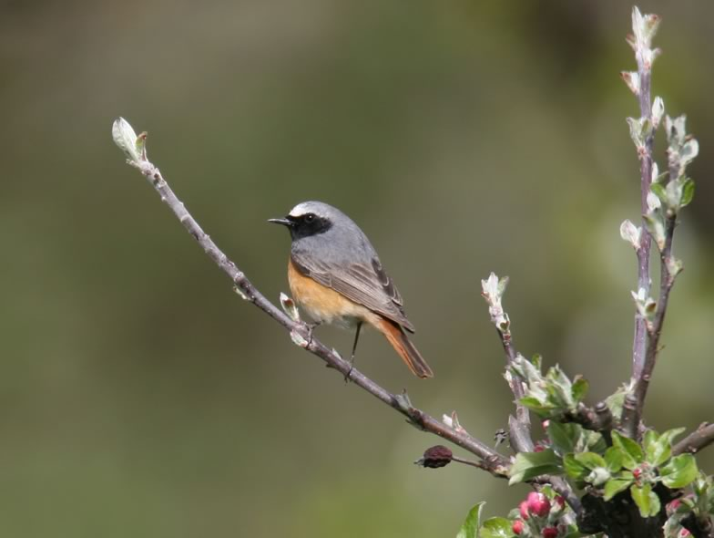

The common redstart (Phoenicurus phoenicurus) is a beautiful bird of semi-open habitat types (orchards, open woodland, park, garden). Populations of common redstarts are declining, in particular outside the Alps. The reason for the decline could be linked with habitat changes. As a sit-and-wait predator, the common redstart predominantly preys on arthropods captured on the ground. Because the ground vegetation in many farmland systems has become denser due to fertilization, we studied whether the access to food could be a critical factor. In a comparative study including other species, we found that common redstarts preferred to hunt on patches where the ground vegetation is sparse. Thus, it is likely that the cover of the ground vegetation is an important habitat feature, and that creating sparely vegetated patches is an efficient way to support redstart populations.

## External collaborators

Nicolas Martinez, Dr. Niklaus Zbinden, Swiss Ornithological Institute Sempach

## Publications

Vickery, J. & R. Arlettaz. 2012. The importance of habitat heterogeneity at multiple scales for birds in European agricultural landscapes. In: Birds and Habitat: Relationships in Changing Landscapes (ed. R.J. Fuller), pp. 177-204. Cambridge University Press, Cambridge. [(PDF, 3.3 MB)](/files/vineyards/VickeryArlettaz_in_Fuller2012_eng.pdf)

Schaub, M., N. Martinez, A. Tagmann-Ioset, N. Weisshaupt, M.L. Maurer, T.S. Reichlin, F. Abadi, N. Zbinden, L. Jenni & R. Arlettaz. 2010. Patches of Bare Ground as a Staple Commodity for Declining Ground-Foraging Insectivorous Farmland Birds. PLoS ONE 5:e13115. [(PDF, 755KB)](/files/vineyards/Schaub_PLoSONE2010_eng.pdf)
