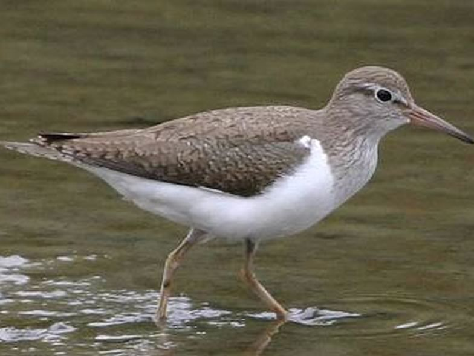

## River restoration and wading birds

River restoration is one the greatest challenges facing conservation biologists. The majority of Central European rivers on flood plains have been recalibrated (damming) since the XIXth century, which led to a dramatic loss of invaluable habitats and biodiversity. Finges/Pfyn is the only Swiss section of the Rhône river at plain elevation which was not narrowly dammed all along, although calibration was attempted after World War II. In the mid 1990s a project of revitalisation was launched, which consisted in broadening the river bed by not rebuilding dams destroyed by major floods. We investigated the effects of this «natural» renaturation, and controlled gravel extraction aimed at increasing habitat quality, on the habitat mosaic and on the response of two rare wading birds (common sandpiper and little ringed plover) whose populations had been monitored in Finges since the late 1970s. The habitat mosaic diversity increased dramatically after renaturation, which boosted the demography of the two bird species.

## Uni Bern supervisor

Raphaël Arlettaz

## External collaborators

Pierre-Alain Oggier, Federal road network, canton of Valais

Dr. Marc Kéry, Swiss Ornithological Institute Sempach

Philippe Werner, Alain Lugon, independent ecological consultants

## Publications

Arlettaz, R., A. Lugon, A. Sierro, P. Werner, M. Kéry & P.A. Oggier. 2011. River bed restoration boosts habitat mosaics and the demography of two rare non-aquatic vertebrates. Biological Conservation 144: 2126-2132. [(PDF, 705KB)](/files/river_restoration_waders/Arlettaz_BioCon2011_eng.pdf)

## Related Master Thesis

Peris Morente, E. 2020. Multiscale habitat selection in two endangered waders: how targeted gravel extraction along revitalised rivers can boost these two bird species. Master Thesis. University of Bern. [PDF](/files/river_restoration_waders/PerisMorente_MSc2020_eng.pdf)

Pilati, M. 2019. Enhancing the habitat of the Common Sandpiper via targeted sediment extractions. Master Thesis. University of Bern. [PDF](/files/river_restoration_waders/Pilati_MSc2019_eng.pdf)
