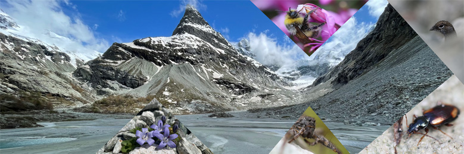

As a result of global warming, Central European glaciers are melting at an unprecedented rate and expected to disappear by 2100. This dramatic melt will open new spaces, triggering vegetation succession and offering new areas for biodiversity, in particular valuable alluvial habitats. Yet, these emerging habitats are already threatened by infrastructure development, notably hydropower production and sediment exploitation, which calls for better appraisals of their biodiversity and measures to counter future environmental impacts.

This research programme aims to provide spatially-explicit, evidence-based recommendations for conservation management to authorities, policy-makers and organizations. We shall 1) identify where such high-alpine alluvial habitats will appear in the Swiss landscape , 2) predict their future biodiversity so as to rank them according to their intrinsic natural value, and 3) assess where overlaps with potential infrastructure development are likely to occur, this for guiding land-use planning.

Based on information about glacial geomorphology and biodiversity, spatially-explicit models will be constructed so as to rank high-alpine, proglacial alluvial areas with respect to their ecological value and potential vulnerability to infrastructure development, accounting for two time horizons (2050 and 2100). The programme relies on different sources of data, notably citizen science information and ad hoc fieldwork relevés, with a major focus on carabid beetles, ground-dwelling spiders and wild bees as bioindicators.

### Uni Bern supervisors

[Alejandra Morán Ordóñez](https://www.cb.iee.unibe.ch/about_us/morn_ordez_alejandra/index_eng.html) (University Basel), Raphaël Arlettaz

### Publications

-

### Related PhD thesis

### Related Master theses

Käser, J.Z. 2026. Diversity, microecology and functional strategies of spiders in proglacial habitats of the Valais Alps. Master Thesis, University of Bern. PDF
