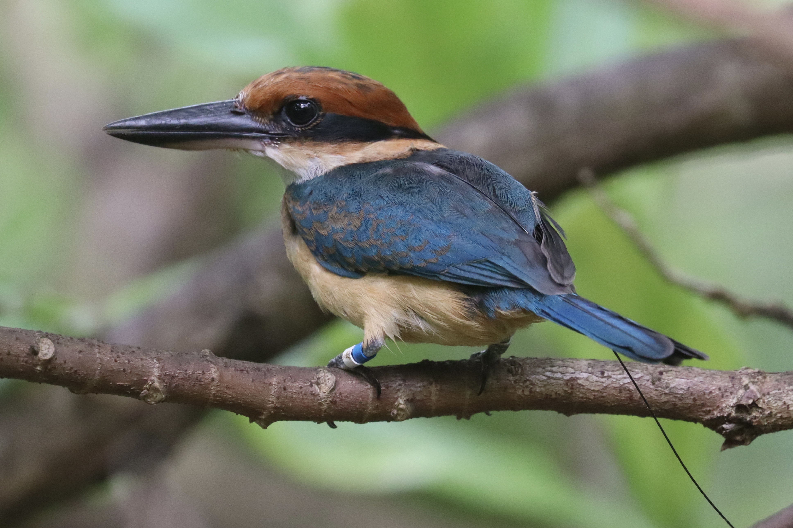

To address the growing loss of biodiversity and the challenges posed by climate and global changes, various creative conservation strategies are being implemented. One increasingly important approach is conservation introduction (also referred to as assisted colonisation): the intentional movement of a threatened species from its current imperilled range to new areas. This action has proven successful, particularly for highly threatened and extinct-in-the-wild species, but it is not exempt from risks. Indeed, when a species is introduced in a new habitat, it is added to the local species interaction network and can thus potentially disrupt its balance. Although the risks to the introduced species itself are generally well examined before introduction, there are currently no clear frameworks for the assessments of potential negative impacts on the resident ecosystem.

The focus of this project is to support the International Union for the Conservation of Nature (IUCN) in building guidelines for assessing and mitigating the risks linked to conservation translocations. Our group provides scientific guidance and rigorous framework for assessing such risks, to assist decision makers and conservation practitioners planning and evaluating conservation introductions, enabling transparent and sound decision-making based on a clearly defined framework. We aim to promote conservation introductions that are both effective and responsible, benefitting threatened species without unintentionally harming others.

We focus on developing and simultaneously testing these methods on two high-profile introduction projects to verify their applicability: the Mexican boxer pupfish (*Cyprinodon simus*), and sihek (Guam kingfisher, *Todiramphus cinnamominus*).

## Uni Bern supervisors

[PD Dr. Stefano Canessa](https://www.cb.iee.unibe.ch/about_us/pd_dr_canessa_stefano/index_eng.html) & [Maude Vernet](https://www.cb.iee.unibe.ch/about_us/vernet_maude/index_eng.html)

## External collaborators

I[UCN SSC Conservation Translocation Specialist Group](https://iucn.org/our-union/commissions/iucn-species-survival-commission-2021-2025)
(International Union for the Conservation of Nature, Species Survival Commission)

[Prof. Dr. John G. Ewen](https://www.zsl.org/about-zsl/our-people/dr-john-g-ewen)

[Zoological Society of London](https://www.zsl.org/) (ZSL)

## Related Publications

Pascal, L.V., S.A. Vollert, M.D. Bimler, C.M. Baker, M. Vernet, S. Canessa, C. Drovandi & M.P. Adams. 2025. EEMtoolbox: A user-friendly R package for flexible ensemble ecosystem modelling. Methods in Ecology and Evolution 16: 921-929. [PDF](/files/developing_guidelines_for_conservation_introductions/Pascal_MetEcoEvo2025_eng.pdf)

Vernet, M., A.E. Trask, C.E. Andrews, J.G. Ewen, S. Medina, A. Moehrenschlager & S. Canessa. 2024. Assessing invasion risks using EICAT‑based expert elicitation: application to a conservation translocation. Biological Invasions 26: 2707-2721. [PDF](/files/developing_guidelines_for_conservation_introductions/Vernet_BioInv2024_eng.pdf)

## Related PhD thesis

Vernet, M. (2024 – ongoing). Wildlife conservation: assessing the risks and benefits of moving endangered species beyond their range. PhD Thesis, University of Bern.

## Related Master theses

Vernet, M. 2024. Assessing and modelling invasion risks: Application to a conservation introduction. Master Thesis. University of Bern. [PDF](/files/developing_guidelines_for_conservation_introductions/Vernet_MSc2024_eng.pdf)

[Rasch, S.](https://www.cb.iee.unibe.ch/about_us/rasch_sabrina/index_eng.html) (2024 – ongoing). Developing a data pipeline for monitoring conservation impacts on a remote island. Master Thesis. [IBU](https://www.bioinformatics.unibe.ch/) University of Bern.

## Related Bachelor thesis

[Ochsner, E](https://www.thee.iee.unibe.ch/about_us/team/staff/ochsner_emma/index_eng.html). (2025 – ongoing). Modelling different management strategies for an extinct-in-the-wild species. Bachelor Thesis. [THEE](https://www.thee.iee.unibe.ch/index_eng.html) University of Bern.
