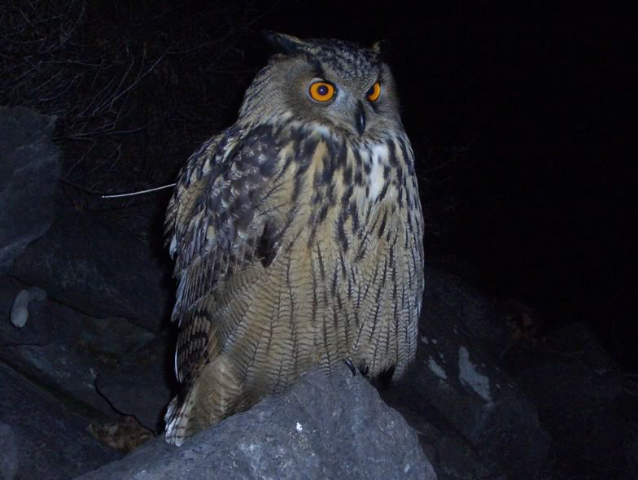

Several species of raptors, among both the diurnal and nocturnal birds of prey, play the role of environmental sentinels, meaning that their populations often decline following some degradation in the general environment. Vice versa, their population recovery may indicate an amelioration of environmental conditions.Our group contributes to monitor and carry out research on several species of raptors in the Swiss Alps since years, in particular eagle owls, peregrine falcons and short-toed snake eagles.

The Eagle owl is the largest owl species in the world. It is a top predator, capable of preying on large raptors such as Goshawk or Peregrine falcon. The Central European populations underwent a dramatic decline: the species has been systematically persecuted for centuries, and probably suffered from food-chain contamination by organochlorines during the second half of the 20th century. Massive reintroduction programmes have been launched in Germany in the 1970s and 1980s, which probably boosted the settlement of breeding pairs across Switzerland. Despite that the species is slightly recovering in southern areas (e.g. Rhone valley in France), its Swiss populations tend to show large fluctuations, with regular losses of adult partners on traditional breeding territories. This is indicative of some adverse factors affecting population dynamics. We first investigated the dispersal of young using classical and satellite telemetry; this showed the existence of a wide meta-population system in the north-western Alps. We then applied an integrated population dynamic model, based on different sources of information (age at death of individuals retrieved, long-term monitoring data of the Valais population, radiotracking) to understand species demography. Valais Eagle owls pay a heavy toll to anthropogenic mortality, especially dangerous pylons which cause numerous fatal electrocutions. By systematically mitigating dangerous pylons, we could help the species to recover. Implementation programmes are carried out with local electric companies to solve this problem on the spot.

## Uni Bern supervisors

Adrian Aebischer, Michael Schaub, Raphaël Arlettaz

## Publications

Penteriani, V., M.d.M. Delgado, A. Kuparinen, P. Saurola, J. Valkama, E. Salo, J. Toivola, A. Aebischer & R. Arlettaz. 2014. Bright moonlight triggers natal dispersal departures. Behavioral Ecology and Sociobiology 68: 743-747. [(PDF, 283KB)](/files/eagle_owl/Penteriani_BehEcoSobio2014_eng.pdf)

Aebischer, A., P. Nyffeler & R. Arlettaz. 2010. Wide-range dispersal in juvenile Eagle Owls (*Bubo bubo*) across the European Alps calls for transnational conservation programmes. Journal of Ornithology 151: 1-9. [(PDF, 508KB)](/files/eagle_owl/Aebischer_JOrn2010_eng.pdf)

Schaub, M., A. Aebischer, O. Gimenez, S. Berger & R. Arlettaz. 2010. Massive immigration balances high anthropogenic mortality in a stable eagle owl population: Lessons for conservation. Biological Conservation 143:1911-1918. [(PDF, 296KB)](/files/electricity_networks/Schaub_BioCon2010_eng.pdf)

Aebischer, A. 2008. Dispersione dei giovani e mortalità del Gufo reale *Bubo bubo* in Svizzera. Ficedula 40: 2-6. [(PDF, 335KB)](/files/electricity_networks/Aebischer_Fice2008_eng.pdf)

Aebischer, A., P. Nyffeler, S. Koch & R. Arlettaz. 2005. Jugenddispersion und Mortalität Schweizer Uhus *Bubo bubo* - Ein aktueller Zwischenbericht. Ornithologischer Anzeiger 44: 197-200. [(PDF, 1.6 MB)](/files/electricity_networks/Aebischer_OrnAnz2005_eng.pdf)

## Related Diploma/Master theses

Koch, S. 2005. Mortality factors and nestling diet of the Eagle owl *Bubo bubo* in Switzerland. Diploma Thesis, University of Bern. [PDF](/files/eagle_owl/Koch_Dipl2005copy_eng.pdf)

Nyffeler, P. 2004. Nestling diet, juvenile dispersal, and adult habitat selection of the Eagle owl *Bubo bubo* in the Swiss Rhône valley. Diploma Thesis, University of Bern. [PDF](/files/eagle_owl/Nyffeler_Dipl2004copy_eng.pdf)
