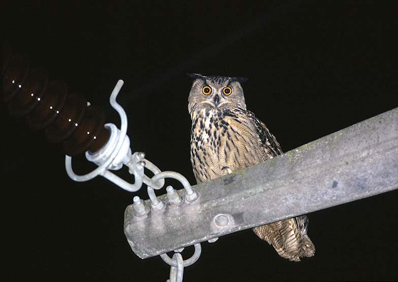

Networks for electricity distribution (the grid) constitute obstacles (aerial cables, pylon structures with risk of electrocution) that can threat flying animals, such as birds and bats. We have carried out research on the impact of electrocution on the eagle owl, which is heavily impacted by electrocution throughout Europe. Our research results and recommendations provide guidance for conservation managers and electricity compagnies who deploy measures for mitigating the impact of this infrastructure so as to lower mortality risks.

## Uni Bern supervisors

Adrian Aebischer, Michael Schaub, Raphaël Arlettaz

## Publications

Schaub, M., A. Aebischer, O. Gimenez, S. Berger & R. Arlettaz. 2010. Massive immigration balances high anthropogenic mortality in a stable eagle owl population: Lessons for conservation. Biological Conservation 143:1911-1918. [(PDF, 296KB)](/files/electricity_networks/Schaub_BioCon2010_eng.pdf)

Aebischer, A. 2008. Dispersione dei giovani e mortalità del Gufo reale *Bubo bubo* in Svizzera. Ficedula 40: 2-6. [(PDF, 335KB)](/files/electricity_networks/Aebischer_Fice2008_eng.pdf)

Aebischer, A., P. Nyffeler, S. Koch & R. Arlettaz. 2005. Jugenddispersion und Mortalität Schweizer Uhus *Bubo bubo* - Ein aktueller Zwischenbericht. Ornithologischer Anzeiger 44: 197-200. [(PDF, 1.6 MB)](/files/electricity_networks/Aebischer_OrnAnz2005_eng.pdf)

Schaub, M. & R. Pradel. 2004. Assessing the relative importance of different sources of mortality from recoveries of marked animals. Ecology 85: 930-938. [(PDF, 92KB)](/files/electricity_networks/Schaub_Eco2004a_eng.pdf)

Schaub, M. & J.D. Lebreton. 2004. Testing the additive versus the compensatory hypothesis of mortality from ring recovery data using a random effects model. Animal Biodiversity and Conservation 27: 73-85. [(PDF, 857KB)](/files/electricity_networks/Schaub_AniBiodivCon2004_eng.pdf)

## Thesis

Koch, S. 2005. Mortality factors and nestling diet of the Eagle owl Bubo bubo in Switzerland. Diploma Thesis, University of Bern.
