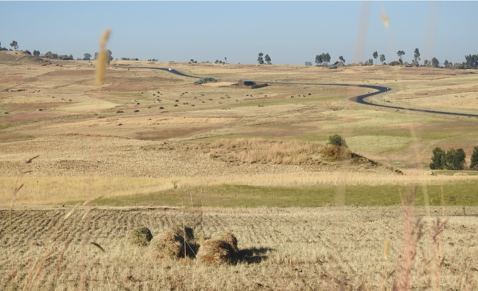

Agricultural landscapes in Africa are still largely dominated by small-scale subsistence farming operated by smallholders. Many sites harbour high biodiversity. However, as most African countries are confronted to an unprecedented population growth and a rapid economic development, efforts to intensify food production are widespread, with concomitant potentially negative effects on biodiversity. In this project we are working in a highly contrasted agricultural landscape in the Ethiopian highlands comprising two distinct farming systems: intensively managed large-scale farming vs small-scale traditional farming. We aim at understanding the effects of management practices and semi-natural habitats on avian communities in order to deliver recommendations for a sustainable agriculture.

## Uni Bern supervisors

Alain Jacot, Raphaël Arlettaz

## External collaborator

University of Lausanne

## Publications

Marcacci, G., J. Gremion, J. Mazenauer, T. Sori, F. Kebede, M. Ewnetu, P. Christe, R. Arlettaz & A. Jacot. 2022. High semi-natural vegetation cover and heterogeneity of field sizes promote bird beta-diversity at larger scales in Ethiopian Highlands. Journal of Applied Ecology 59: 1219-1230. [PDF](/files/ethiopian_highlands/Marcacci_JAppEco2022_eng.pdf)

Gremion, J., G. Marcacci, J. Mazenauer, T. Sori, F. Kebede, M. Ewnetu, P. Christe, R. Arlettaz & A. Jacot. 2022. Habitat preferences of the Ortolan Bunting (*Emberiza hortulana*) in its prime wintering grounds, the cereal-dominated Ethiopian Highlands. Ibis 164: 74-87. [PDF](/files/ethiopian_highlands/Gremion_Ibis2022_eng.pdf)

Marcacci, G., J. Gremion, J. Mazenauer, T. Sori, F. Kebede, M. Ewnetu, P. Christe, R. Arlettaz & A. Jacot. 2020. Large-scale versus small-scale agriculture: Disentangling the relative effects of the farming system and semi-natural habitats on birds’ habitat preferences in the Ethiopian highlands. Agriculture, Ecosystems and Environment 289: article 106737. [(PDF, 1.6 MB)](/files/ethiopian_highlands/Marcacci_AgrEcosysEnv2020_eng.pdf)

## Related Master thesis

Marcacci, G. 2019. Large-scale versus small-scale agriculture: disentangling the relative effects of the farming system and semi-natural habitats on birds’ habitat preferences in the Ethiopian highlands. MSc Thesis. University of Bern. [PDF](/files/ethiopian_highlands/Marcacci_MSc2019_eng.pdf)
