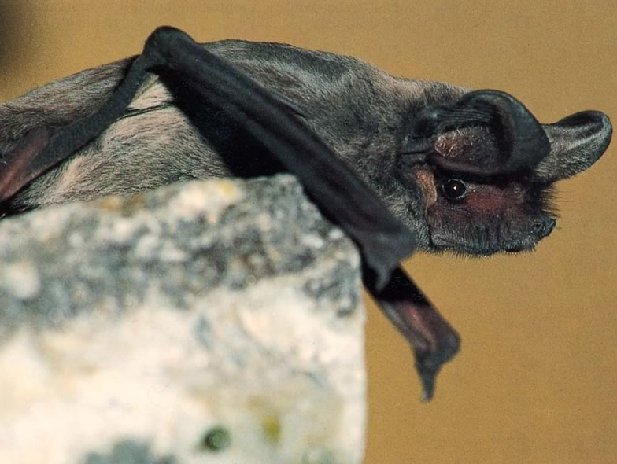

*Tadarida teniotis* is the only molossid bat, a widespread tropical family, occurring in Europe. It is also one of the rarest bat species of Switzerland, occurring only in the southern part of the country, above all in Valais. This species emits loud audible (to a human ear) echolocation calls which allow its feeding on flying tympanate insects, as established by our dietary analyses. In effect, moths and lacewings have earing organs tuned on the main frequency range of bats’ ultrasonic calls and can thus avoid predation. Our ecophysiological studies showed that Tadarida teniotis also differs from other sympatric, temperate-zone species in that it cannot hibernate at low ambient temperature (below 6-5-7.5°C), which probably constrains its distribution range to southern biomes. This species thus constitutes an excellent model to measure the effects of climate change on species distribution adjustments.

## Uni Bern supervisor

Raphaël Arlettaz

## Publications

Wellig, S.D., S. Nusslé, D. Miltner, O. Kohle, O. Glaizot, V. Braunisch, M.K. Obrist & R. Arlettaz. 2018. Mitigating the negative impacts of tall wind turbines on bats: Vertical activity profiles and relationships to wind speed. PLoS ONE 13: e0192493. [(PDF, 1.0 MB)](/files/flying_vertebrates_vs_wind_turbines/Wellig_PLOSONE2018_eng.pdf)

Ibáñez, C. & R. Arlettaz. 2013. *Tadarida teniotis* European Free-tailed Bat. In: Mammals of Africa (eds. M. Happold & D.C.D. Happold), pp. 533-535. Bloomsbury Publishing, London. [(PDF, 547KB)](/files/european_free_tailed_bat/Ibanez_BS2013_eng.pdf)

Arlettaz, R., C. Ruchet, J. Aeschimann, E. Brun, M. Genoud & P. Vogel. 2000. Physiological traits affecting the distribution and wintering strategy of the bat *Tadarida teniotis*. Ecology 81:1004-1014. [(PDF, 218KB)](/files/european_free_tailed_bat/Arlettaz_Eco2000_eng.pdf)

Rydell, J. & R. Arlettaz. 1994. Low-frequency echolocation enables the bat *Tadarida teniotis* to feed on tympanate insects. Proceedings of the Royal Society. Series B, Biological sciences 257:175-178. [(PDF, 746KB)](/files/european_free_tailed_bat/Rydell_PRoySocB1994_eng.pdf)

## Related Diploma/Master thesis

Fischer, M.C. 2003. Winter foraging in the European free-tailed bat *Tadarida teniotis* (Molossidae): Opportunistic or constrained? Diploma Thesis, University of Bern. [PDF](/files/european_free_tailed_bat/Fischer_Dipl2003copy_eng.pdf)
