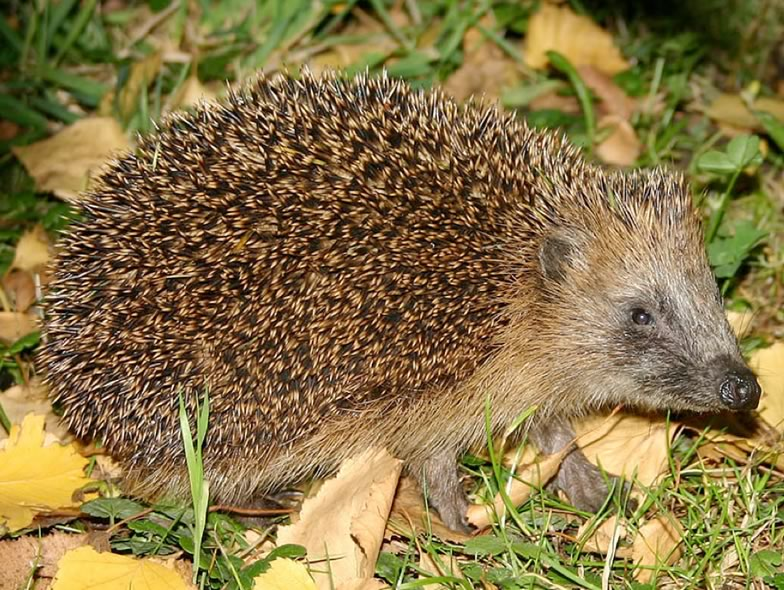

It is assumed that parasitism is closely linked to host density and, therefore, to opportunities to infest a host population. Hedgehog populations might reach high densities in urban areas. We investigated hedgehog parasite abundance and diversity in a comparative approach between rural, suburban and urban habitats.
While the health status of hedgehogs was similar in all three habitats, the diversity of parasite species was higher in urban than in rural areas. There were clear gradients in parasite gradients from rural through suburban to urban areas. Given high prevalences and intensities of most parasite species in thriving dense urban hedgehog populations, blood characteristics may reflect detrimental, but natural density-dependent effects.

## Uni Bern supervisor

Fabio Bontadina

## Related Diploma/Master Thesis

Egli, R. 2004. Comparison of physical condition and parasite burdens in rural, suburban and urban hedgehogs *Erinaceus* europaeus: Implications for conservation. Diploma Thesis, University of Bern. [PDF](/files/european_hedgehog/Egli_Dipl2004copy_eng.pdf)
