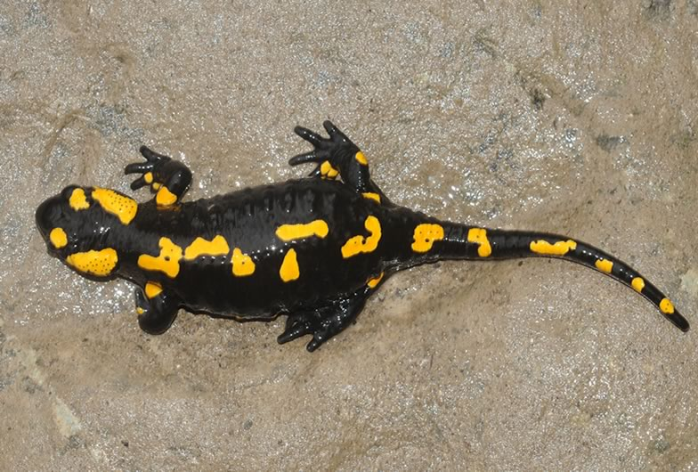

Amphibian population dynamics is generally thought to be driven by recruitment. However, this statement is unlikely to be true in all amphibians. We therefore studied how strongly population dynamics of the fire salamander (*Salamandra salamandra*) is impacted by the variation of recruitment and survival using marked individuals. In addition we study dispersal in this species.

## Uni Bern supervisor

Michael Schaub

## External collaborators

Dr. Benedikt R. Schmidt, KARCH, Neuchâtel, Switzerland

Dr. Sebastian Steinfartz, University Bielefeld, Germany

## Publications

Schmidt, B.R., M. Schaub & S. Steinfartz. 2007. Apparent survival of the salamander *Salamandra salamandra* is low because of high migratory activity. Frontiers in Zoology 4: art. 19. [(PDF, 567KB)](/files/fire_salamander/Schmidt_FroZoo2007_eng.pdf)

Schmidt, B.R., R. Feldmann & M. Schaub. 2005. Demographic Processes Underlying Population Growth and Decline in *Salamandra salamandra*. Conservation Biology 19: 1149-1156. [(PDF, 204KB)](/files/fire_salamander/Schmidt_ConBio2005_eng.pdf)
