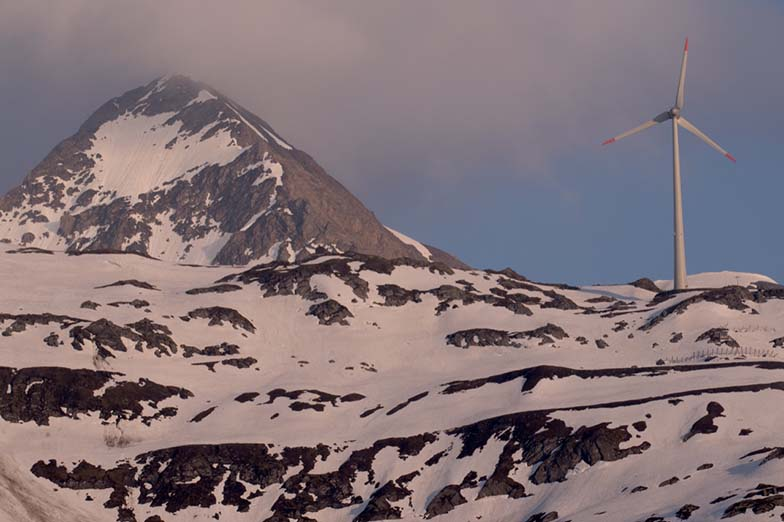
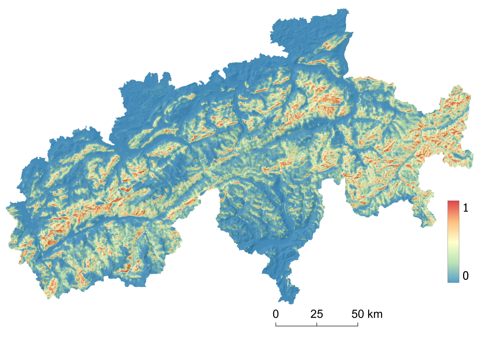
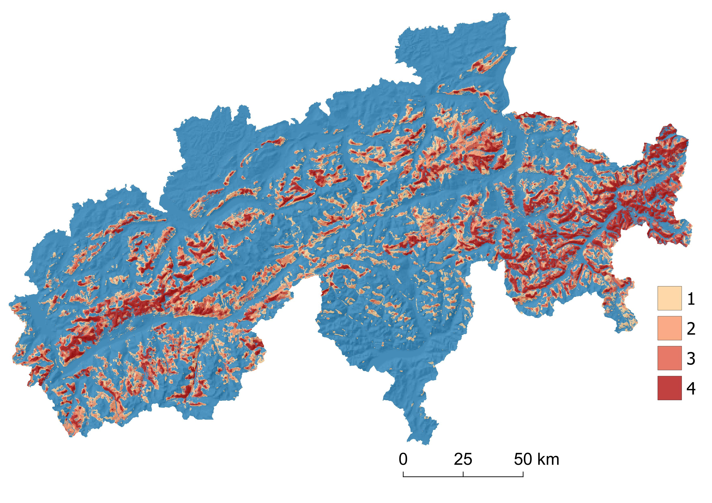
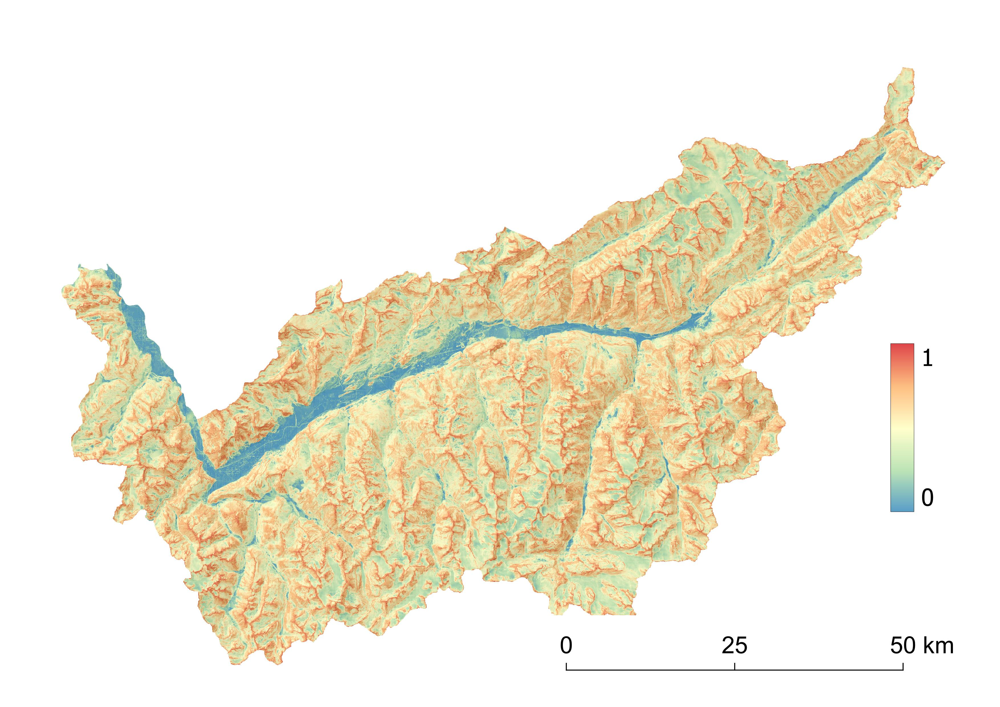
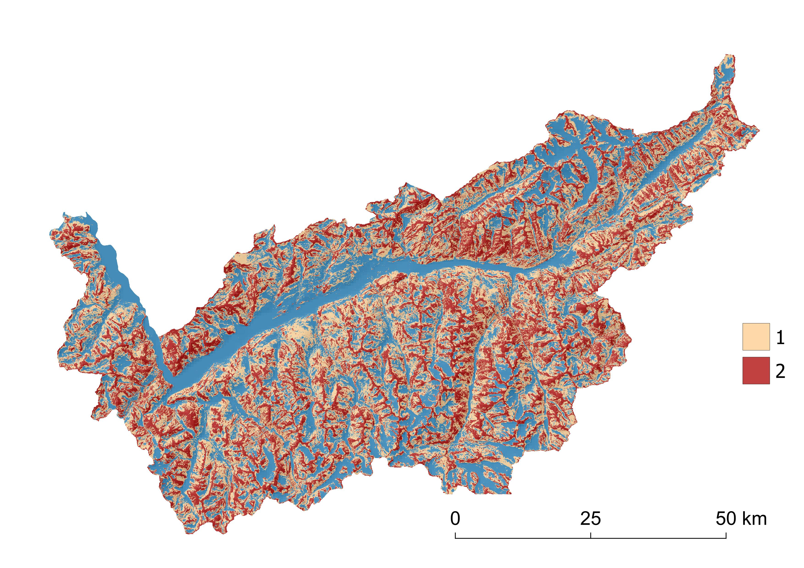

Wind energy, although recognised as a clean and environmentally friendly source of energy, can threaten flying vertebrates. There are several mechanisms that affect species, including mortality through collision with overhead structures, displacement, and habitat loss. To better understand the negative effects of wind energy development on species, we conducted several studies, varying from the development of spatially explicit models to predict areas of potential conflicts, to species-specific analyses of the main factors contributing to the risk.

The main objective of our research is to provide evidence-based recommendations to assist policy makers, wildlife managers, wind energy companies, and environmental consultants in their decisions and reduce the risk of new wind facilities being deployed in areas crucial for species conservation.

We work on iconic bird species, namely bearded vulture, golden eagle, red-billed chough and bats.

## Uni Bern supervisors

Sergio Vignali, Veronika Braunisch, Raphaël Arlettaz

## Publications

Vignali, S., F. Lörcher, D. Hegglin, R. Arlettaz & V. Braunisch. 2022. A predictive flight-altitude model for avoiding future conflicts between an emblematic raptor and wind energy development in the Swiss Alps. Royal Society Open Science 9: article number 211041. [PDF](/files/flying_vertebrates_vs_wind_turbines/Vignali_RoySocOpeSci2022_eng.pdf)

Braunisch, V., S. Vignali, P.A. Oggier & R. Arlettaz. 2021. Present in the western European Alps but absent in the eastern part: Can habitat availability explain the differences in red-billed chough occurrence? Journal of Avian Biology 52: e02682. [(PDF, 1.8 MB)](/files/flying_vertebrates_vs_wind_turbines/Braunisch_JAviBio2021_eng.pdf)

Taubmann, J., J.L. Kämmerle, H. Andrén, V. Braunisch, I. Storch, W. Fiedler, R. Suchant & J. Coppes. 2021. Wind energy facilities affect resource selection of capercaillie *Tetrao urogallus*. Wildlife Biology: wlb.00737. [(PDF, 1.1 MB)](/files/flying_vertebrates_vs_wind_turbines/Taubmann_WilBio2021_eng.pdf)

Vignali, S., F. Lörcher, D. Hegglin, R. Arlettaz & V. Braunisch. 2021. Modelling the habitat selection of the bearded vulture to predict areas of potential conflict with wind energy development in the Swiss Alps. Global Ecology and Conservation 25: Article Number: e01405. [(PDF, 2.8 MB)](/files/flying_vertebrates_vs_wind_turbines/Vignali_GloEcoCon2021_eng.pdf)

Coppes, J., J.L. Kämmerle, V. Grünschachner-Berger, V. Braunisch, K. Bollmann, P. Mollet, R. Suchant & U. Nopp-Mayr. 2020. Consistent effects of wind turbines on habitat selection of capercaillie across Europe. Biological Conservation 244: Article 108529. [(PDF, 1.6 MB)](/files/flying_vertebrates_vs_wind_turbines/Coppes_BioCon2020_eng.pdf)

Coppes, J., V. Braunisch, K. Bollmann, I. Storch, P. Mollet, V. Grünschachner-Berger, J. Taubmann, R. Suchant & U. Nopp-Mayr. 2020. The impact of wind energy facilities on grouse: a systematic review. Journal of Ornithology 161: 1-15. [(PDF, 861KB)](/files/flying_vertebrates_vs_wind_turbines/Coppes_JOrn2020_eng.pdf)

Wellig, S.D., S. Nusslé;, D. Miltner, O. Kohle, O. Glaizot, V. Braunisch, M.K. Obrist & R. Arlettaz. 2018. Mitigating the negative impacts of tall wind turbines on bats: Vertical activity profiles and relationships to wind speed. PLoS ONE 13: e0192493. [(PDF, 1.0 MB)](/files/flying_vertebrates_vs_wind_turbines/Wellig_PLOSONE2018_eng.pdf)

## Related PhD Thesis

Vignali, S. 2021. Predicting areas of potential conflicts between bearded vultures (*Gypaetus barbatus*) and wind turbines in the Swiss Alps. PhD Thesis. University of Bern.

## Related Master Theses

Wanner, S. 2017. Flight behaviour of birds around a solitary wind turbine in a Swiss alpine valley. Master Thesis. University of Bern. [(PDF, 980KB)](/files/flying_vertebrates_vs_wind_turbines/Wanner_MSc2017_eng.pdf)

Wellig, S. 2013. Mitigating the negative effects of tall wind turbines on bats: vertical activity profiles and relationships to wind speed. Master Thesis. University of Bern. [(PDF, 1.2 MB)](/files/flying_vertebrates_vs_wind_turbines/Wellig_MSc2013_eng.pdf)

## Unpublished Report

Vignali, S., V. Braunisch & R. Arlettaz. 2023. Large soaring raptors vs wind turbines development in the Swiss Alps. Final report, January 2023.  [PDF](/files/flying_vertebrates_vs_wind_turbines/RaptorsVSWindTurbines_FinalReport_eng.pdf)

this study is also referred to on the website of the Federal Office for the Environment: [https://www.bafu.admin.ch/bafu/de/home/themen/biodiversitaet/fachinformationen/erhaltung-und-foerderung-von-arten/grossraubtiere/voegel.html](https://eur03.safelinks.protection.outlook.com/?url=https%3A%2F%2Fwww.bafu.admin.ch%2Fbafu%2Fde%2Fhome%2Fthemen%2Fbiodiversitaet%2Ffachinformationen%2Ferhaltung-und-foerderung-von-arten%2Fgrossraubtiere%2Fvoegel.html&data=05%7C02%7Craphael.arlettaz%40unibe.ch%7C4635bee6a4a44c9dca7a08dd1f818117%7Cd400387a212f43eaac7f77aa12d7977e%7C1%7C0%7C638701363253307095%7CUnknown%7CTWFpbGZsb3d8eyJFbXB0eU1hcGkiOnRydWUsIlYiOiIwLjAuMDAwMCIsIlAiOiJXaW4zMiIsIkFOIjoiTWFpbCIsIldUIjoyfQ%3D%3D%7C0%7C%7C%7C&sdata=lWhJH3L86irkSjCt0O1JdUmfCph%2B2JAyaiqqGub2nfs%3D&reserved=0)

Download the map as jepg [[BeardVultureSwissAlps_jepg_eng.zip](/files/flying_vertebrates_vs_wind_turbines/BeardVultureSwissAlps_jepg_eng.zip)]

Download the map as geoTIFF (follows)

Download the map as jpeg [[GoldenEagleValais_jepg_eng.zip](/files/flying_vertebrates_vs_wind_turbines/GoldenEagleValais_jepg_eng.zip)]

Download the map as geoTIFF (follows)

## Bearded vulture Swiss Alps

See the graphical abstract of the report for an explanation of each map.

Download the map as jepg [[BeardVultureSwissAlps_jepg_eng.zip](/files/flying_vertebrates_vs_wind_turbines/BeardVultureSwissAlps_jepg_eng.zip)]

Download the map as geoTIFF (follows)

## Golden eagle Valais

See the graphical abstract of the report for an explanation of each map.

Download the map as jpeg [[GoldenEagleValais_jepg_eng.zip](/files/flying_vertebrates_vs_wind_turbines/GoldenEagleValais_jepg_eng.zip)]

Download the map as geoTIFF (follows)
