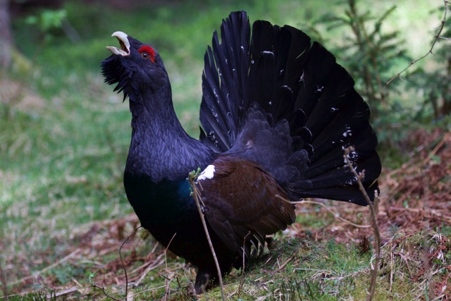

In montane and subalpine forest ecoystems, biodiversity largely depends on forest composition and structural diversity (e.g. variability in vertical and horizontal structure, age structure, presence of gaps, clearings, snags and dead wood). Although natural stand dynamics are largely overruled by forest practices, climate change is expected to affect the abundance and distribution of structural parameters and, consequently, habitat quality for the associated species. Focusing on a well-selected set of bird species indicative of structural diversity in boreal or mountain forests, this project aims at (I) quantifying species-habitat relationships over climatic gradients, (II) predicting changes in distribution and habitat suitability, and (III) developing adaptive conservation management strategies to ensure the persistence of a rich biodiversity in mountain forests under a scenario of climate change.

## Uni Bern supervisors

Veronika Braunisch, Raphaël Arlettaz

## External collaborators

Dr. Kurt Bollmann, Dr. Niklaus Zimmermann, Swiss Federal Institute for Forest, Snow and Landscape Research WSL, Birmensdorf

Dr. Rudi Suchant, Dr. Marc Hanewinkel, Forest Research Institute of Baden-Wuerttemberg (FVA), Freiburg, Germany

Dr. Ramona Maggini, Swiss Ornithological Institute Sempach

## Further informations

*Forschungsprogramm, Wald und Klimawandel (WSL /BAFU)*
Prognostizierte Effekte des Klimawandels auf Indikatorarten für strukturelle und biologische Diversität im Gebirgswald (PDF, 54KB)

## Publications

Coppes, J., J. L. Kämmerle, K.E. Schroth, V. Braunisch & R. Suchant. 2021. Weather conditions explain reproductive success and advancement of the breeding season in Western Capercaillie (*Tetrao urogallus*). Ibis 163: 990-1003. [PDF](/files/forest_birds_climate/Coppes_Ibis2021_eng.pdf)

Brambilla, M., D. Scridel, G. Bazzi, L. Ilahiane, A. Iemma, P. Pedrini, E. Bassi, R. Bionda, L. Marchesi, F. Genero, N. Teufelbauer, R. Probst, A. Vrezec, P. Kmecl, T. Mihelič, G. Bogliani, H. Schmid, G. Assandri, R. Pontarini, V. Braunisch, R. Arlettaz & D. Chamberlain. 2020. Species interactions and climate change: How the disruption of species co-occurrence will impact on an avian forest guild. Global Change Biology 26: 1212-1224. [(PDF, 1.3 MB)](/files/forest_birds_climate/Brambilla_GloChaBio2020_eng.pdf)

Mollet, P., K. Bollmann, V. Braunisch & R. Arlettaz. 2018. Subalpine Coniferous Forests of Europe: Avian Communities in European High-Altitude Woodlands. In Ecology and Conservation of Forest Birds (eds. G. Mikusiński, J.M. Roberge & R.J. Fuller), pp. 231-252. Cambridge University Press, Cambridge. [(PDF, 760KB)](/files/forest_birds_climate/Mollet_BS2018_eng.pdf)

Hofstetter, L., R. Arlettaz, K. Bollmann & V. Braunisch. 2015. Interchangeable sets of complementary habitat variables allow for flexible, site-adapted wildlife habitat management in forest ecosystems. Basic and Applied Ecology 16: 420-433. [(PDF, 1.1 MB)](/files/forest_birds_climate/Hofstetter_BasAppEco2015_eng.pdf)

Braunisch, V., J. Coppes, R. Arlettaz, R. Suchant, F. Zellweger & K. Bollmann. 2014. Temperate Mountain Forest Biodiversity under Climate Change: Compensating Negative Effects by Increasing Structural Complexity. PLoS ONE 9: e97718. [(PDF, 1.2 MB)](/files/forest_birds_climate/Braunisch_PLoSONE2014_eng.pdf)

Braunisch, V., J. Coppes, R. Arlettaz, R. Suchant, H. Schmid & K. Bollmann. 2013. Selecting from correlated climate variables: a major source of uncertainty for predicting species distributions under climate change. Ecography 36: 971-983. [(PDF, 1.2 MB)](/files/forest_birds_climate/Braunisch_Ecogra2013_eng.pdf)

Zellweger, F., V. Braunisch, A. Baltensweiler, and K. Bollmann. 2013. Remotely sensed forest structural complexity predicts multi species occurrence at the landscape scale. Forest Ecology and Management 307:303-312. [(PDF, 2.1 MB)](/files/forest_birds_climate/Zellweger_ForEcoMan2013_eng.pdf)

## Related Master thesis

Hofstetter, L. 2013. Identifying combined sets of crucial habitat variables and providing quantitative thresholds for flexible wildlife habitat management in forest ecosystems. MSc Thesis, Universität Bern. [(PDF, 551KB)](/files/forest_birds_climate/Hofstetter_MSc2013_eng.pdf)
