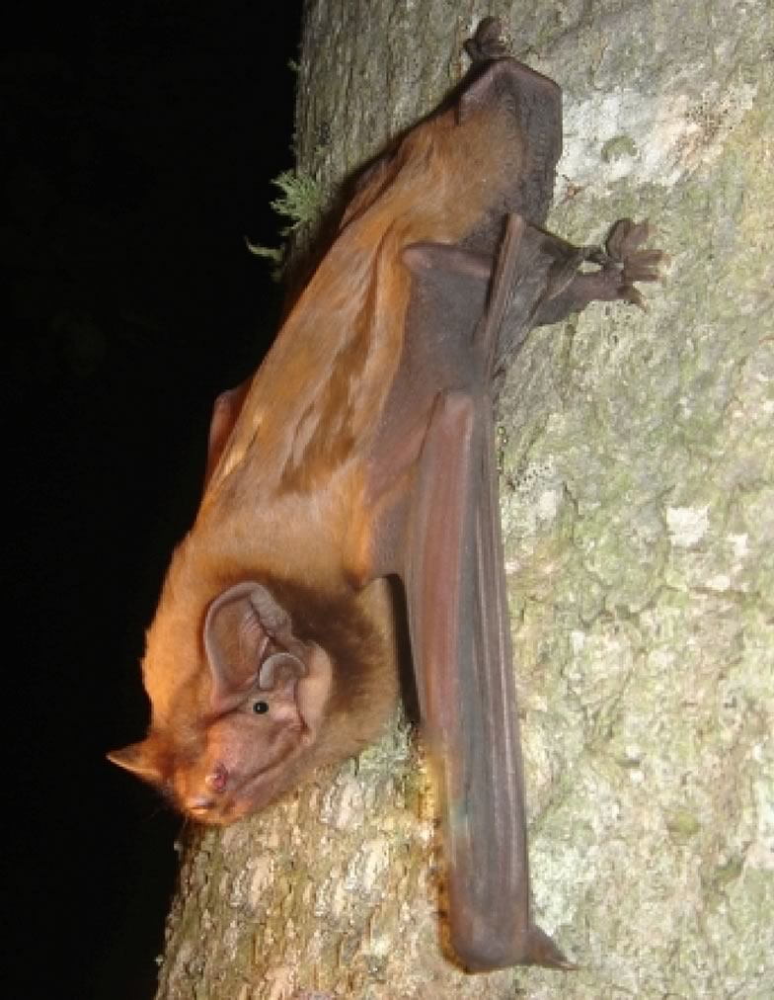

The Giant noctule is the largest bat species of Europe; it has mostly a Mediterranean distribution. Spanish colleagues thought they may feed on migratory passerines based on feathers found in their droppings in spring and fall. This surprising diet has been confirmed by stable isotopic analyses carried out in collaboration with our lab.

## Uni Bern supervisors

Fabio Bontadina, Raphaël Arlettaz

## External collaborators

Dr. Ana G. Popa-Lisseanu, Dr. Carlos Ibáñez, Doñana Biological Station, Seville, Spain

## Publications

Popa-Lisseanu, A.G., F. Bontadina & C. Ibáñez. 2009. Giant noctule bats face conflicting constraints between roosting and foraging in a fragmented and heterogeneous landscape. Journal of Zoology 278: 126-133. [(PDF, 428KB)](/files/giant_noctule_bat/Popa-Lisseanu_JZoo2009_eng.pdf)

Popa-Lisseanu, A.G., F. Bontadina, O. Mora, & C. Ibáñez. 2008. Highly structured fission fusion societies in an aerial-hawking, carnivorous bat. Animal Behaviour 75: 471-482. [(PDF, 324KB)](/files/giant_noctule_bat/Popa-Lisseanu_AniBeh2008_eng.pdf)

Popa-Lisseanu, A.G., A. Delgado-Huertas, M.G. Forero, A. Rodríguez, R. Arlettaz & C. Ibáñez. 2007. Bats’ Conquest of a Formidable Foraging Niche: The Myriads of Nocturnally Migrating Songbirds. PLoS ONE 2: e205. [(PDF, 232KB)](/files/giant_noctule_bat/Popa-Lisseanu_PLoSONE2007_eng.pdf)

Bontadina, F. & R. Arlettaz. 2003. A heap of feathers does not make a bat's diet. Functional Ecology 17: 141-142. [(PDF, 116KB)](/files/giant_noctule_bat/Bontadina_FunEco2003_eng.pdf)
