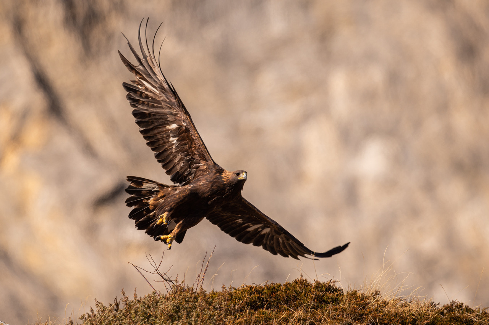

We investigate the movement ecology of golden eagles in the Swiss Alps to better predict topographic situations under which the installation of wind turbines would represent a risk of collision for this large soaring raptor. Our results provide recommendations for a wildlife-friendly installation of renewable energy infrastructure in the Alps. See this section of our website for more details: [https://www.cb.iee.unibe.ch/research/flying_vertebrates_vs_wind_turbines/index_eng.html](/research/flying-vertebrates-vs-wind-turbines/)

## Uni Bern supervisors

Sergio Vignali, Veronika Braunisch, Raphaël Arlettaz

## Publications

Vignali, S., V. Braunisch & R. Arlettaz. 2023. Large soaring raptors vs wind turbines development in the Swiss Alps. Unpublished final report, January 2023. Original maps are available upon request to [sergio.vignali@unibe.ch](mailto:sergio.vignali@unibe.ch)  [PDF](/files/flying_vertebrates_vs_wind_turbines/RaptorsVSWindTurbines_FinalReport_eng.pdf)
