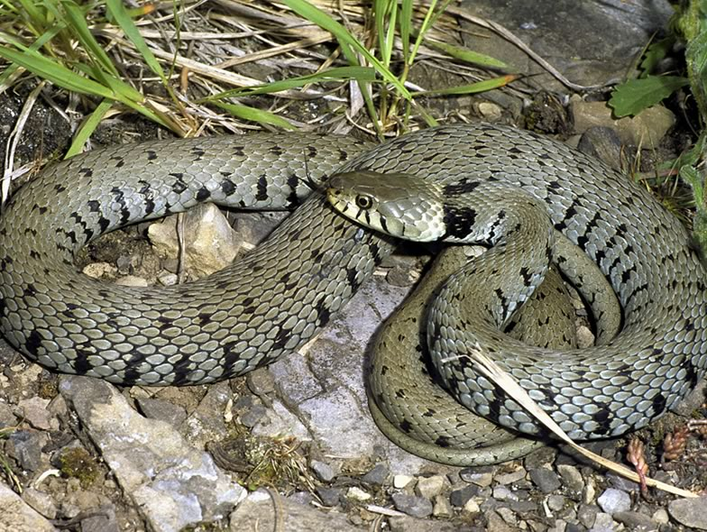

The Grass snake (*Natrix**natrix*) experienced a strong decline in the Swiss lowlands in the last century, mainly due to the dramatic loss and degradation of wetlands. Using radiotracking, we investigated the response of Grass snakes to species-specific measures implemented in an area of intensive agriculturearound the restoration of a drainage canal system and the development of a new road network. The study showed a preference of Grass snakes for edge habitats like riparian zones or woodland borders, although cereal fields were also heavily used during the post-oviposition phase (in summer), when the abundance of rodents peaked in them. In conservation areas and set-asides the snakes were using significantly smaller home ranges compared to individuals living in the surroundings of mixed forest patches. The restoration measures certainly help maintaining the species in farmland-dominated matrices.

## Uni Bern supervisors

Ulrich Hofer, Raphaël Arlettaz

## Publications

Wisler, C., U. Hofer & R. Arlettaz. 2008. Snakes and Monocultures: Habitat Selection and Movements of Female Grass Snakes (*Natrix natrix* L.) in an Agricultural Landscape. Journal of Herpetology 42: 337-346. [(PDF, 921KB)](/files/grass_snake/Wisler_JHerp2008_eng.pdf)

## Related Diploma thesis

Wisler, C. 2006. Habitat requirements of the Grass snake (*Natrix**natrix*L.) in a landscape dominated by intensive farmland: a first appreciation of conservation needs. Diploma Thesis, University of Bern. [PDF](/files/grass_snake/Wisler_Dipl2006_eng.pdf)
