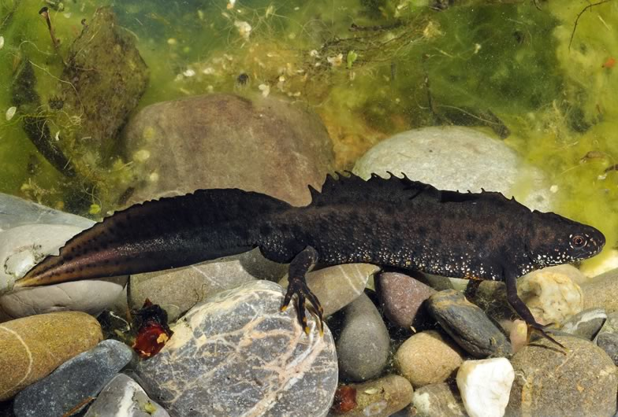

The Great crested newt (*Triturus cristatus*) is categorized as endangered on the Swiss redlist. The growing body of scientific evidence for massive declines of amphibians world-wide calls for cost-efficient monitoring schemes to inform conservation management. Our study compared the efficiency of flashlight surveys and trapping to assess the population status of Triturus cristatus in breeding ponds. We also tested how different sampling covariates affect detectability of the two sampling techniques. Finally, we compared the capture success of unbaited traps vs traps baited with light sticks.

## Uni Bern supervisor

Jérôme Pellet

## External collaborator

Dr. Benedikt R. Schmidt, KARCH, Neuchâtel, Switzerland

## Publications

Kröpfli, M., P. Heer & J. Pellet. 2010. Cost-effectiveness of two monitoring strategies for the great crested newt (*Triturus cristatus*). Amphibia-Reptilia 31: 403-410. [(PDF, 155KB)](/files/great_crested_newt/Kropfli_AmpRep2010_eng.pdf)

## Related Diploma/Master Thesis

Jenny, M. 2008. The decline of the Great Crested Newt in Switzerland: towards a recognition of causal factors. Diploma Thesis, University of Bern. [(PDF, 347KB)](/files/great_crested_newt/Jenny_Dipl2008_eng.pdf)
