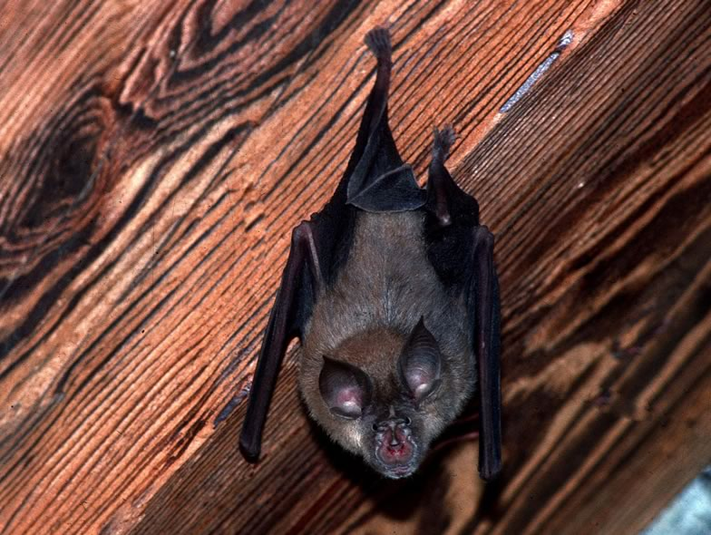

The Greater horseshoe is one of the rarest bat species of Central Europe. In Switzerland it is restricted to a few colonies in the Alps and close to the Jura mountains. In the late 1980s, the restoration of a church in Valais enabled us to improve roost conditions for the second largest nursery colony in Switzerland, which led to a subsequent population increase. The colony has been monitored continuously since then, with systematic ring-marking of the young cohorts. A capture-recapture analysis of these data within an integrated population dynamic modelling framework delivered crucial demographic information for a better preservation of this rare bat species beyond the study site. More recently we have run translocation experiments which proved suitable for the reinforcement of relict populations.

## Uni Bern supervisors

Fabio Bontadina, Michael Schaub, Raphaël Arlettaz

## External collaborator

Antoine Sierro, Swiss Ornithological Institute, Valais Field Station, Salquenen

## Publications

Sierro, A., A. Lugon & R. Arlettaz. 2009. La colonie de grands rhinolophes *Rhinolophus ferrumequinum* de l’église St-Sylve à Vex (Valais, Suisse) : évolution sur deux décennies (1986-2006). Le Rhinolophe 18: 75-82. [(PDF, 436KB)](/files/greater_horseshoe_bat/Sierro_Rhino2009_eng.pdf)

Weinberger, I.C., F. Bontadina & R. Arlettaz. 2009. Translocation as a conservation tool to supplement relict bat colonies: a pioneer study with endangered horseshoe bats. Endangered Species Research 8: 41-48. [(PDF, 307KB)](/files/lesser_horseshoe_bat/Weinberger_EdaSpecRes2009_eng.pdf)

Schaub, M., O. Gimenez, A. Sierro & R. Arlettaz. 2007. Use of Integrated Modeling to Enhance Estimates of Population Dynamics Obtained from Limited Data. Conservation Biology 21: 945-955. [(PDF, 1.7 MB)](/files/integrated_population_model/Schaub_ConBio2007_eng.pdf)

## Related Diploma/Master theses

Weinberger, I. 2007. Translocation as a conservation tool to supplement relict bat colonies: A pilot study with endangered horseshoe bats. Diploma Thesis, University of Bern.

Lugon, A. 1996. Ecologie du Grand Rhinolophe, *Rhinolophus ferrumequinum* (Chiroptera, Rhinolophidae) en Valais (Suisse): Habitat, Régime alimentaire et Stratégie de chasse. Diploma Thesis. University of Neuchâtel.
