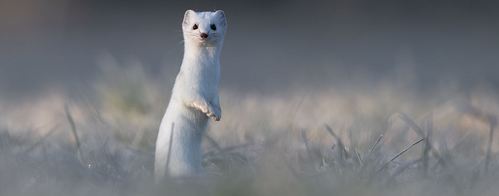

#### Aufruf zum Sammeln von genetischen Proben von Hermelin und Mauswiesel

Helfen Sie mit beim Sammeln! Für eine Studie zur Populationsstruktur von Hermelin und Mauswiesel sammelt die Universität Bern Proben. Ob Totfunde, Kotproben oder Hinweise zu aktuellen Vorkommen der Tiere – wir bedanken uns für jegliche Mithilfe. Detaillierte Informationen finden Sie auf dieser Seite:

- Link Flyer auf Deutsch ([PDF](/files/hermelinmauswiesel/230725_Wiesel-gesucht_Flyer_eng.pdf))
- Link Flyer en Français ([PDF](/files/hermelinmauswiesel/230725_Hermine-Cherche_Flyer_eng.pdf))
- Link Flyer in English ([PDF](/files/hermelinmauswiesel/FlyerinEnglish_Stoat_eng.pdf))
- Link Flyer in italiano ([PDF](/files/hermelinmauswiesel/it_flyer260414_Cercasi_ermellini_Flyer_eng.pdf))

#### Was genau suchen wir?

- Proben, die genetisches Material enthalten. Vorzugsweise Gewebeproben von toten Tieren oder Kotproben (siehe Bestimmungshilfe weiter unten). Aber auch andere Proben, wie beispielsweise Haare sammeln wir. Wir sind an neuen wie auch bereits gesammelten Proben interessiert, sollten Sie bereits solche besitzen.
- Orte, an dem die Tiere nesten oder sonst aktiv sind interessieren uns ebenfalls. Gerne nehmen wir Hinweise entgegen.

#### Wie wird gesammelt?

Beim Sammeln unbedingt Datum, Fundort (Koordinaten) und Sammler:in (inkl. Kontaktangaben) notieren und der Probe beilegen.

- Gewebe: Tote Tiere als Ganzes in einem Gefrierbeutel einfrieren.
- 1. Tiere nicht anfassen, da sie Krankheitserreger oder Parasiten tragen können! Gummihandschuhe verwenden oder einen Plastiksack wie ein Gummihandschuh überstülpen (wie ein «Robidog» Sack).
- 2. Den Plastiksack (verknotet oder im ZIP-Beutel) zusammen mit den Angaben in einen zweiten Plastiksack geben.
- 3. Alles zusammen einfrieren und mit uns Kontakt aufnehmen.

- Kot: Bevorzugt in einem Plastikröhrchen/Glas (es können auch saubere Konfitürengläser verwendet werden) einfrieren. Alternativ an der Luft trocknen und gleichermassen verpacken.
- Haare: In einem Plastikröhrchen/Glas (alternativ in einem Briefumschlag) vor Nässe und Sonneneinstrahlung schützen.

#### Wohin?

Kontaktieren Sie uns, wenn Sie eine Probe haben oder einen Ort kennen.

Telefon: 031 684 31 73

E-Mail: andrin.duerst@unibe.ch

- Abgabe: Muster können nach Absprache in unserem Büro (Muesmattstrasse 27, Büro 022, 3012 Bern) abgegeben werden.
- Versand: Ein Versand per Post ist möglich (Postadresse: Baltzerstrasse 6, CH-3012 Bern). Bitte beachten Sie, dass gefrorene Proben gut verpackt per A-Post und nicht über das Wochenende verschickt werden sollten.
- Abholung: Wir können die Proben auch direkt bei Ihnen abholen.

#### Bestimmung von Kot

Kot lässt sich vor allem auf Strukturen wie Ast-/Steinhaufen, Trockenmauern oder einzelnen Steinen finden. Oft wird er an exponierter, leicht erhöhter Position zur Markierung platziert. Als Hilfe zur Bestimmung des Kots von Kleinsäugern finden Sie hier eine Übersicht:

- Flyer Bestimmungshilfe für Kot auf Deutsch ([PDF](/files/hermelinmauswiesel/230310_Kot_Bestimmung_Marderartige_DE_eng.pdf))
- Flyer détermination crottes en Français ([PDF](/files/hermelinmauswiesel/230310_Determinationdescrottes_mustelides_FR_eng.pdf))

#### Das übergeordnete Projekt

Die Studie zur Populationsstruktur der Kleinmusteliden ist Teil des Projektes «Kleinstrukturen für die Biodiversität».

Weitere Informationen zu Projekt finden Sie [hier](/research/small-structures/).
