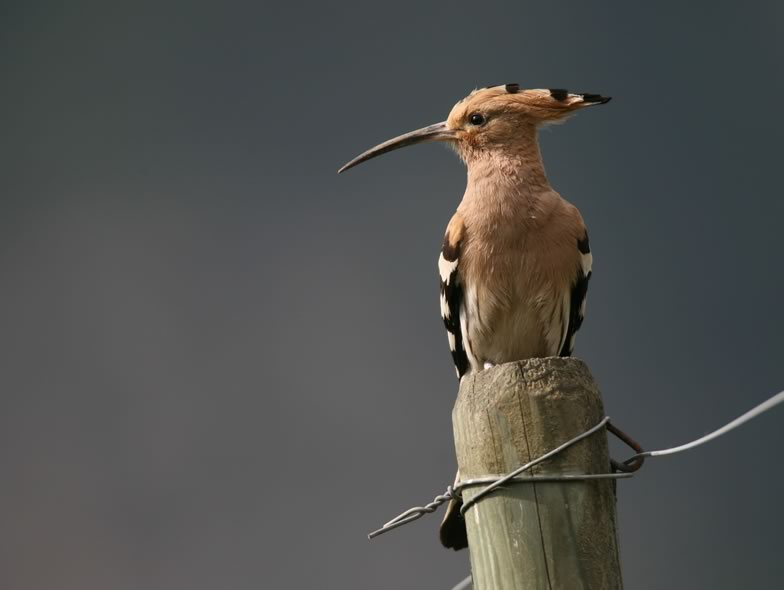

The Hoopoe is one of the most endangered bird species of Central Europe. In Switzerland it lives mostly on the plain of the Upper Rhone valley, in the Valais Alps. As the Valais population was steadily declining, the Swiss ornithological institute launched an evidence-based conservation programme in 1998. This led to a rapid recovery of the population within a few years. The Valais Hoopoe population has become one of our major research models. We have conducted research on habitat selection, diet, reproductive ecology, eco-toxicology, migration and population dynamics, and continue to work on this fascinating bird. Our results provide essential information for species preservation in Central European agroecosystems.

## Uni Bern supervisors

Alain Jacot, Michael Schaub, Raphaël Arlettaz

## Publications

Barón, M.D., M. Martín-Vivaldi, E. Martínez-Renau, R. Arlettaz, D. Engelbrecht, C. Enkvist, E.L. Jansen van Rensburg, Z. Lu, A. Martín-Platero, M. Martínez-Bueno, Á. Martínez-García, C. Ruiz-Castellano, M. Schaub, M.T. Stanback, T.M.F.N.van de Ven, E. Videvall, L. Wei & J.J. Soler. 2026. Functional phylosymbiosis in birds: phylogeny and antimicrobial properties of bacterial symbionts in Bucerotiformes. Animal Microbiome 8: article number 116. [PDF](/files/publications/Baron_AniMbm2026_eng.pdf)

Schaub, M., R. Arlettaz, I. Zwahlen & E.C. Martin. 2026. Estimating seasonal survival of migratory birds using continuous-time capture–recapture models. Ecological Applications 36: e70301. [PDF](/files/publications/Schaub_EcoApp2026_eng.pdf)

Martín-Vivaldi, M., Á. Martínez-García, J.M. Peralta-Sánchez, M. Schaub, R. Arlettaz, A.M. Martín-Platero, E. Martínez-Renau, M.D. Barón, M. Ruiz-Rodríguez, E. López-Hernández, M. Martínez-Bueno, E. Valdivia & J.J. Soler. 2026. The uropygial gland of the European hoopoe as a symbiotic organ. Animal Microbiome 8: article number 55. [PDF](/files/publications/Martin-Vivaldi_AniMbm2026_eng.pdf)

Plard, F., R. Arlettaz, A. Jacot & M. Schaub. 2020. Disentangling the spatial and temporal causes of decline in a bird population. Ecology and Evolution 10: 6906-6918. [(PDF, 789KB)](/files/hoopoe/Plard_EcoEvo2020_eng.pdf)

Plard, F., R. Arlettaz & M. Schaub. 2018. Hoopoe males experience intra‑seasonal while females experience inter‑seasonal reproductive costs. Oecologia 186: 665-675. [(PDF, 827KB)](/files/hoopoe/Plard_Oec2018_eng.pdf)

van Wijk, R.E., M. Schaub, S. Hahn, N. Juárez-García-Pelayo, B. Schäfer, L. Viktora, M. Martín-Vivaldi, M. Zischewski & S. Bauer. 2018. Diverse migration strategies in hoopoes (*Upupa epops*) lead to weak spatial but strong temporal connectivity. The Science of Nature 105: article 42. [(PDF, 1.2 MB)](/files/hoopoe/vanWijk_SciNat2018_eng.pdf)

Souchay, G., R.E. van Wijk, M. Schaub & S. Bauer. 2018. Identifying drivers of breeding success in a long-distance migrant using structural equation modelling. Oikos 127: 125-133. [(PDF, 498KB)](/files/hoopoe/Souchay_Oik2018_eng.pdf)

Plard, F., S. Schindler, R. Arlettaz & M. Schaub. 2018. Sex-Specific Heterogeneity in Fixed Morphological Traits Influences Individual Fitness in a Monogamous Bird Population. The American Naturalist 191: 106-119. [(PDF, 1.6 MB)](/files/hoopoe/Plard_AmeNat2018_eng.pdf)

Hildebrandt, B. & M. Schaub. 2018. The effects of hatching asynchrony on growth and mortality patterns in Eurasian Hoopoe *Upupa epops* nestlings. Ibis 160: 145-157. [(PDF, 740KB)](/files/hoopoe/Hildebrandt_Ibis2018_eng.pdf)

van Wijk, R.E., M. Schaub & S. Bauer. 2017. Dependencies in the timing of activities weaken over the annual cycle in a long-distance migratory bird. Behavioral Ecology and Sociobiology 71: art. 73. [(PDF, 2.5 MB)](/files/hoopoe/vanWijk_BehEcoSobio2017_eng.pdf)

van Wijk, R.E., S. Bauer & M. Schaub. 2016. Repeatability of individual migration routes, wintering sites, and timing in a long-distance migrant bird. Ecology and Evolution 6: 8679-8685. [(PDF, 510KB)](/files/hoopoe/vanWijk_EcoEvo2016_eng.pdf)

Guillod, N., R. Arlettaz & A. Jacot. 2016. Impact of spatial variation of a crucial prey, the molecricket, on hoopoe territory occupancy and reproduction. Journal of Avian Biology 47: 697-705. [(PDF, 1.1 MB)](/files/hoopoe/Guillod_JAviBio2016_eng.pdf)

Ryser, S., N. Guillod, C. Bottini, R. Arlettaz & A. Jacot. 2016. Sex-specific food provisioning patterns by parents in the asynchronously hatching European hoopoe. Animal Behaviour 117: 15-20. [(PDF, 368KB)](/files/hoopoe/Ryser_AniBeh2016_eng.pdf)

van Wijk, R.E., G. Souchay, S. Jenni-Eiermann, S. Bauer & M. Schaub. 2016. No detectable effects of lightweight geolocators on a Palaearctic-African long-distance migrant. Journal of Ornithology 157:255-264. [(PDF, 343KB)](/files/hoopoe/vanWijk_JOrn2016_eng.pdf)

Hoffmann, J., E. Postma, and M. Schaub. 2015. Factors influencing double brooding in Eurasian Hoopoes *Upupa epops*. Ibis 157:17-30. [(PDF, 297KB)](/files/hoopoe/Hoffmann_Ibis2015_eng.pdf)

Tschumi, M., M. Schaub & R. Arlettaz. 2014. Territory Occupancy and Parental Quality as Proxies for Spatial Prioritization of Conservation Areas. PLoS ONE 9: e97679. [(PDF, 363KB)](/files/hoopoe/Tschumi_PLoSONE2014_eng.pdf)

Schmid, B., L. Tam-Dafond, S. Jenni-Eiermann, R. Arlettaz, M. Schaub & L. Jenni. 2013. Modulation of the adrenocortical response to acute stress with respect to brood value, reproductive success and survival in the Eurasian hoopoe. Oecologia 173: 33-44. [(PDF, 272KB)](/files/hoopoe/Schmid_Oec2013_eng.pdf)

Reichlin, T.S., K.A. Hobson, S.L. Van Wilgenburg, M. Schaub, L.I. Wassenaar, M. Martín-Vivaldi, R. Arlettaz & L. Jenni. 2013. Conservation through connectivity: can isotopic gradients in Africa reveal winter quarters of a migratory bird? Oecologia 171: 591-600. [(PDF, 405KB)](/files/hoopoe/Reichlin_Oec2013_eng.pdf)

Vickery, J. & R. Arlettaz. 2012. The importance of habitat heterogeneity at multiple scales for birds in European agricultural landscapes. In: Birds and Habitat: Relationships in Changing Landscapes (ed. R.J. Fuller), pp. 177-204. Cambridge University Press, Cambridge. [(PDF, 3.3 MB)](/files/vineyards/VickeryArlettaz_in_Fuller2012_eng.pdf)

Berthier, K., F. Leippert, L. Fumagalli, & R. Arlettaz. 2012. Massive Nest-Box Supplementation Boosts Fecundity, Survival and Even Immigration without Altering Mating and Reproductive Behaviour in a Rapidly Recovered Bird Population. PLoS ONE 7: e36028. [(PDF, 152KB)](/files/hoopoe/Berthier_PLoSONE2012_eng.pdf)

Bötsch, Y., R. Arlettaz & M. Schaub. 2012. Breeding dispersal of Eurasian Hoopoes (*Upupa epops*) within and between years in relation to reproductive success, sex, and age. The Auk 129: 283-295 (plus 7 pages of supplementary material). [(PDF, 1.0 MB)](/files/hoopoe/Botsch_Auk2012_eng.pdf)

Schaub, M., T.S. Reichlin, F. Abadi, M. Kéry, L. Jenni & R. Arlettaz. 2012. The demographic drivers of local population dynamics in two rare migratory birds. Oecologia 168: 97-108. [(PDF, 413KB)](/files/hoopoe/Schaub_Oec2012_eng.pdf)

Tagmann-Ioset, A., M. Schaub, T.S. Reichlin, N. Weisshaupt & R. Arlettaz. 2012. Bare ground as a crucial habitat feature for a rare terrestrially foraging farmland bird of Central Europe. Acta Oecologica 39: 25-32. [(PDF, 934KB)](/files/hoopoe/Tagmann-Ioset_ActOec2012_eng.pdf)

Arlettaz, R., M. Schaad, T.S. Reichlin & M. Schaub. 2010. Impact of weather and climate variation on Hoopoe reproductive ecology and population growth. Journal of Ornithology 151: 889-899. [(PDF, 346KB)](/files/hoopoe/Arlettaz_JOrn2010b_eng.pdf)

Arlettaz, R., M. Schaub, J. Fournier, T.S. Reichlin, A. Sierro, J. Watson & V. Braunisch. 2010. From publications to public actions: when conservation biologists bridge the gap between research and implementation. BioScience 60: 835-842. [(PDF, 8.4 MB)](/files/research_implementation/Arlettaz_BioSci2010_eng.pdf)

Bächler, E., S. Hahn, M. Schaub, R. Arlettaz, L. Jenni, J.W. Fox, V. Afanasyev & F. Liechti. 2010. Year-Round Tracking of Small Trans-Saharan Migrants Using Light-Level Geolocators. PLoS ONE 5: e9566. [(PDF, 726KB)](/files/hoopoe/Bachler_PLoSONE2010_eng.pdf)

Schaub, M., N. Martinez, A. Tagmann-Ioset, N. Weisshaupt, M.L. Maurer, T.S. Reichlin, F. Abadi, N. Zbinden, L. Jenni & R. Arlettaz. 2010. Patches of Bare Ground as a Staple Commodity for Declining Ground-Foraging Insectivorous Farmland Birds. PLoS ONE 5:e13115  [(PDF, 755KB)](/files/vineyards/Schaub_PLoSONE2010_eng.pdf)

Reichlin, T.S., M. Schaub, M.H.M. Menz, M. Mermod, P. Portner, R. Arlettaz & L. Jenni. 2009. Migration patterns of Hoopoe *Upupa epops* and Wryneck *Jynx torquilla* : an analysis of European ring recoveries. Journal of Ornithology 150: 393-400. [(PDF, 1.4 MB)](/files/hoopoe/Reichlin_JOrn2009_eng.pdf)

Fournier, J. & R. Arlettaz. 2001. Food provision to nestlings in the Hoopoe *Upupa epops*: implications for the conservation of a small endangered population in the Swiss Alps. Ibis 143: 2-10. [(PDF, 1.3 MB)](/files/hoopoe/Fournier_Ibis2001_eng.pdf)

Arlettaz, R., J. Fournier, and N. Zbinden. 2000. Evolution démographique (1979-1998) d'une population témoin de Huppe fasciée *Upupa epops* en Valais et stratégie de conservation ciblée. Nos Oiseaux 47:19-27. [(PDF, 3.2 MB)](/files/hoopoe/Arlettaz_NosOis2000_eng.pdf)

## Related PhD Theses

Abadi Gebreselassie, F. 2010. Regulation of local bird populations: Deeper insights from integrated population models. PhD Thesis, University of Bern. [PDF](/files/hoopoe/AbadiGebreselassie_PhD2010copy_eng.pdf)

Reichlin, T.S. 2009. Population dynamics of two endangered bird species, *Upupa epops* and *Jynx torquilla*, in Valais (Switzerland). PhD Thesis, University of Bern. [(PDF, 4.8 MB)](/files/hoopoe/Reichlin_PhD2009_eng.pdf)

## Related Diploma/Master theses

Studer, L. 2025. Post-fledging movement behaviour of juvenile Eurasian Hoopoes (*Upupa epops*) in the Rhone Valley (CH). Master Thesis. University of Bern.

Felder, R. 2024. Climate and carry-over effects regulate post-fledging survival of the European Hoopoe (*Upupa epops*). Master Thesis. University of Bern. [PDF](/files/hoopoe/Felder_MSc2024_eng.pdf)

Bühler, R.H. 2016. Sex-specific foraging niches and habitat selection in an asynchronously breeding bird, the European hoopoe *Upupa epops*. Master Thesis. University of Bern. [PDF](/files/hoopoe/Buhler_MSc2016_eng.pdf)

Guillod, N. 2013. Landscape of prey in a hoopoe population: consequences of spatial variation of molecricket availability on reproductive success and conservation strategies. Master Thesis. University of Bern. [PDF](/files/hoopoe/Guillod_MSc2013copy_eng.pdf)

Ryser, S. 2012. Prey delivery strategy at nestbox determines differential food allocation to nestlings by male and female Hoopoe parents. Master Thesis, University of Bern. [(PDF, 310KB)](/files/hoopoe/Ryser_MSc2012_eng.pdf)

Bötsch, Y. 2010. Breeding dispersal of hoopoes in relation to reproductive success, sex and age. Master Thesis, University of Bern. [(PDF, 463KB)](/files/hoopoe/Botsch_MSc2010pdf_eng.pdf)

Tschumi, M. 2010. Breeding territory occupancy in hoopoes: governed by habitat quality or phenotypic traits? Master Thesis, University of Bern. [(PDF, 4.9 MB)](/files/hoopoe/Tschumi_MSc2010_eng.pdf)

Portner, P. 2008. Determinants of reproductive success in an endangered, recovering hoopoe population. Diploma Thesis, University of Bern. [(PDF, 5.7 MB)](/files/hoopoe/Portner_Dipl2008_eng.pdf)

Ioset, A. 2007. The importance of bare ground for terrestrially foraging insectivorous farmland birds: a case study of the endangered Hoopoes (*Upupa epops*). Diploma Thesis, University of Bern. [(PDF, 387KB)](/files/hoopoe/Ioset_Dipl2007_eng.pdf)

Leippert, F. 2005. May the availability of an unlimiting offer of artificial breeding sites induce detrimental density-dependent effects on the reproductive behaviour of an endangered, recovering Hoopoe (*Upupa e. epops*) population? Diploma Thesis, University of Bern. [PDF](/files/hoopoe/Leippert_MSc2005copy_eng.pdf)

Berger, T. 2004. Pesticide and PCB contamination in a small population of the Hoopoe (*Upupa epops*) in Switzerland and toxicological implications. Diploma Thesis, University of Bern, EPF Lausanne and University of Fribourg. [(PDF, 501KB)](/files/hoopoe/Berger_Dipl2004_eng.pdf)

Schaad, M. 2002. Influence of weather conditions on chick provisioning activity in the Hoopoe (*Upupa e. epops*). Diploma Thesis, University of Bern. [(PDF, 2.1 MB)](/files/hoopoe/Schaad_Dipl2002_eng.pdf)
