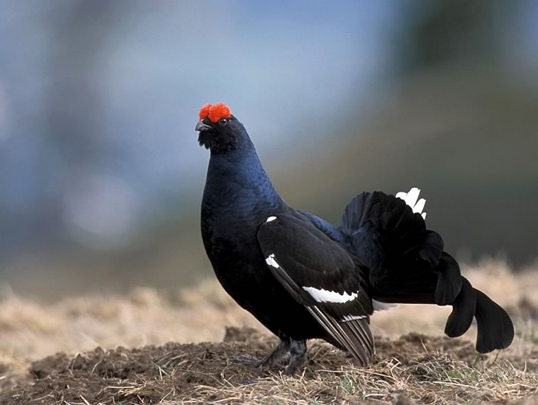

Currently, this division has six main research axes. A first programme investigates how to improve biodiversity status through appropriate farming management, with a major focus on lowland extensively managed hay meadows and traditionally used upland hay meadows as well as on vineyards. A second module studies how forest biodiversity can be maintained and promoted through adaptive management in the face of climate change; here we work mostly with emblematic vertebrate species that are rare and under threat. A third module aims at better understanding the seasonality of survival in rare migratory species to decipher the threats affecting population dynamics at different stages of their life cycle in order to take appropriate action. A fourth research programme deals with the effects of outdoor recreation, notably winter snowsports, on upland and Alpine biodiversity, seeking solutions for a more balanced human-wildlife coexistence. In a fifth module, we test the efficiency of conservation and restoration measures on rare emblematic species, especially birds and amphibians, with the idea to improve conservation action. Our last research module focuses on the socio-ecological drivers of biodiversity change and attitudes of humans towards nature and biodiversity, seeking solutions for a better uptake by society and policy-makers of the conservation recommendations that are formulated by science.

