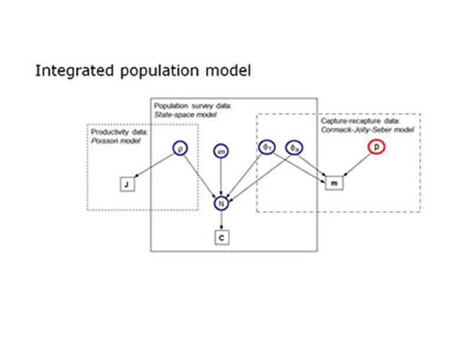

While there exist many statistical methods to study single demographic parameters or the population growth rate (e.g. time-series analyses, capture-recapture methods), the development of models that make simultaneous use of all possible pieces of information about individuals from a local population (e.g. capture-recapture data, reproductive success, census data) to estimate demographic and population growth rates has only just begun. Such integrated population models have very useful features: demographic parameters for which no explicit data sampling has been conducted can still be estimated and the precision of the parameter estimates is increased. Increased precision of the parameter estimates is important because the power to detect possible reasons for the temporal variation increases.
This study aims to further develop and understand integrated population models using Bayesian statistics, and to apply these models in case studies. It is funded by the Swiss National Science Foundation.

## Uni Bern supervisor

Michael Schaub

## External collaborator

Dr. Olivier Gimenez, CNRS Montpellier, France

## Publications

Schaub, M. & D. Fletcher. 2015. Estimating immigration using a Bayesian integrated population model: choice of parametrization and priors. Environmental and Ecological Statistics 22: 535-549. [(PDF, 545KB)](/files/integrated_population_model/Schaub_EnvEcoSta2015_eng.pdf)

Abadi, F., O. Gimenez, H. Jakober, W. Stauber, R. Arlettaz & M. Schaub. 2012. Estimating the strength of density dependence in the presence of observation errors using integrated population models. Ecological Modelling 242: 1-9. [(PDF, 535KB)](/files/integrated_population_model/Abadi_EcoMod2012_eng.pdf)

Schaub, M. & F. Abadi. 2011. Integrated population models: a novel analysis framework for deeper insights into population dynamics. Journal of Ornithology 152: S227-S237. [(PDF, 299KB)](/files/integrated_population_model/Schaub_JOrn2011_eng.pdf)

Abadi, F., O. Gimenez, R. Arlettaz & M. Schaub. 2010. An assessment of integrated population models: bias, accuracy, and violation of the assumption of independence. Ecology 91: 7-14. [(PDF, 163KB)](/files/integrated_population_model/Abadi_Eco2010_eng.pdf)

Abadi, F., O. Gimenez, B. Ullrich, R. Arlettaz & M. Schaub. 2010. Estimation of immigration rate using integrated population models. Journal of Applied Ecology 47: 393-400. [(PDF, 337KB)](/files/integrated_population_model/Abadi_JAppEco2010_eng.pdf)

Schaub, M., A. Aebischer, O. Gimenez, S. Berger & R. Arlettaz. 2010. Massive immigration balances high anthropogenic mortality in a stable eagle owl population: Lessons for conservation. Biological Conservation 143:1911-1918. [(PDF, 296KB)](/files/electricity_networks/Schaub_BioCon2010_eng.pdf)

Baillie, S.R. & M. Schaub. 2009. Understanding changes in bird populations – the role of bird marking. Ringing & Migration 24: 189-198. [(PDF, 221KB)](/files/integrated_population_model/Baillie_RinMig2009_eng.pdf)

Schaub, M., O. Gimenez, A. Sierro & R. Arlettaz. 2007. Use of Integrated Modeling to Enhance Estimates of Population Dynamics Obtained from Limited Data. Conservation Biology 21: 945-955. [(PDF, 1.7 MB)](/files/integrated_population_model/Schaub_ConBio2007_eng.pdf)

## Related PhD Thesis

Abadi Gebreselassie, F. 2010. Regulation of local bird populations: Deeper insights from integrated population models. PhD Thesis, University of Bern.
