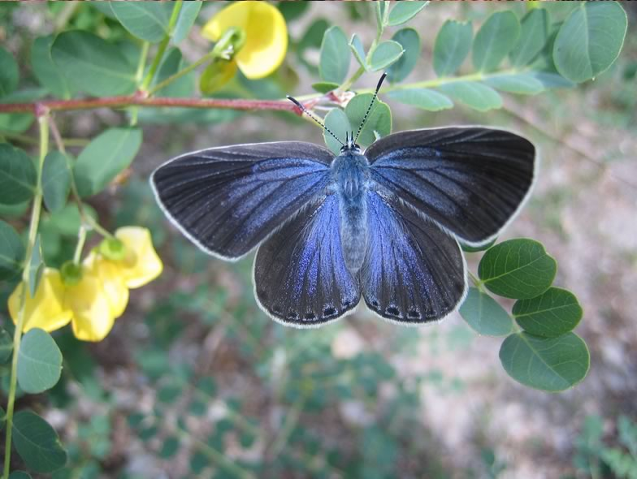

The Iolas blue (Iolana iolas) is one of the most endangered butterfly species in Switzerland. Its survival depends on the availability of the bladder senna (Colutea arborescens), which represents the main plant host for the larvae and the main provider of nectar for the adults. Nowadays the Swiss distribution of the Iolas blue is restricted to two areas in central Valais, where it occurs in only very low numbers. In order to prevent a local extinction of this largest member of the Lycaenidae, a restoration program was launched in 2000. It consists of planting bladder senna bushes on south-exposed slopes, mostly within or near vineyards. We evaluated the effectiveness of the restoration scheme in order to provide evidence-based suggestions for its improvement.

## Uni Bern supervisors

Jérôme Pellet, Raphaël Arlettaz

## External collaborator

Antoine Sierro, Swiss Ornithological Institute, Valais Field Station, Salquenen

## Publications

Heer, P., J. Pellet, A. Sierro & R. Arlettaz. 2013. Evidence-based assessment of butterfly habitat restoration to enhance management practices. Biodiversity and Conservation 22: 239-252. [(PDF, 262KB)](/files/iolas_blue/Heer_BiodivCon2013_eng.pdf)

Pellet, J., J.T. Bried, D. Parietti, A. Gander, P.O. Heer, D. Cherix & R. Arlettaz. 2012. Monitoring Butterfly Abundance: Beyond Pollard Walks. PLoS ONE 7: e41396. [(PDF, 396KB)](/files/iolas_blue/Pellet_PLoSONE2012_eng.pdf)

Heer, P., J. Pellet, A. Sierro & R. Arlettaz. 2011. Neue Erkenntnisse zum Schutz und zur Ökologie des Blasenstrauchbläulings *Iolana iolas* (Ochsenheimer, 1816). Entomo Helvetica 4: 111-127. [(PDF, 3.7 MB)](/files/iolas_blue/Heer_EntHel2011_eng.pdf)

## Related Diploma/Master thesis

Heer, P. 2011. Conservation ecology of the endangered Iolas blue *Iolana iolas* (Lepidoptera, Lycaenidae): enhancing monitoring schemes and habitat restoration. Master Thesis, University of Bern. [(PDF, 322KB)](/files/iolas_blue/Heer_MSc2011_eng.pdf)
