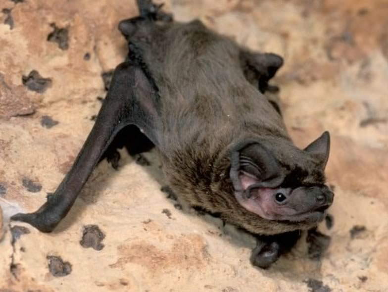

During the past decades deciduous woodland has undergone major structural changes in Europe. We investigated the ecological value of traditional chestnut orchards in Southern Switzerland in the framework of the SELPI project. Using bioacoustic methods, we found high bat activity and diversity in the newly managed woodlands compared to the abandoned ones. Restored woodlands turned out to be of major importance as stop-over site for the migratory Leisler's bat Nyctalus leisleri. The ecology of this endangered species was examined by radiotracking of foraging and roosting habitats in order to identify the key features for a sound conservation. Monitoring data over 20 years revealed a complicated social population structure and a population dynamics mainly driven by adult survival. The results support an appropriate traditional management of chestnut orchards in order to keep the attractiveness for this migratory bat.

## Uni Bern supervisors

Fabio Bontadina, Raphaël Arlettaz

## External collaborators

Dr. Marco Moretti, Swiss Federal Institute for Forest, Snow and Landscape Research WSL, Bellinzona

Nicola Zambelli, Marzia Mattei-Roesli, Centro Protezione Chirotteri Ticino, Semione, Switzerlan

## Publications

Szentkuti, S., F. Bontadina, M. Spada, M. Moretti, N. Zambelli, A. Martinoli & R. Arlettaz. 2013. Factors underlying migratory bat aggregations in chestnut groves. Endangered Species Research 21:105-114.  [(PDF, 633KB)](/files/leisler_s_bat/Szentkuti_EdaSpecRes2013_eng.pdf)

Obrist, M.K., E. Rathey, F. Bontadina, A. Martinoli, M. Conedera, P. Christe & M. Moretti. 2011. Response of bat species to sylvo-pastoral abandonment. Forest Ecology and Management 261:789-798. [(PDF, 653KB)](/files/leisler_s_bat/Obrist_ForEcoMan2011_eng.pdf)

Schorcht, W., F. Bontadina & M. Schaub. 2009. Variation of adult survival drives population dynamics in a migrating forest bat. Journal of Animal Ecology 78: 1182-1190. [(PDF, 221KB)](/files/leisler_s_bat/Schorcht_JAniEco2009_eng.pdf)

Zambelli, N., M. Moretti, M. Mattei-Roesli & F. Bontadina. 2009. Negative consequences of forearm bands that are too small for bats. Acta Chiropterologica 11: 216-219. [(PDF, 252KB)](/files/leisler_s_bat/Zambelli_ActChi2009_eng.pdf)

Spada, M., S. Szentkuti, N. Zambelli, M. Mattei-Roesli, M. Moretti, F. Bontadina, R. Arlettaz, G. Tosi, & A. Martinoli. 2008. Roost selection by non-breeding Leisler's bats (*Nyctalus leisleri*) in montane woodlands: implications for habitat management. Acta Chiropterologica 10: 81-88. [(PDF, 96KB)](/files/leisler_s_bat/Spada_ActChi2008_eng.pdf)

## Related Diploma/Master Theses

Szentkuti, S. 2006. Do traditionally managed chestnut orchards represent optimal foraging and roosting habitats for the rare Leisler's bat (*Nyctalus leisleri*)? Diploma Thesis, University of Bern. [(PDF, 323KB)](/files/leisler_s_bat/Szentkuti_Dipl2006_eng.pdf)
