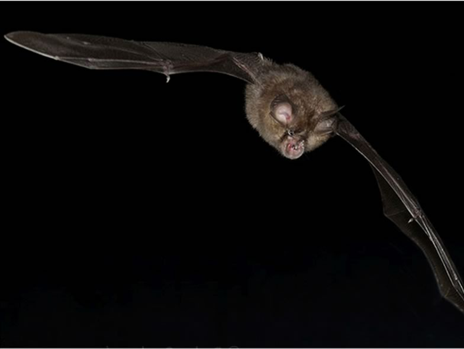

*Rhinolophus hipposideros* is probably the bat species which has faced the most dramatic decline of any Central European bats, with regional extinction in several areas such as Germany, Northern and Western Switzerland. We have launched an applied research programme («Rhippos») for understanding the reasons for its decline, looking at patterns of resources exploitation (diet composition and selection, habitat selection, impact of pesticides). Our results indicate that the species is a generalist forest forager which would still today find suitable foraging conditions in most parts of Switzerland, including in the lowlands. It seems that the past use of some pesticides, particularly DDT for timber treatment in building attics, may be the main factor having caused its decline. The banning of these substances in the 1970s may explain the current recovery of many populations. However, habitat fragmentation still represents the main obstacle to recolonisation of the former range. Translocations of individuals from thriving populations into relict populations may be a solution, but our first trials in that direction were not encouraging.

## Uni Bern supervisors

Fabio Bontadina, Raphaël Arlettaz

## Publications

Weinberger, I.C., F. Bontadina & R. Arlettaz. 2009. Translocation as a conservation tool to supplement relict bat colonies: a pioneer study with endangered horseshoe bats. Endangered Species Research 8: 41-48. [(PDF, 307KB)](/files/lesser_horseshoe_bat/Weinberger_EdaSpecRes2009_eng.pdf)

Bontadina, F., S.F. Schmied, A. Beck & R. Arlettaz. 2008. Changes in prey abundance unlikely to explain the demography of a critically endangered Central European bat. Journal of Applied Ecology 45: 641-648. [(PDF, 182KB)](/files/lesser_horseshoe_bat/Bontadina_JAppEco2008_eng.pdf)

Bontadina, F., T. Hotz & K. Märki. 2006. Die Kleine Hufeisennase im Aufwind. Ursachen der Bedrohung, Lebensraumansprüche und Förderung einer Fledermausart. Haupt Verlag, Bern.

Bontadina, F., H. Schofield & B. Naef-Daenzer. 2002. Radio-tracking reveals that lesser horseshoe bats (*Rhinolophus hipposideros*) forage in woodland. Journal of Zoology 258: 281-290. [(PDF, 127KB)](/files/lesser_horseshoe_bat/Bontadina_JZoo2002_eng.pdf)

## Related PhD Thesis

Bontadina, F. 2002. Conservation ecology in the horseshoe bats *Rhinolophus ferrumequinum* and *Rhinolophus hipposideros*. PhD Thesis, University of Bern.

## Related Diploma/Master theses

Weinberger, I. 2007. Translocation as a conservation tool to supplement relict bat colonies: A pilot study with endangered horseshoe bats. Diploma Thesis, University of Bern. [PDF](/files/lesser_horseshoe_bat/Weinberger_Dipl2007copy_eng.pdf)

Schmied, S. 2003. Does food scarcity limit the current distribution of the once widespread lesser horseshoe bat (*Rhinolophus hipposideros*)? Diploma Thesis, University of Bern. [PDF](/files/lesser_horseshoe_bat/Schmied_Dipl2003copy_eng.pdf)
