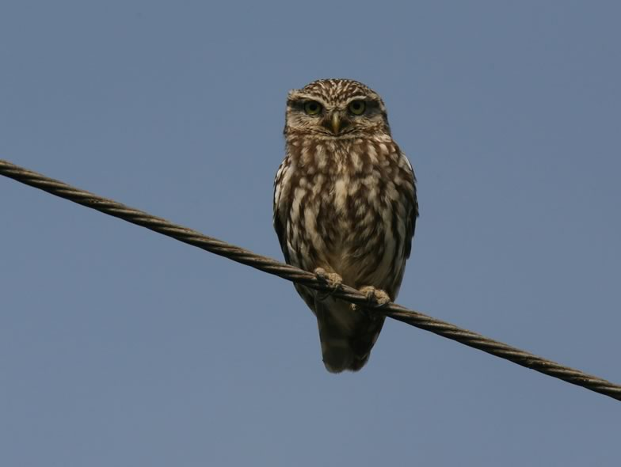

We studied the demographic mechanisms that are responsible for the dynamics of four little owl populations. We estimated all relevant demographic parameters and assessed how much their temporal variance contributed to the temporal variance of the population growth rate. We found that the temporal variation of survival was the most important demographic mechanism for the variation of the population growth rates, but that immigration was also important in all populations. We also applied an integrated population model to one of the study populations with the aim to model immigration as a function of food availability. We found immigration to the population to be higher in years with high vole density, thus, local food availability had an effect on the dispersal behaviour of the owls. Of conservation relevance is the insight, that local little populations can only survive, if they are part of a larger system of spatially structured populations. Successful conservation is thus only possible if the measures extend over large areas. How large these areas needs to be (i.e., how many breeding pairs the system needs to have), is still an open question.

## Uni Bern supervisor

Michael Schaub

## Publications

Apolloni, N., M.U. Grüebler, R. Arlettaz, T.K. Gottschalk & B. Naef-Daenzer. 2018. Habitat selection and range use of little owls in relation to habitat patterns at three spatial scales. Animal Conservation 21: 65-75. [(PDF, 920KB)](/files/little_owl/Apolloni_AniCon2018_eng.pdf)

Abadi, F., O. Gimenez, B. Ullrich, R. Arlettaz & M. Schaub. 2010. Estimation of immigration rate using integrated population models. Journal of Applied Ecology 47: 393-400. [(PDF, 337KB)](/files/integrated_population_model/Abadi_JAppEco2010_eng.pdf)

Schaub, M., B. Ullrich, G. Knötzsch, P. Albrecht & C. Meisser. 2006. Local population dynamics and the impact of scale and isolation: a study on different little owl populations. Oikos 115: 389-400. [(PDF, 252KB)](/files/little_owl/Schaub_Oik2006_eng.pdf)

## Related Master thesis

Apolloni, N. 2013. Landscape use, foraging habitat selection and relationships to food resources in breeding little owls: recognizing the importance of scale for species conservation management. Master Thesis, University of Bern. [(PDF, 2.9 MB)](/files/little_owl/Apolloni_MSc2013_eng.pdf)
