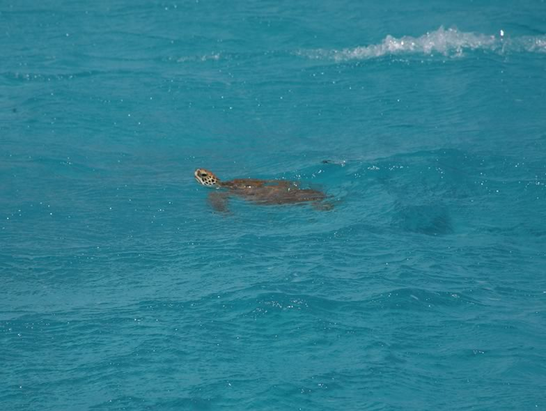

As many sea turtles worldwide, Loggerheads decline in many places, including the Mediterranean. We launched a project on Zakynthos, Greece, to better understand what is affecting this largest rookery in the Mediterranean. We first looked at nesting beach conditions and nesting choice by the turtles; second, we assessed with satellite telemetry the whereabouts and winter grounds of several individuals during the non-breeding season. Finally we investigated extra-pair paternity in the context of climate warming which may alter the sex ratio in the breeding population. This information is now used to enhance the conservation management of this major rookery.

## Uni Bern supervisors

Adrian Aebischer, Raphaël Arlettaz

## External collaborator

Dimitris Margaritoulis, ARCHELON, The Sea Turtle Protection Society of Greece, Athens, Greece

## Publications

Zbinden, J.A., A. Aebischer, D. Margaritoulis & R. Arlettaz. 2008. Important areas at sea for adult loggerhead sea turtles in the Mediterranean Sea: satellite tracking corroborates findings from potentially biased sources. Marine Biology 153: 899-906. [(PDF, 293KB)](/files/loggerhead_sea_turtle/Zbinden_MarBio2008_eng.pdf)

Zbinden, J.A., A. Aebischer, D. Margaritoulis & R. Arlettaz. 2007. Insights into the management of sea turtle internesting area through satellite telemetry. Biological Conservation 137: 157-162. [(PDF, 401KB)](/files/loggerhead_sea_turtle/Zbinden_BioCon2007_eng.pdf)

Zbinden, J.A., C.R. Largiadèr, F. Leippert, D. Margaritoulis & R. Arlettaz. 2007. High frequency of multiple paternity in the largest rookery of Mediterranean loggerhead sea turtles. Molecular Ecology 16: 3703-3711. [(PDF, 206KB)](/files/loggerhead_sea_turtle/Zbinden_MolEco2007_eng.pdf)

Zbinden, J.A., C. Davy, D. Margaritoulis & R. Arlettaz. 2007. Large spatial variation and female bias in the estimated sex ratio of loggerhead sea turtle hatchlings of a Mediterranean rookery. Endangered Species Research 3: 305-312. [(PDF, 411KB)](/files/loggerhead_sea_turtle/Zbinden_EdaSpecRes2007_eng.pdf)

Zbinden, J.A., D. Margaritoulis & R. Arlettaz. 2006. Metabolic heating in Mediterranean loggerhead sea turtle clutches. Journal of Experimental Marine Biology and Ecology 334: 151-157. [(PDF, 119KB)](/files/loggerhead_sea_turtle/Zbinden_JExpMarBio2006_eng.pdf)

## Related PhD Thesis

Zbinden, J.A. 2006. Conservation Biology of the largest population of the loggerhead sea turtle in the Mediterranean. PhD Thesis, University of Bern [PDF](/files/loggerhead_sea_turtle/Zbinden_PhD2006copy_eng.pdf)
