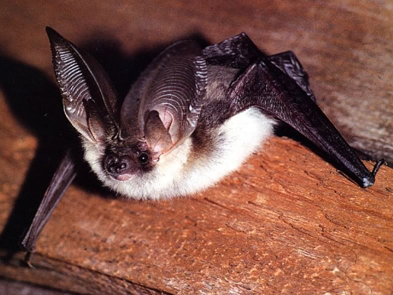

In Central Europe molecular studies have revealed the existence of three sibling species of long-eared bats, Plecotus auritus, P. austriacus and, very recently in the Swiss Alps, P. macrobullaris. The new discovery of cryptic species may significantly change our view about the distribution, abundance, ecology and accordingly the conservation status of the whole cryptic species complex.
The aim of this project was, using precise genetic tools, to specify the distribution of all three sister taxa and their ecological niche requirements in Switzerland as well as to specify their conservation status.
Therefore we developed an identification method based on external morphological measurements, which is, contrary to identification by eye, safe and contrary to genetic analyses directly applicable in the field. We also investigated dietary and foraging habitat preferences, which may provide guidance for foraging habitat management. With the analysis of occurrences and potential distribution patterns we could highlight the rarity and sensibility to changes from the optimal habitat in P. austriacus, for which we propose an upgrade to a status of higher conservation concern on the Swiss Red List.

## Uni Bern supervisors

Fabio Bontadina, Veronika Braunisch, Raphaël Arlettaz

## External collaborators

Andres Beck, SWILD - Urban Ecology and Wildlife Research, Zurich, Switzerland

Andreas Kiefer, Johannes Gutenberg-University Mainz, Germany

Igor Pavlinic, Zoological Department of the Croatian Natural History Museum Zagreb, Croatia

## Publications

Andriollo, T., S. Ashrafi, R. Arlettaz & M. Ruedi. 2018. Porous barriers? Assessment of gene flow within and among sympatric long‐eared bat species. Ecology and Evolution 8: 12841-12854. [(PDF, 1.0 MB)](/files/long_eared_bats/Andriollo_EcoEvo2018_eng.pdf)

Razgour, O., J. Juste, C. Ibáñez, A. Kiefer, H. Rebelo, S. J. Puechmaille, R. Arlettaz, T. Burke, D. A. Dawson, M. Beaumont & G. Jones. 2013. The shaping of genetic variation in edge-of-range populations under past and future climate change. Ecology Letters 16: 1258-1266. [(PDF, 1.1 MB)](/files/long_eared_bats/Razgour_EcoLet2013_eng.pdf)

Ashrafi, S., M. Rutishauser, K. Ecker, M.K. Obrist, R. Arlettaz & F. Bontadina. 2013. Habitat selection of three cryptic *Plecotus* bat species in the European Alps reveals contrasting implications for conservation. Biodiversity and Conservation 22: 2751-2766. [(PDF, 359KB)](/files/long_eared_bats/Ashrafi_BiodivCon2013_eng.pdf)

Rutishauser, M.D., F. Bontadina, V. Braunisch, S. Ashrafi & R. Arlettaz. 2012. The challenge posed by newly discovered cryptic species: disentangling the environmental niches of long-eared bats. Diversity and Distributions 18: 1107-1119. [(PDF, 476KB)](/files/long_eared_bats/Rutishauser_DivDtr2012_eng.pdf)

Ashrafi, S., A. Beck, M. Rutishauser, R. Arlettaz & F. Bontadina. 2011. Trophic niche partitioning of cryptic species of long-eared bats in Switzerland: implications for conservation. European Journal of Wildlife Research 57: 843-849. [(PDF, 168KB)](/files/long_eared_bats/Ashrafi_EurJWilRes2011_eng.pdf)

Ashrafi, S., F. Bontadina, A. Kiefer, I. Pavlinic & R. Arlettaz. 2010. Multiple morphological characters needed for field identification of cryptic long-eared bat species around the Swiss Alps. Journal of Zoology 281: 241-248. [(PDF, 256KB)](/files/long_eared_bats/Ashrafi_JZoo2010_eng.pdf)

## Related PhD Thesis

Ashrafi, S. 2010. Resource partitioning in three cryptic, sympatric bat species (*Plecotus* spp.) with contrasting conservation status. PhD Thesis, University of Bern. [(PDF, 2.3 MB)](/files/long_eared_bats/Ashrafi_PhD2010_eng.pdf)

## Related Diploma/Master Thesis

Rutishauser, M. 2009. The challenge posed by newly discovered cryptic species: Exploring the environmental niches of long-eared bats in Switzerland. Diploma Thesis, University of Bern. [(PDF, 863KB)](/files/long_eared_bats/Rutishauser_Dipl2009_eng.pdf)
