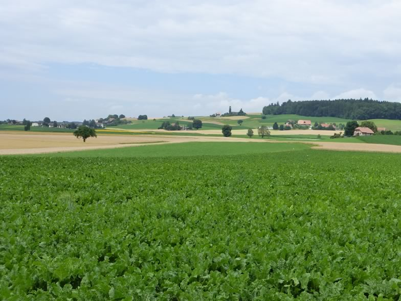

## Integrating food production and biodiversity conservation in temperate agricultural landscapes

The relationship between biodiversity and agricultural productivity has attracted considerable attention since decades, especially within the new farming framework termed “sustainable intensification”, which aims to increase food production while minimizing impacts on the environment. Biodiversity needs space and access to net primary production of  ecosystems and therefore often competes with agricultural production. As land is limited and human population rising, this conflict is likely to increase further and calls for more researches on how to better integrate food production and  biodiversity conservation in agricultural landscapes. Previous studies on the topic have been conducted mostly at site/field scales. Studies at larger scales remain rare, and most of them were done in the tropics. Therefore we urgently need more studies carried out in temperate agricultural zones, especially at farm or landscape scales, in order to better appraise the links between land-use, farming intensity and biodiversity. In this PhD project, we intend to link biodiversity and land-use data to investigate the biodiversity-productivity relationship at landscape scale (1 km2). We are going to collect data on yield, land-use and management practices via farmer interviews and from existing GIS databases, while biodiversity data will be obtained from the Swiss Biodiversity Monitoring programme. The goal of this project is to investigate, if there exists, an optimum balance between land-use, agricultural intensification and biodiversity. For more information, see [link](https://www.bfh.ch/hafl/en/research/reference-projects/productivity-and-biodiversity/).

## Uni Bern supervisors

Jean-Yves Humbert, Raphaël Arlettaz

## External collaborator

Jan Grenz, School of Agricultural, Forest and Food Sciences HAFL, Zollikofen

## Publications

Zingg, S., J. Grenz & J.Y. Humbert. 2024. Food production and biodiversity are not incompatible in temperate heterogeneous agricultural landscapes. Frontiers in Sustainable Food Systems 8: article 1377369. [PDF](/files/lowland_farmland/Zingg_FroSusFooStm2024_eng.pdf)

Ritschard, E., S. Zingg, R. Arlettaz & J.Y. Humbert. 2019. Biodiversitätsförderflächen: Vögel und Tagfalter profitieren von der Fläche und Qualität / Surfaces de promotion de la biodiversité: étendue et qualité favorisent oiseaux et papillons. Agrarforschung Schweiz / Recherche Agronomique Suisse 10: 206-213. [(PDF, 302KB)](/files/lowland_farmland/Ritschard_AgrfSch2019_eng.pdf) [(PDF, 302KB)](/files/lowland_farmland/Ritschard_RecAgnSui2019_eng.pdf)

Zingg, S., E. Ritschard, R. Arlettaz & J.Y. Humbert. 2019. Increasing the proportion and quality of land under agri-environment schemes promotes birds and butterflies at the landscape scale. Biological Conservation 231: 39-48. [(PDF, 1.1 MB)](/files/lowland_farmland/Zingg_BioCon2019_eng.pdf)

Zingg, S., J. Grenz & J.Y. Humbert. 2018. Landscape-scale effects of land use intensity on birds and butterflies. Agriculture, Ecosystems and Environment 267: 119-128 (plus 12 pages of Appendix). [(PDF, 1.3 MB)](/files/lowland_farmland/Zingg_AgrEcosysEnv2018_eng.pdf)

## Related PhD thesis

Zingg, S. 2018. Integrating food production and biodiversity conservation in temperate agricultural landscapes. PhD Thesis, University of Bern. [(PDF, 3.4 MB)](/files/lowland_farmland/Zingg_PhD2018_eng.pdf)    [external link](http://www.bfh.ch/hafl/biodiversitaet)

## Related Master thesis

Ritschard, E.M. 2016. The area and quality of farmland declared under agri-environment schemes promote birds and butterflies at the landscape scale. Master Thesis, University of Bern. [(PDF, 870KB)](/files/lowland_farmland/Ritschard_MSc2016_eng.pdf)
