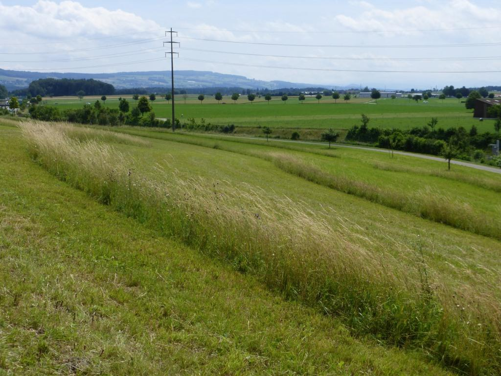

Although about 25% of European farmland is under some sort of agri-environmental contract, these schemes have provided only moderate benefits for biodiversity until now. In the Swiss agricultural lowland regions, the greatest biodiversity potential lies within extensively managed meadows, which are by far the main type of biodiversity promotion areas (BPA), equivalent to the European agri-environment schemes (AES).
Currently we have two long-term research projects running that investigate experimentally (full-block design with random allocation of treatment to field) and at the field scale alternative management practices (project 1) or active restoration measures (project 2) within extensively managed lowland meadows declared as BPA. Our ultimate objective is to provide end-users, notably farmers and authorities, with easily implementable, evidence-based recommendations for future grassland restoration and management strategies that can improve habitat conditions for farmland biodiversity.

(1) Reinstating spatio-temporal management heterogeneity in extensively managed grasslands
In this ongoing project (2010-2022), we experimentally modified the management regime of extensively managed meadows under BPA regulations, so as to increase spatial, temporal, structural and hence ecological heterogeneity. Specifically, we investigate alternative mowing regimes with the main aim to understand how these small management changes can contribute to promote plant and field invertebrate communities. So far results have shown that herbivores, e.g. orthopterans and plant- and leafhoppers, as well as pollinators, e.g. wild bees, hoverflies and butterflies increase in diversity and abundance, sometimes massively, when the first mowing date is delayed by one month (from 15 June to 15 July) or when an uncut grass refuge is left over after mowing operations. Predators like spiders are also favoured by delaying the first possible mowing date.
Nevertheless in these lowland meadows the plant communities seem not to benefit from the alternative mowing regimes. This indicates that in fragmented cultivated landscapes, where source populations (ancient grasslands) are rare and isolated, full restoration of grasslands requires measures that go beyond the mere extensification of farming practice that relies on passive restoration. Our hypothesis is that the main factor of recovery is missing: the seed bank or seed input.

(2) Active restoration of species-poor, extensively managed grasslands
In this new (2018-2022/26) large-scale restoration research project (60 grassland fields across the Swiss Plateau) we will experimentally evaluate pro-active reseeding methods that rely either on hay transfer from biodiversity-rich meadows, or on locally produced commercial seed mixtures, for pushing poor grassland plant and invertebrate communities towards species-richer stable states. We shall collect baseline data in 2018 (before interventions) and monitor subsequent changes (following reseeding) of various biotic and abiotic components using different metrics on multiple plant and animal taxa (species richness, diversity, functional traits, community analyses, etc.) and hay productivity and quality.

## Uni Bern supervisors

Jean-Yves Humbert & Raphaël Arlettaz

## Publications

Forgione, L., D. Slodowicz, M. Bergauer, R.A. Dupont, R. Arlettaz & J.Y. Humbert. 2026. Restoring plant diversity in lowland grasslands: Efficacy of different seed addition and soil preparation methods. Agriculture, Ecosystems and Environment 405: Article 110369. [PDF](/files/publications/Forgione_AgrEcosysEnv2026_eng.pdf)

Negroni, M., A. Fenestraz, R. Arlettaz & J.Y. Humbert. 2026. Little differences of uncut refuge rotation frequency on arthropod communities in extensively managed meadows. Basic and Applied Ecology 91: 97-107. [PDF](/files/publications/Negroni_BasAppEco2026_eng.pdf)

Herzon, I., J.M. Bullock, J.Y. Humbert, R. Arlettaz, P. Török & K. Stein-Bachinger. 2025. Improving biodiversity in agricultural grassland systems. In: Advances in temperate grassland science and management (ed. A. van den Pol-van Dasselaar), 42 pp. Burleigh Dodds Science Publishing, Cambridge, UK. [PDF](/files/lowland_grassland/Herzon_eBS2025_eng.pdf)

Révész, K., R. Gallé, J.Y. Humbert & P. Batáry. 2025. Effects of uncut refuge management on grassland arthropods – A systematic review. Global Ecology and Conservation 57:  Article Number e03381. [PDF](/files/lowland_grassland/Revesz_GloEcoCon2025_eng.pdf)

Humbert, J.Y. & R. Arlettaz. 2024. Gestion des prairies favorisant la biodiversité. In: Tätigkeitsbericht 2023 der Abteilung Naturförderung, pp. 16-17. Amt für Landwirtschaft und Natur des Kantons Bern, Abteilung Naturförderung, Münsingen. [PDF](/files/lowland_grassland/Humbert_RepS2024_eng.pdf)

Rossier, L.C.P., C. Auberson, R. Arlettaz & J.Y. Humbert. 2023. Effects of uncut grass refuges on the plant community of extensively managed hay meadows. Basic and Applied Ecology 72: 38-44. [PDF](/files/lowland_grassland/Rossier_BasAppEco2023_eng.pdf)

Slodowicz, D., C. Auberson, E. Ferreira de Carvalho, R. Angeleri, M. Stańska, I. Hajdamowicz, Y. Kurtogullari, R. Roth, L. Rossier, G. Enz, J.Y. Humbert, & R. Arlettaz. 2023. No detrimental effects of soil disturbance resulting from grassland restoration operations on aboveground-dwelling invertebrate communities. Restoration Ecology 31: article number e13860. [PDF](/files/lowland_grassland/Slodowicz_RestEco2023_eng.pdf)

Slodowicz, D., A. Durbecq, E. Ladouceur, R. Eschen, J.Y. Humbert & R. Arlettaz. 2023. The relative effectiveness of different grassland restoration methods: A systematic literature search and meta-analysis. Ecological Solutions and Evidence 4: e12221. [PDF](/files/lowland_grassland/Slodowicz_EcoSolEvi2023_eng.pdf)

Kühne, I., R. Arlettaz & J.Y. Humbert. 2022. Landscape woody features, local management and vegetation composition shape moth communities in extensively managed grasslands. Insect Conservation and Diversity 15: 739-751. [PDF](/files/lowland_grassland/Kuhne_InsConDiv2022_eng.pdf)

Stöckli, A., D. Slodowicz, R. Arlettaz & J.Y. Humbert. 2021. Transfer of invertebrates with hay during restoration operations of extensively managed grasslands in Switzerland. Journal of Insect Conservation 25: 189-194. [(PDF, 1.3 MB)](/files/lowland_grassland/Stockli_JInsCon2021_eng.pdf)

Slodowicz, D., J.Y. Humbert& R. Arlettaz. 2019. The relative effectiveness of seed addition methods for restoring or re‑creating species rich grasslands: a systematic review protocol. Environmental Evidence 8: article 28. [(PDF, 779KB)](/files/lowland_grassland/Slodowicz_EnvEvi2019_eng.pdf)

van Klink, R., M.H.M. Menz, H. Baur, O. Dosch, I. Kühne, L. Lischer, H. Luka, S. Meyer, T. Szikora, D. Unternährer, R. Arlettaz & J.Y. Humbert. 2019. Larval and phenological traits predict insect community response to mowing regime manipulations. Ecological Applications 29: e01900. [(PDF, 267KB)](/files/lowland_grassland/vanKlink_EcoApp2019_eng.pdf)

Humbert, J.Y., P. Buri, D. Unternährer & R. Arlettaz. 2018. Alternative Mähregimes zur Förderung der Artenvielfalt von Wiesen / Des régimes de fauche alternatifs pour favoriser la biodiversité des prairies. Agrarforschung Schweiz / Recherche Agronomique Suisse 9: 314-321. [(PDF, 194KB)](/files/lowland_grassland/Humbert_AgrfSch2018_eng.pdf), [(PDF, 196KB)](/files/lowland_grassland/Humbert_RecAgnSui2018_eng.pdf)

van Klink, R., S. Boch, P. Buri, N.S. Rieder, J.Y. Humbert & R. Arlettaz. 2017. No detrimental effects of delayed mowing or uncut grass refuges on plant and bryophyte community structure and phytomass production in low-intensity hay meadows. Basic and Applied Ecology 20: 1-9. [(PDF, 520KB)](/files/lowland_grassland/vanKlink_BasAppEco2017_eng.pdf)

Meyer, S., D. Unternährer, R. Arlettaz, J.Y. Humbert & M.H.M. Menz. 2017. Promoting diverse communities of wild bees and hoverflies requires a landscape approach to managing meadows. Agriculture, Ecosystems and Environment 239: 376-384. [(PDF, 562KB)](/files/lowland_grassland/Meyer_AgrEcosysEnv2017_eng.pdf)

Buri, P., J.Y. Humbert, M. Stańska, I. Hajdamowicz, E. Tran, M.H. Entling & R. Arlettaz. 2016. Delayed mowing promotes planthoppers, leafhoppers and spiders in extensively managed meadows. Insect Conservation and Diversity 9: 536-545. [(PDF, 214KB)](/files/lowland_grassland/Buri_InsConDiv2016_eng.pdf)

Bruppacher, L., J. Pellet, R. Arlettaz & J.Y. Humbert. 2016. Simple modifications of mowing regime promote butterflies in extensively managed meadows: Evidence from field-scale experiments. Biological Conservation 196: 196-202. [(PDF, 577KB)](/files/lowland_grassland/Bruppacher_BioCon2016_eng.pdf)

Kühne, I., R. Arlettaz, J. Pellet, L. Bruppacher & J.Y. Humbert. 2015. Leaving an uncut grass refuge promotes butterfly abundance in extensively managed lowland hay meadows in Switzerland. Conservation Evidence 12: 25-27. [(PDF, 434KB)](/files/lowland_grassland/Kuhne_ConEvi2015_eng.pdf)

Buri, P., J.Y. Humbert & R. Arlettaz. 2014. Promoting Pollinating Insects in Intensive Agricultural Matrices: Field-Scale Experimental Manipulation of Hay-Meadow Mowing Regimes and Its Effects on Bees. PLoS ONE 9: e85635. [(PDF, 294KB)](/files/lowland_grassland/Buri_PLoSONE2014_eng.pdf)

Buri, P., R. Arlettaz & J.Y. Humbert. 2013. Delaying mowing and leaving uncut refuges boosts orthopterans in extensively managed meadows: Evidence drawn from field-scale experimentation. Agriculture, Ecosystems and Environment 181: 22-30. [(PDF, 444KB)](/files/lowland_grassland/Buri_AgrEcosysEnv2013_eng.pdf)

Humbert, J.Y., J. Pellet, P. Buri & R. Arlettaz. 2012. Does delaying the first mowing date benefit biodiversity in meadowland? Environmental Evidence 1: article 9 (13 p.). [(PDF, 646KB)](/files/lowland_grassland/Humbert_EnvEvi2012_eng.pdf)

Humbert, J.Y., J. Ghazoul, N. Richner, & T. Walter. 2012. Uncut grass refuges mitigate the impact of mechanical meadow harvesting on orthopterans. Biological Conservation 152: 96-101.[(PDF, 302KB)](/files/lowland_grassland/Humbert_BioCon2012_eng.pdf)

## Related PhD thesis

Slodowicz, D. 2022. Grassland Restoration: Relative effectiveness of different restoration methods on plant and invertebrate diversity. PhD Thesis, University of Bern. [PDF](/files/lowland_grassland/Slodowicz_PhD2022_eng.pdf)

Buri, P. 2013. Designing tomorrow’s farmland: alternative mowing regimes for promoting biodiversity in extensively managed meadowland. PhD Thesis, University of Bern. [(PDF, 4.9 MB)](/files/lowland_grassland/Buri_PhD2013_eng.pdf)

## Related Master thesis

Wyss, M. 2026. Assessing the efficacy of assisted restoration for the conservation of orthopterans in mesic hay meadows. Master thesis. University of Bern.

Poupon, L. 2025. Farmland butterfly diversity in actively restored meadows. Master thesis. University of Bern.

Kurmann, A. 2023. Mid-term effects of grassland restoration on wild bee and hoverfly communities. Master Thesis. University of Bern. [PDF](/files/lowland_grassland/Kurmann_MSc2023_eng.pdf)

Hold, A.G. 2021. Effects of a flexible first mowing date on the biodiversity of extensively managed meadows - a case study from canton Bern, Switzerland. Master Thesis. ETH Zürich, University of Bern & Berne University of applied sciences  [PDF](/files/lowland_grassland/Hold_MSc2021_eng.pdf)

Auberson, C. 2021. Grassland restoration and soil disturbance: the effects of harrowing and ploughing on ground beetle communities. Master Thesis. University of Bern. [(PDF, 1.6 MB)](/files/lowland_grassland/Auberson_MSc2021_eng.pdf)

Stöckli, A. 2021. Nesting incidence of groundnesting bees in Swiss lowland perennial wildflower strips. Master Thesis. University of Bern. [(PDF, 5.3 MB)](/files/lowland_grassland/Stockli_MSc2021_eng.pdf)

Ferreira de Carvalho, E. 2021. Mid-term effect of active grassland restoration methods with soil disturbance on ground-dwelling spiders. Master Thesis. University of Bern and University of Neuchâtel. [(PDF, 3.7 MB)](/files/lowland_grassland/FerreiradeCarvalho_MSc2021_eng.pdf)

Enz, G.B.C. 2021. Auchenorrhyncha and host plant networks in extensively managed grasslands in the Swiss lowlands. Master Thesis. University of Bern. [PDF](/files/lowland_grassland/Enz_MSc2021_eng.pdf)

Klein, N. 2019. Effects of grassland management intensity on orthopterans as food resource for insectivorous birds. Master Thesis. University of Bern. [PDF](/files/lowland_grassland/Klein_MSc2019_eng.pdf)

Roth, R. 2019. Determinants of invertebrate presence in extensively managed grasslands in the Swiss lowland. Master Thesis. University of Bern. [(PDF, 1.8 MB)](/files/lowland_grassland/Roth_MSc2019_eng.pdf)

Weinrich, M. 2018. Ecological quality in Swiss lowland meadows: does plant and invertebrate diversity correlate? Master Thesis. University of Bern. [(PDF, 4.5 MB)](/files/lowland_grassland/Weinrich_MSc2018_eng.pdf)

Lischer, L. 2016. Effects of altered mowing regimes in extensively managed meadows on ground and rove beetles. Master Thesis. University of Bern. [(PDF, 1.0 MB)](/files/lowland_grassland/Lischer_MSc2016_eng.pdf)

Szikora, T. 2015. Promoting parasitic wasps among Swiss lowland extensively managed meadows: positive effects of delaying mowing and leaving uncut grass refuges. Master Thesis, University of Bern. [(PDF, 1.3 MB)](/files/lowland_grassland/Szikora_MSc2015_eng.pdf)

Kühne, I. 2015. Landscape woody features, meadow plant composition and mowing regime shape moth communities in extensively managed grasslands. Master Thesis, University of Bern. [(PDF, 190KB)](/files/lowland_grassland/Kuhne_MSc2015_eng.pdf)

Unternährer, D. 2015. Leaving uncut refuges within lowland extensively managed meadows secures wild bee species richness and diversity. Master Thesis. University of Bern. [(PDF, 865KB)](/files/lowland_grassland/Unternahrer_MSc2015_eng.pdf)

Bruppacher, L. 2014. Evidence-based mowing recommendations to restore butterfly populations in extensively managed grasslands. Master Thesis, University of Bern. [(PDF, 649KB)](/files/lowland_grassland/Bruppacher_MSc2014_eng.pdf)

Tran, E. 2014. Effect of four different mowing regimes on ground-dwelling spiders in Swiss lowland extensively managed hay meadows. Master Thesis, University of Bern. [(PDF, 609KB)](/files/lowland_grassland/Tran_MSc2014_eng.pdf)
