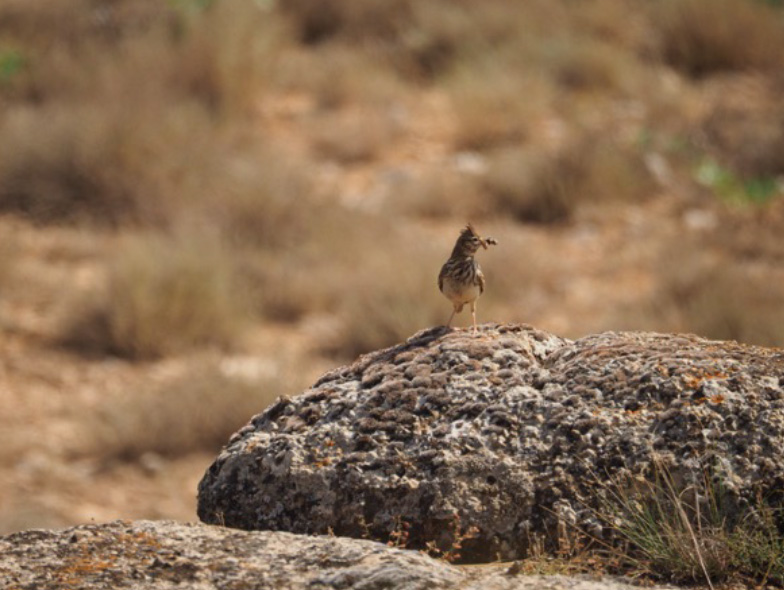

*© Helena Navalpotro*

Steppe birds are a group of birds that have been especially affected by land use changes. The current biodiversity loss is mainly human-induced and due to changes in agricultural practices such as monocultures or intensive livestock farming. Agricultural intensification, especially after World War II, has severely impacted bird species in European steppe habitats. In Spain, which holds the largest steppe areas and bird populations in Europe, the number of sheep has significantly decreased between 1992 and 2020, negatively affecting steppe birds because sheep maintain a low and open vegetation structure. Land use changes and human activities have caused habitat loss, population isolation, and fragmentation. An additional major threat is predation, particularly for ground-nesting birds like larks. This study aims to identify nest predation dynamics for the Mediterranean short-toed lark and Thekla’s lark in Catalonia to better understand and manage their populations. In a broader context the project provides insights in the management of an unbalanced ecosystem and develops solution stragegies.

## Uni Bern supervisors

Stefano Canessa, Raphaël Arlettaz

## External collaborators

Dr. Gerard Bota, Helena Navalpotro ( Forest Science and Technology Centre of Catalonia (CTFC), Spain)

## Publications

Hofer, M.A., S. Canessa, G. Bota, R. Arlettaz & H. Navalpotro. 2024. Predation dynamics and breeding parameters of Mediterranean Short-toed Lark *Alaudala rufescens* and Thekla’s Lark *Galerida theklae* nests in western Catalonia. Revista Catalana d'Ornitologia 40: 22-33. [PDF](/files/mediterranean_larks/Hofer_RCtaOrn2024_eng.pdf)

## Related Master thesis

Hofer, M.A. 2024. Predators of mediterranean short-toed lark *Alaudala rufescens* and Thekla’s lark *Galerida theklae* nests in western Catalonia. Master Thesis. University of Bern. [PDF](/files/mediterranean_larks/Hofer_MSc2024_eng.pdf)
