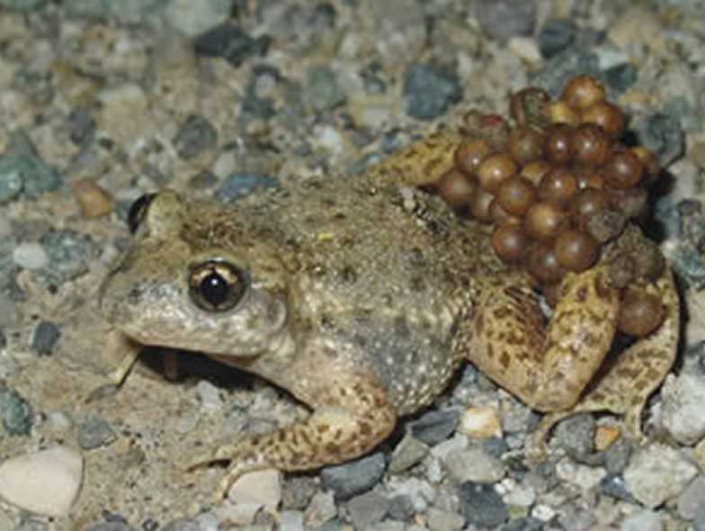

The midwife toad (Alytes obstetricans) has declined dramatically in Central Europe over the past 25 years. With about half of the Swiss populations that went extinct, the midwife toad is red-listed as an endangered species in the country. Ponds have been created in several areas of the Swiss Plateau to increase the offer of breeding sites within suitable habitat matrices. We tested the effectiveness of these newly created ponds (pond colonization, population size and evidence for reproduction) in relation to several environmental factors (pond connectivity, habitat structure, etc.) to provide evidence-based mangement guidance and cost-effective solutions for ponds restoration and creation in the future.

## External collaborator

Dr. Benedikt R. Schmidt, KARCH, Neuchâtel, Switzerland

## Publications

Schmidt, B.R., R. Arlettaz, M. Schaub, B. Lüscher & M. Kröpfli. 2019. Benefits and limits of comparative effectiveness studies in evidence-based conservation. Biological Conservation 236: 115-123. [(PDF, 1.1 MB)](/files/midwife_toad/Schmidt_BioCon2019_eng.pdf)

## Related Master thesis

Kroepfli, M. 2011. Factors influencing colonization of created habitats by an endangered amphibian species. Master Thesis, University of Bern. [PDF](/files/midwife_toad/Kroepfli_MSc2011copy_eng.pdf)
