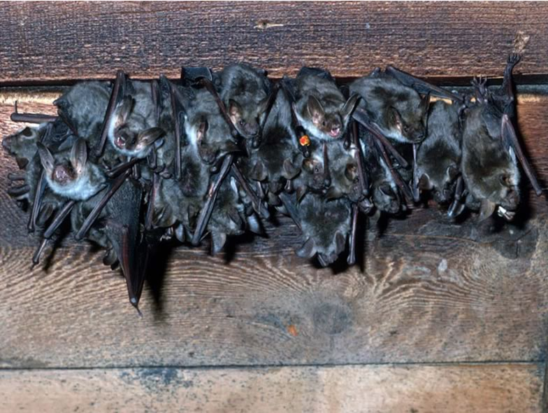

*Myotis myotis* and *Myotis blythii* are two cryptic sibling species of bats that occur in sympatry over wider areas of the Western Palaearctic. In his PhD study, Raphaël Arlettaz investigated their distribution using genetic markers (isozymes), niche segregation (trophic niche partitioning and habitat selection), diet selectivity and foraging behaviour. He also studied in Kyrgyzstan another, unrelated bat species with similar foraging habits (*Otonycteris hemprichi*). Complementary data on habitat selection by *Myotis blythii* have been collected more recently to look for any effects of agricultural intensification on habitat amplitude. Long-term mark-recapture data are currently analysed to look at the impact of the slightly diverging species-specific life history strategies on population demographics. We also used mouse-eared bats as a model for investigating host-parasite relationships in general.

## Uni Bern supervisor

Raphaël Arlettaz

## Publications

Wellig, S.D., S. Nusslé, D. Miltner, O. Kohle, O. Glaizot, V. Braunisch, M.K. Obrist & R. Arlettaz. 2018. Mitigating the negative impacts of tall wind turbines on bats: Vertical activity profiles and relationships to wind speed. PLoS ONE 13: e0192493. [(PDF, 1.0 MB)](/files/flying_vertebrates_vs_wind_turbines/Wellig_PLOSONE2018_eng.pdf)

Arlettaz, R., P. Christe & M. Schaub. 2017. Food availability as a major driver in the evolution of life-history strategies of sibling species. Ecology and Evolution 7: 4163-4172. [(PDF, 531KB)](/files/mouse_eared_bats/Arlettaz_EcoEvo2017_eng.pdf)

Schmieder, D.A., S. Zsebők & B.M. Siemers. 2014. The tail plays a major role in the differing manoeuvrability of two sibling species of mouse-eared bats (*Myotis myotis* and *Myotis blythii*). Canadian Journal of Zoology 92: 965-977. [(PDF, 835KB)](/files/mouse_eared_bats/Schmiederetal2014_CJZ_finalversion_eng.pdf)

Christe, P., O. Glaizot, G. Evanno, N. Bruyndonckx, G. Devevey, G. Yannic, P. Patthey, A. Maeder, P. Vogel & R. Arlettaz. 2007. Host sex and ectoparasites choice: preference for, and higher survival on female hosts. Journal of Animal Ecology 76: 703-710. [(PDF, 133KB)](/files/mouse_eared_bats/Christe_JAniEco2007_eng.pdf)

Russo, D., G. Jones & R. Arlettaz. 2007. Echolocation and passive listening by foraging mouse-eared bats *Myotis myotis* and M. blythii. The Journal of Experimental Biology 210: 166-176. [(PDF, 317KB)](/files/mouse_eared_bats/Russo_JExpBio2007_eng.pdf)

Roesli, M., F. Bontadina, T. Maddalena, K. Märki, T. Hotz, A.S. Genini, D. Torriani, R.Güttinger & M. Moretti. 2005. Ambienti di caccia e regime alimentare del Vespertilio maggiore (*Myotis myotis*) e del Vespertilio minore (*Myotis blythi*) (Chiroptera: Vespertilionidae) nel Cantone Ticino - Foraging habitats and diet of the Greater and Lesser mouse-eared bat (*Myotis myotis* and *Myotis blythi*) (Chiroptera: Vespertilionidae) in Canton Ticino [in Italian with English abstract]. Bollettino della Società ticinese di Scienze naturali 93: 63-75. [(PDF, 1.2 MB)](/files/mouse_eared_bats/Roesli_BlSocTicSN2005b_eng.pdf)

Giorgi, M.S., R. Arlettaz, F. Guillaume, S. Nusslé, C. Ossola, P. Vogel & P. Christe. 2004. Causal mechanisms underlying host specificity in bat ectoparasites. Oecologia 138: 648-654. [(PDF, 150KB)](/files/mouse_eared_bats/Giorgi_Oec2004_eng.pdf)

Christe, P., M.S. Giorgi, P. Vogel & R. Arlettaz. 2003. Differential species-specific ectoparasitic mite intensities in two intimately coexisting bat species: resource-mediated host attractiveness or parasite specialization? Journal of Animal Ecology 72: 866-872. [(PDF, 123KB)](/files/mouse_eared_bats/Christe_JAniEco2003_eng.pdf)

Arlettaz, R., G. Jones & P.A. Racey. 2001. Effect of acoustic clutter on prey detection by bats. Nature 414: 742-745. [(PDF, 182KB)](/files/mouse_eared_bats/Arlettaz_Nature2001_eng.pdf)

Arlettaz, R., P. Christe, A. Lugon, N. Perrin & P. Vogel. 2001. Food availability dictates the timing of parturition in insectivorous mouse-eared bats. Oikos 95: 105-111. [(PDF, 881KB)](/files/mouse_eared_bats/Arlettaz_Oik2001_eng.pdf)

Giorgi, M.S., R. Arlettaz, P. Christe & P. Vogel. 2001. The energetic grooming costs imposed by a parasitic mite (*Spinturnix myoti*) upon its bat host (*Myotis myotis*). Proceedings of the Royal Society of London. Series B, Biological sciences 268: 2071-2075. [(PDF, 174KB)](/files/mouse_eared_bats/Giorgi_PRoySocB2001_eng.pdf)

Christe, P., R. Arlettaz & P. Vogel. 2000. Variation in intensity of a parasitic mite (*Spinturnix myoti*) in relation to the reproductive cycle and immunocompetence of its bat host (*Myotis myotis*). Ecology Letters 3: 207-212. [(PDF, 175KB)](/files/mouse_eared_bats/Christe_EcoLet2000_eng.pdf)

Arlettaz, R. 1999. Habitat selection as a major resource partitioning mechanism between the two sympatric sibling bat species *Myotis myotis* and *Myotis blythii*. Journal of Animal Ecology 68: 460-471. [(PDF, 603KB)](/files/mouse_eared_bats/Arlettaz_JAniEco1999_eng.pdf)

Arlettaz, R., M. Ruedi, C. Ibañez, J. Palmeirim & J. Hausser. 1997. A new perspective on the zoogeography of the sibling mouse-eared bat species *Myotis myotis* and *Myotis blythii*: morphological, genetical and ecological evidence. Journal of Zoology 242: 45-62. [(PDF, 823KB)](/files/mouse_eared_bats/Arlettaz_JZoo1997_eng.pdf)

Arlettaz, R., N. Perrin & J. Hausser. 1997. Trophic resource partitioning and competition between the two sibling bat species *Myotis myotis* and *Myotis blythii*. Journal of Animal Ecology 66: 897-911. [(PDF, 2.3 MB)](/files/mouse_eared_bats/Arlettaz_JAniEco1997_eng.pdf)

Arlettaz, R. 1996. Feeding behaviour and foraging strategy of free-living mouse-eared bats, *M**yotis myotis* and *Myotis blythii*. Animal Behaviour 51: 1-11. [(PDF, 275KB)](/files/mouse_eared_bats/Arlettaz_AniBeh1996_eng.pdf)

Arlettaz, R., G. Dändliker, E. Kasybekov, J. M. Pillet, S. Rybin & J. Zima. 1995. Feeding habits of the long-eared desert bat, *Otonycteris hemprichi* (Chiroptera: Vespertilionidae). Journal of Mammalogy 76: 873-876. [(PDF, 156KB)](/files/mouse_eared_bats/Arlettaz_JMam1995_eng.pdf)

Arlettaz, R. & N. Perrin. 1995. The trophic niches of sympatric sibling *Myotis myotis* and *M. blythii*: do mouse-eared bats select prey? Symposia of the zoological Society of London 67: 361-376. [(PDF, 1.7 MB)](/files/mouse_eared_bats/Arlettaz_SymZooSocLon1995_eng.pdf)

## Related PhD Thesis

Arlettaz, R. 1995. Ecology of the sibling mouse-eared bats (*Myotis myotis* and *Myotis blythii*): zoogeography, niche, competition, and foraging. PhD Thesis, University of Lausanne.

## Related Diploma/Master thesis

Rey, E. 2004. How modern agriculture reduces the overall ecological space: comparison of mouse-eared bats' niche breadth in intensively vs. extensively cultivated areas. Diploma Thesis, University of Bern and University of Neuchâtel. [(PDF, 3.4 MB)](/files/mouse_eared_bats/Rey_Dipl2004_eng.pdf)
