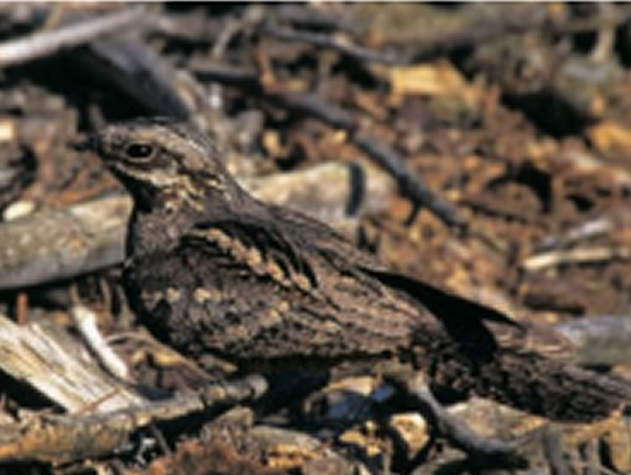

The Nightjar is an endangered bird which, in Switzerland, occurs mostly in Valais. We studied diet and habitat selection by breeding nightjars to orient habitat management. Clearings in dense forest stands have been created by foresters, in close collaboration with the Valais field station of the Swiss Ornithological Institute, to enhance habitat suitability, but the birds did not react to these measures so far. Patience?

## Uni Bern supervisor

Raphaël Arlettaz

## Publications

Winiger, N., P. Korner, R. Arlettaz & A. Jacot. 2018. Vegetation structure and decreased moth abundance limit the recolonisation of restored habitat by the European Nightjar. Rethinking Ecology 3: 25-39. [(PDF, 448KB)](/files/nightjar/Winiger_RthEco2018_eng.pdf)

Sierro, A., R. Arlettaz, B. Naef-Daenzer, S. Strebel & N. Zbinden. 2001. Habitat use and foraging ecology of the nightjar (*Caprimulgus europaeus*) in the Swiss Alps: towards a conservation scheme. Biological Conservation 98: 325-331. [(PDF, 493KB)](/files/nightjar/Sierro_BioCon2001_eng.pdf)

## Related Master thesis

Keller, N. 2014. The decline of the European nightjar (*Caprimulgus europaeus*) in Switzerland: habitat change or drop in food supply? New guidelines for habitat management. Master Thesis, University of Bern. [(PDF, 7.4 MB)](/files/nightjar/Keller_MSc2014_eng.pdf)
