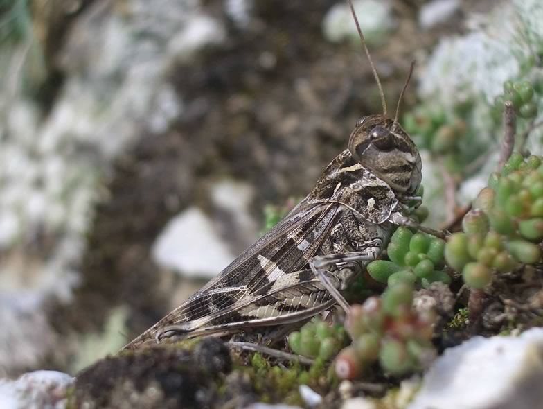

This rare grasshopper, considered as extinct since the 1930s, was accidentally rediscovered in 1992 in the Valais Alps. We now use this model for running our field practical with conservation biology students. Data on population extension, abundance and species’ habitat requirements have been collected over the years, which enabled us to build a habitat suitability model. The yearly field practical enables us to keep an eye on this threatened species of Switzerland. More recently, we have investigated the genetic structure of this relict population, comparing it with other Palaearctic populations. This information will guide future translocation trials aimed at reinstalling the species where habitat is deemed suitable, based on our spatial model.

## Uni Bern supervisors

Karine Berthier, Raphaël Arlettaz

## Publications

Schmid, S., S. Neuenschwander, C. Pitteloud, G. Heckel, M. Pajkovic, R. Arlettaz & N. Alvarez. 2018. Spatial and temporal genetic dynamics of the grasshopper *Oedaleus decorus* revealed by museum genomics. Ecology and Evolution 8:1480-1495. [(PDF, 834KB)](/files/oedaleus_decorus/Schmid_EcoEvo2018_eng.pdf)

Kindler, E., R. Arlettaz & G. Heckel. 2012. Deep phylogeographic divergence and cytonuclear discordance in the grasshopper *Oedaleus decorus*. Molecular Phylogenetics and Evolution 65: 695-704. [(PDF, 967KB)](/files/oedaleus_decorus/Kindler_MolPhyEvo2012_eng.pdf)

Berthier, K., A. Loiseau, R. Streiff & R. Arlettaz. 2008. Eleven polymorphic microsatellite markers for *Oedaleus decorus* (Orthoptera, Acrididae), an endangered grasshopper in Central Europe. Molecular Ecology Resources 8: 1363-1366. [(PDF, 80KB)](/files/oedaleus_decorus/Berthier_MolEcoRso2008_eng.pdf)

## Related Diploma/Master thesis

Kindler, E. 2010. Deep genetic divergence and cytonuclear discordance in the grasshopper *Oedaleus decorus*. Master Thesis, University of Bern. [(PDF, 8.8 MB)](/files/oedaleus_decorus/Kindler_MSc2010_eng.pdf)
