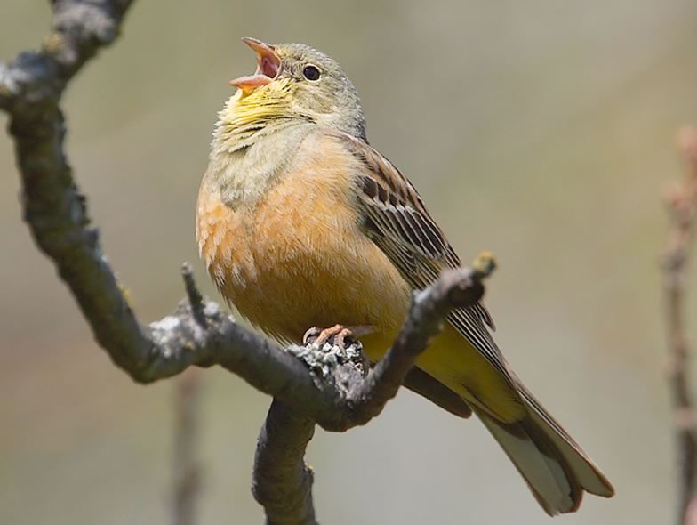

This is the second most rapidly decling bird species of Europe, with a ca 80% decrease within two decades. The Swiss population, concentrated in Central Valais, is on the brink of exinction. We attempted to understand species’ requirements in Switzerland during a MSc study, but the populations consisted of only a few territorial males, with no sign of reproduction, when we launched the field work. We thus could only study habitat selection in non-breeding males. To compensate for this lack of data, we analysed a dataset from Catalonia, where the species thrive in post-fire Mediterranean forest ecosystems. The species requires patches of bare ground in invertebrate-rich grasslands for foraging, a feature which probably decreased in northern biomes due to recent abandonment of grazing activities and fire management of ground vegetation within farmland. Such practices should be restored if the species is to be saved. In a review, we call for more targeted research to better inform species conservation.

## Uni Bern supervisor

Raphaël Arlettaz

## External collaborators

Dr. Lluís Brotons, Centre Tecnològic Forestal de Catalunya, Solsona, Catalonia, Spain

Paul Mosimann-Kampe, independent ecological consultant, Ins, Switzerland

## Publications

Gremion, J., G. Marcacci, J. Mazenauer, T. Sori, F. Kebede, M. Ewnetu, P. Christe, R. Arlettaz & A. Jacot. 2022. Habitat preferences of the Ortolan Bunting (*Emberiza hortulana*) in its prime wintering grounds, the cereal-dominated Ethiopian Highlands. Ibis 164: 74-87. [PDF](/files/ethiopian_highlands/Gremion_Ibis2022_eng.pdf)

Jiguet, F., A. Robert, R. Lorrillière, K.A. Hobson, K.J. Kardynal, R. Arlettaz, F. Bairlein, V. Belik, P. Bernardy, J.L. Copete, M.A. Czajkowski, S. Dale, V. Dombrovski, D. Ducros, R. Efrat, J. Elts, Y. Ferrand, R. Marja, S. Minkevicius, P. Olsson, M. Pérez, M. Piha, M. Raković, H. Schmaljohann, T. Seimola, G. Selstam, J.P. Siblet, M. Skierczyǹski, A. Sokolov, J. Sondell & C. Moussy. 2019. Unravelling migration connectivity reveals unsustainable hunting of the declining ortolan bunting. Science Advances 5: eaau2642. [(PDF, 664KB)](/files/ortolan_bunting/Jiguet_SciAdv2019_eng.pdf)

Moussy, C., R. Arlettaz, J.L. Copete, S. Dale, V. Dombrovski, J. Elts, R. Lorrillière, R. Marja, E. Pasquet, M. Piha, T. Seimola, G. Selstam & F. Jiguet. 2018. The genetic structure of the European breeding populations of a declining farmland bird, the ortolan bunting (*Emberiza hortulana*), reveals conservation priorities. Conservation Genetics 19: 909-922. [(PDF, 1.5 MB)](/files/ortolan_bunting/Moussy_ConGen2018_eng.pdf)

Jiguet, F., R. Arlettaz, H.G. Bauer, V. Belik, J.L. Copete, L. Couzi, M.A. Czajkowski, S. Dale, V. Dombrovski, J. Elts, Y. Ferrand, R. Hargues, G. M. Kirwan, S. Minkevicius, M. Piha, G. Selstam, M. Skierczyński, J. P. Siblet & A. Sokolov. 2016. An update of the European breeding population sizes and trends of the Ortolan Bunting (Emberiza hortulana). Ornis Fennica 93:186-196. [(PDF, 115KB)](/files/ortolan_bunting/Jiguet_OrnFen2016_eng.pdf)

Menz, M.H.M. & R. Arlettaz. 2012. The precipitous decline of the ortolan bunting *Emberiza hortulana*: time to build on scientific evidence to inform conservation management. Oryx 46: 122-129. [(PDF, 121KB)](/files/ortolan_bunting/Menz_Oryx2012_eng.pdf)

Menz, M.H.M., L. Brotons & R. Arlettaz. 2009. Habitat selection by Ortolan Buntings *Emberiza hortulana* in post-fire succession in Catalonia: implications for the conservation of farmland populations. Ibis 151: 752-761. [(PDF, 253KB)](/files/ortolan_bunting/Menz_Ibis2009_eng.pdf)

Menz, M.H.M., P. Mosimann-Kampe & R. Arlettaz. 2009. Foraging habitat selection in the last Ortolan Bunting *Emberiza hortulana* population in Switzerland: final lessons before extinction. Ardea 97: 323-333. [(PDF, 347KB)](/files/ortolan_bunting/Menz_Ardea2009_eng.pdf)

Revaz, E., B. Posse, A. Gerber, A. Sierro, & R. Arlettaz. 2005. Quel avenir pour le Bruant ortolan *Emberiza hortulana* en Suisse? Nos Oiseaux 52: 67-82. [(PDF, 737KB)](/files/ortolan_bunting/Revaz_NosOis2005_eng.pdf)

## Related Diploma/Master Thesis

Menz, M.H.M. 2008. Ecological requirements of the threatened Ortolan bunting *Emberiza hortulana* in temperate Europe (Swiss Alps) and in the Mediterranean (Catalonia). Master Thesis, University of Bern. [(PDF, 1.2 MB)](/files/ortolan_bunting/Menz_MSc2008_eng.pdf)
