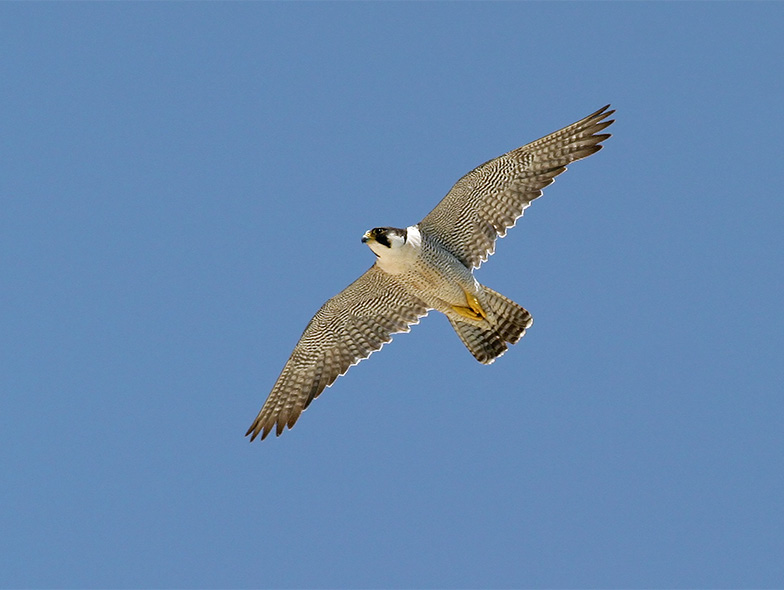

Several species of raptors, among both the diurnal and nocturnal birds of prey, play the role of environmental sentinels, meaning that their populations often decline following some degradation in the general environment. Vice versa, their population recovery may indicate an amelioration of environmental conditions.

Our group contributes to monitor and carry out research on several species of raptors in the Swiss Alps since years, in particular eagle owls, peregrine falcons and short-toed snake eagles.

The peregrine falcon, emblem of Ancient Egypt and Middle Age falconry, was on the brink of extinction in the 1960s in the Western World due to the widespread use of heavy metals and pesticides, notably organochlorinated insecticides such as the sadly famous DDT. When these chemical substances were banned, in the early 1970s, the species immediately started to recover. The population of the Upper Rhône valley (Valais and Vaud Chablais) has been loosely monitored since the 1970s and much more intensively so since 2013. In effect, after a fantastic population recovery until the 1990s-2010s, this population, as many others in Central Europe, started again to show signs of decline, which may be due to until now unrecognized issues in the environment. If this negative trend continues, in-depth research will be launched on the peregrine falcon with the objective to identify the causes of this population drop and try to mitigate them.
