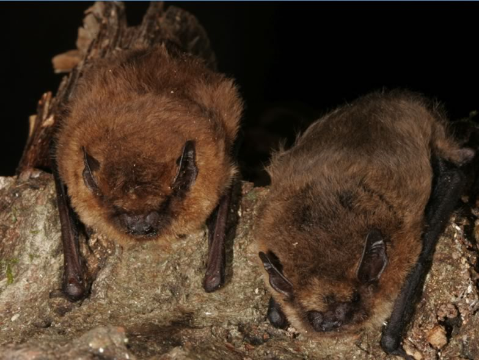

The Soprano pipistrelle (Pipistrellus pygmaeus) has been recently recognized, based on its acoustic and genetic characteristics. It is a sibling species of the widely distributed Common pipistrelle (P. pipistrellus). P. pygmaeus was found in many European countries, including Switzerland. A MSc project shed new light on the distribution of these two cryptic species and their ecological niche differentiation in Switzerland. The Soprano pipistrelle was found to be much rarer than its sibling species, preferring lowland river ecosystems near richly structured landscapes and urban areas. Due to its scarcity the Soprano pipistrelle is a potentially endangered species in Switzerland.

## Uni Bern supervisors

Fabio Bontadina, Raphaël Arlettaz

## Publications

Wellig, S.D., S. Nusslé, D. Miltner, O. Kohle, O. Glaizot, V. Braunisch, M.K. Obrist & R. Arlettaz. 2018. Mitigating the negative impacts of tall wind turbines on bats: Vertical activity profiles and relationships to wind speed. PLoS ONE 13: e0192493. [(PDF, 1.0 MB)](/files/flying_vertebrates_vs_wind_turbines/Wellig_PLOSONE2018_eng.pdf)

Sattler, T., F. Bontadina, A.H. Hirzel & R. Arlettaz. 2007. Ecological niche modelling of two cryptic bat species calls for a reassessment of their conservation status. Journal of Applied Ecology 44: 1188-1199. [(PDF, 754KB)](/files/pipistrelle_bats/Sattler_JAppEco2007_eng.pdf)

## Related Diploma/Master thesis

Sattler, T. 2003. Ecological factors affecting the distribution of the sibling species *Pipistrellus pygmaeus and Pipistrellus pipistrellus* in Switzerland. Diploma Thesis, University of Bern. [PDF](/files/pipistrelle_bats/Sattler_Dipl2003copy_eng.pdf)
